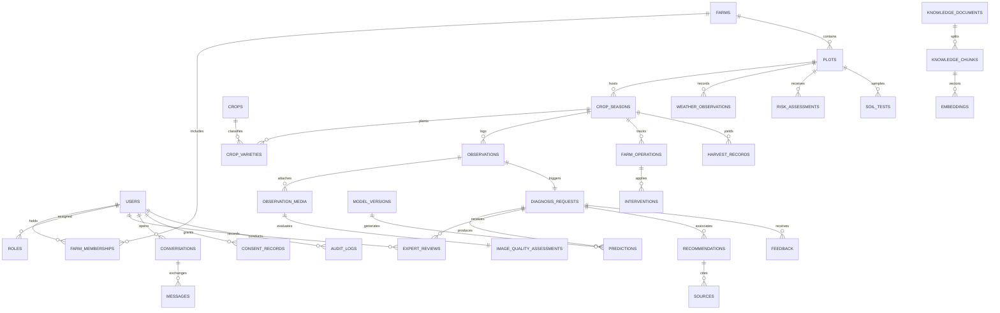

# KISANVISION — DATABASE DESIGN SPECIFICATION

**Document Version:** 1.0.0  
**Status:** Approved for Stage 1 Baseline  
**Target Engine:** PostgreSQL 15+ with `pgvector` Extension  
**Target Provider:** Managed Supabase (AWS `ap-south-1`, Mumbai, India)  
**Author:** Principal Database Architect, Senior Backend Engineer  

---

## 1. Architectural Principles & Isolation Strategy

1. **Strict Multi-Tenant Isolation:** All operational farm data (plots, observations, interventions) is partitioned by `farm_id` and owned by an authorized `user_id`. Queries enforce ownership boundaries at the application and Row-Level Security (RLS) layers.
2. **Immutable Traceability & Auditability:** AI diagnostic predictions, expert review overrides, and consent logs are append-only. Historical predictions are never mutated when models are retrained.
3. **Data Protection & DPDPA Compliance:** Personal user data (phone, name) is separated from anonymized diagnostic telemetry. When a user requests data deletion, farm telemetry is retained only in anonymized research splits if explicit prior consent was granted; otherwise, it is purged.
4. **Hybrid Relational & Vector Search:** Knowledge documents and chunks are co-located with high-dimensional vector embeddings (`vector(384)`) indexed via HNSW for millisecond similarity searches.

---

## 2. Entity-Relationship Diagram (ERD)

---

## 3. Data Dictionary: All 32 Core Entities

### 3.1 Identity & Farm Structure

#### 1. `users`
- **PK:** `id UUID DEFAULT gen_random_uuid()`
- **Fields:** `phone_number VARCHAR(15) UNIQUE NOT NULL`, `full_name VARCHAR(100)`, `preferred_language VARCHAR(10) DEFAULT 'te'`, `state VARCHAR(50) DEFAULT 'Telangana'`, `district VARCHAR(50)`, `mandal VARCHAR(50)`, `village VARCHAR(50)`, `is_active BOOLEAN DEFAULT TRUE`, `created_at TIMESTAMPTZ DEFAULT NOW()`, `updated_at TIMESTAMPTZ DEFAULT NOW()`
- **Indexes:** `idx_users_phone (phone_number)`, `idx_users_mandal (district, mandal)`
- **Tenant Rules:** Global identity table.

#### 2. `roles`
- **PK:** `id SERIAL`
- **Fields:** `user_id UUID REFERENCES users(id) ON DELETE CASCADE`, `role_name VARCHAR(30) NOT NULL` (Enum: `farmer`, `expert`, `researcher`, `admin`), `granted_at TIMESTAMPTZ DEFAULT NOW()`
- **Unique:** `(user_id, role_name)`

#### 3. `farms`
- **PK:** `id UUID DEFAULT gen_random_uuid()`
- **Fields:** `owner_id UUID REFERENCES users(id) ON DELETE RESTRICT`, `farm_name VARCHAR(100) NOT NULL`, `total_area_acres NUMERIC(6,2) NOT NULL`, `district VARCHAR(50) NOT NULL`, `mandal VARCHAR(50) NOT NULL`, `village VARCHAR(50)`, `latitude NUMERIC(9,6)`, `longitude NUMERIC(9,6)`, `created_at TIMESTAMPTZ DEFAULT NOW()`
- **Indexes:** `idx_farms_owner (owner_id)`, `idx_farms_geo (district, mandal)`
- **Tenant Rules:** Only owner and authorized members can read/modify.

#### 4. `farm_memberships`
- **PK:** `id UUID DEFAULT gen_random_uuid()`
- **Fields:** `farm_id UUID REFERENCES farms(id) ON DELETE CASCADE`, `user_id UUID REFERENCES users(id) ON DELETE CASCADE`, `access_level VARCHAR(20) DEFAULT 'viewer'` (Enum: `owner`, `manager`, `worker`, `consulting_expert`), `created_at TIMESTAMPTZ DEFAULT NOW()`
- **Unique:** `(farm_id, user_id)`

#### 5. `plots`
- **PK:** `id UUID DEFAULT gen_random_uuid()`
- **Fields:** `farm_id UUID REFERENCES farms(id) ON DELETE CASCADE`, `plot_name VARCHAR(50) NOT NULL`, `area_acres NUMERIC(6,2) NOT NULL`, `soil_type VARCHAR(30)` (Enum: `black_cotton`, `red_chalka`, `sandy_loam`), `irrigation_type VARCHAR(30)` (Enum: `borewell`, `canal`, `drip`, `rainfed`), `is_active BOOLEAN DEFAULT TRUE`
- **Indexes:** `idx_plots_farm (farm_id)`

#### 6. `plants_and_plant_groups`
- **PK:** `id UUID DEFAULT gen_random_uuid()`
- **Fields:** `plot_id UUID REFERENCES plots(id) ON DELETE CASCADE`, `group_identifier VARCHAR(50)`, `row_number INT`, `plant_count INT`, `notes TEXT`

---

### 3.2 Agronomic Baseline & Crop Management

#### 7. `crops`
- **PK:** `id SERIAL`
- **Fields:** `crop_code VARCHAR(20) UNIQUE NOT NULL` (e.g., `cotton`, `rice`, `chilli`), `common_name_en VARCHAR(50) NOT NULL`, `name_te VARCHAR(50) NOT NULL`, `name_hi VARCHAR(50) NOT NULL`, `scientific_name VARCHAR(100) NOT NULL`

#### 8. `crop_varieties`
- **PK:** `id SERIAL`
- **Fields:** `crop_id INT REFERENCES crops(id)`, `variety_code VARCHAR(50) UNIQUE NOT NULL`, `commercial_name VARCHAR(100) NOT NULL`, `breeder_organization VARCHAR(100)`, `duration_days_min INT`, `duration_days_max INT`, `known_resistances TEXT[]`

#### 9. `crop_seasons`
- **PK:** `id UUID DEFAULT gen_random_uuid()`
- **Fields:** `plot_id UUID REFERENCES plots(id) ON DELETE CASCADE`, `variety_id INT REFERENCES crop_varieties(id)`, `season_name VARCHAR(20)` (Enum: `kharif`, `rabi`, `summer`), `season_year INT NOT NULL`, `sowing_date DATE NOT NULL`, `transplanting_date DATE`, `expected_harvest_date DATE`, `status VARCHAR(20) DEFAULT 'active'`
- **Indexes:** `idx_seasons_plot (plot_id, status)`

#### 10. `crop_stages`
- **PK:** `id SERIAL`
- **Fields:** `crop_id INT REFERENCES crops(id)`, `stage_code VARCHAR(30) NOT NULL`, `stage_name_en VARCHAR(50) NOT NULL`, `stage_name_te VARCHAR(50) NOT NULL`, `gdd_base NUMERIC(5,2)`, `min_days INT`, `max_days INT`

---

### 3.3 Observations, Computer Vision & Expert Verification

#### 11. `observations`
- **PK:** `id UUID DEFAULT gen_random_uuid()`
- **Fields:** `crop_season_id UUID REFERENCES crop_seasons(id) ON DELETE CASCADE`, `recorded_by UUID REFERENCES users(id)`, `observation_type VARCHAR(30)` (Enum: `routine_check`, `symptom_alert`, `pest_scout`), `symptom_description TEXT`, `observed_at TIMESTAMPTZ DEFAULT NOW()`

#### 12. `observation_media`
- **PK:** `id UUID DEFAULT gen_random_uuid()`
- **Fields:** `observation_id UUID REFERENCES observations(id) ON DELETE CASCADE`, `storage_bucket VARCHAR(50) NOT NULL`, `storage_path VARCHAR(255) NOT NULL`, `media_type VARCHAR(20) DEFAULT 'image/jpeg'`, `file_size_bytes INT`, `sha256_hash VARCHAR(64) NOT NULL`, `phash_value VARCHAR(64)`, `created_at TIMESTAMPTZ DEFAULT NOW()`
- **Indexes:** `idx_media_sha256 (sha256_hash)`

#### 13. `image_quality_assessments`
- **PK:** `id UUID DEFAULT gen_random_uuid()`
- **Fields:** `media_id UUID REFERENCES observation_media(id) ON DELETE CASCADE`, `laplacian_blur_score NUMERIC(8,2) NOT NULL`, `is_blurry BOOLEAN NOT NULL`, `mean_illumination NUMERIC(5,2) NOT NULL`, `leaf_coverage_ratio NUMERIC(4,3) NOT NULL`, `is_acceptable_for_inference BOOLEAN NOT NULL`, `rejection_reason VARCHAR(100)`

#### 14. `diagnosis_requests`
- **PK:** `id UUID DEFAULT gen_random_uuid()`
- **Fields:** `observation_id UUID REFERENCES observations(id) ON DELETE CASCADE`, `status VARCHAR(30) DEFAULT 'PENDING'` (Enum: `PENDING`, `INFERRED`, `PENDING_EXPERT_REVIEW`, `VERIFIED`, `REJECTED`), `uncertainty_score NUMERIC(5,4)`, `is_ood BOOLEAN DEFAULT FALSE`, `created_at TIMESTAMPTZ DEFAULT NOW()`
- **Indexes:** `idx_diag_status (status)`

#### 15. `model_versions`
- **PK:** `id SERIAL`
- **Fields:** `model_name VARCHAR(50) NOT NULL`, `version_tag VARCHAR(30) UNIQUE NOT NULL`, `architecture VARCHAR(50) NOT NULL`, `quantization_format VARCHAR(20)` (Enum: `fp32`, `fp16`, `int8_onnx`), `macro_f1_score NUMERIC(5,4)`, `artifact_uri VARCHAR(255) NOT NULL`, `is_active_production BOOLEAN DEFAULT FALSE`, `deployed_at TIMESTAMPTZ`

#### 16. `predictions`
- **PK:** `id UUID DEFAULT gen_random_uuid()`
- **Fields:** `diagnosis_request_id UUID REFERENCES diagnosis_requests(id) ON DELETE CASCADE`, `model_version_id INT REFERENCES model_versions(id)`, `predicted_class_code VARCHAR(50) NOT NULL`, `probability NUMERIC(5,4) NOT NULL`, `rank_order INT NOT NULL`, `saliency_bbox_json JSONB`, `created_at TIMESTAMPTZ DEFAULT NOW()`
- **Indexes:** `idx_pred_request (diagnosis_request_id)`

#### 17. `expert_reviews`
- **PK:** `id UUID DEFAULT gen_random_uuid()`
- **Fields:** `diagnosis_request_id UUID REFERENCES diagnosis_requests(id) ON DELETE CASCADE`, `expert_id UUID REFERENCES users(id)`, `reviewed_class_code VARCHAR(50) NOT NULL`, `action_taken VARCHAR(30)` (Enum: `CONFIRMED`, `OVERRIDDEN`, `INCONCLUSIVE`), `expert_notes TEXT`, `custom_voice_advisory_path VARCHAR(255)`, `reviewed_at TIMESTAMPTZ DEFAULT NOW()`
- **Indexes:** `idx_expert_diag (diagnosis_request_id)`

---

### 3.4 Knowledge Base, Embeddings & RAG

#### 18. `knowledge_documents`
- **PK:** `id UUID DEFAULT gen_random_uuid()`
- **Fields:** `title VARCHAR(200) NOT NULL`, `publishing_body VARCHAR(100) NOT NULL` (e.g., `PJTSAU`, `ICAR-IIRR`), `publication_year INT`, `document_type VARCHAR(30)` (Enum: `package_of_practices`, `research_paper`, `cibrc_advisory`), `source_url VARCHAR(255)`, `created_at TIMESTAMPTZ DEFAULT NOW()`

#### 19. `knowledge_chunks`
- **PK:** `id UUID DEFAULT gen_random_uuid()`
- **Fields:** `document_id UUID REFERENCES knowledge_documents(id) ON DELETE CASCADE`, `chunk_index INT NOT NULL`, `content TEXT NOT NULL`, `language VARCHAR(10) DEFAULT 'te'`, `crop_id INT REFERENCES crops(id)`, `category VARCHAR(30)` (Enum: `pathology`, `entomology`, `chemical_control`, `organic_control`)
- **Indexes:** `idx_chunks_doc (document_id)`

#### 20. `embeddings`
- **PK:** `id UUID DEFAULT gen_random_uuid()`
- **Fields:** `chunk_id UUID REFERENCES knowledge_chunks(id) ON DELETE CASCADE`, `embedding_model VARCHAR(50) NOT NULL`, `vector_embedding vector(384) NOT NULL`
- **Indexes:** `CREATE INDEX idx_embeddings_hnsw ON embeddings USING hnsw (vector_embedding vector_cosine_ops) WITH (m = 16, ef_construction = 64);`

#### 21. `recommendations`
- **PK:** `id UUID DEFAULT gen_random_uuid()`
- **Fields:** `diagnosis_request_id UUID REFERENCES diagnosis_requests(id) ON DELETE CASCADE`, `recommendation_type VARCHAR(30)` (Enum: `chemical`, `biological`, `cultural`), `action_summary_te TEXT NOT NULL`, `action_summary_en TEXT NOT NULL`, `chemical_active_ingredient VARCHAR(100)`, `dosage_per_acre VARCHAR(50)`, `water_volume_litres INT`, `waiting_period_days INT`, `is_cibrc_approved BOOLEAN DEFAULT TRUE`, `generated_at TIMESTAMPTZ DEFAULT NOW()`

#### 22. `sources`
- **PK:** `id UUID DEFAULT gen_random_uuid()`
- **Fields:** `recommendation_id UUID REFERENCES recommendations(id) ON DELETE CASCADE`, `document_id UUID REFERENCES knowledge_documents(id)`, `chunk_id UUID REFERENCES knowledge_chunks(id)`, `citation_excerpt TEXT NOT NULL`

---

### 3.5 Weather, Farm Operations, Soil & Intelligence

#### 23. `weather_observations`
- **PK:** `id UUID DEFAULT gen_random_uuid()`
- **Fields:** `plot_id UUID REFERENCES plots(id) ON DELETE CASCADE`, `observed_timestamp TIMESTAMPTZ NOT NULL`, `temperature_celsius NUMERIC(4,2)`, `relative_humidity_percent NUMERIC(5,2)`, `precipitation_probability NUMERIC(4,2)`, `wind_speed_kmh NUMERIC(5,2)`, `soil_moisture_index NUMERIC(4,3)`, `source VARCHAR(30) DEFAULT 'open_meteo'`
- **Indexes:** `idx_weather_plot_time (plot_id, observed_timestamp DESC)`

#### 24. `risk_assessments`
- **PK:** `id UUID DEFAULT gen_random_uuid()`
- **Fields:** `plot_id UUID REFERENCES plots(id) ON DELETE CASCADE`, `assessed_for_crop_id INT REFERENCES crops(id)`, `threat_code VARCHAR(50) NOT NULL`, `risk_level VARCHAR(20) NOT NULL` (Enum: `LOW`, `MODERATE`, `SEVERE`), `spray_safe_window_start TIMESTAMPTZ`, `spray_safe_window_end TIMESTAMPTZ`, `computed_at TIMESTAMPTZ DEFAULT NOW()`

#### 25. `farm_operations`
- **PK:** `id UUID DEFAULT gen_random_uuid()`
- **Fields:** `crop_season_id UUID REFERENCES crop_seasons(id) ON DELETE CASCADE`, `operation_type VARCHAR(30) NOT NULL` (Enum: `spray`, `fertilizer`, `irrigation`, `weeding`, `pruning`), `scheduled_date DATE NOT NULL`, `status VARCHAR(20) DEFAULT 'pending'` (Enum: `pending`, `completed`, `skipped`), `notes TEXT`

#### 26. `interventions`
- **PK:** `id UUID DEFAULT gen_random_uuid()`
- **Fields:** `operation_id UUID REFERENCES farm_operations(id) ON DELETE CASCADE`, `commercial_product_name VARCHAR(100)`, `active_ingredient VARCHAR(100)`, `total_quantity_applied VARCHAR(50)`, `water_volume_litres INT`, `cost_rupees NUMERIC(8,2)`, `applied_at TIMESTAMPTZ DEFAULT NOW()`

#### 27. `harvest_records`
- **PK:** `id UUID DEFAULT gen_random_uuid()`
- **Fields:** `crop_season_id UUID REFERENCES crop_seasons(id) ON DELETE CASCADE`, `harvest_date DATE NOT NULL`, `quantity_quintals NUMERIC(7,2) NOT NULL`, `quality_grade VARCHAR(20)` (Enum: `Grade-A`, `Grade-B`, `Commercial`), `moisture_percentage NUMERIC(4,2)`, `sale_price_per_quintal NUMERIC(8,2)`

#### 28. `soil_tests`
- **PK:** `id UUID DEFAULT gen_random_uuid()`
- **Fields:** `plot_id UUID REFERENCES plots(id) ON DELETE CASCADE`, `sample_date DATE NOT NULL`, `ph NUMERIC(3,1)`, `ec_ds_m NUMERIC(4,2)`, `organic_carbon_percent NUMERIC(4,2)`, `available_n_kg_ha NUMERIC(6,2)`, `available_p_kg_ha NUMERIC(6,2)`, `available_k_kg_ha NUMERIC(6,2)`, `zinc_ppm NUMERIC(5,2)`, `boron_ppm NUMERIC(5,2)`

---

### 3.6 Conversations, Feedback, Governance & Audit

#### 29. `conversations`
- **PK:** `id UUID DEFAULT gen_random_uuid()`
- **Fields:** `user_id UUID REFERENCES users(id) ON DELETE CASCADE`, `session_title VARCHAR(100)`, `associated_diagnosis_id UUID REFERENCES diagnosis_requests(id)`, `created_at TIMESTAMPTZ DEFAULT NOW()`

#### 30. `messages`
- **PK:** `id UUID DEFAULT gen_random_uuid()`
- **Fields:** `conversation_id UUID REFERENCES conversations(id) ON DELETE CASCADE`, `sender_role VARCHAR(20) NOT NULL` (Enum: `user`, `assistant`), `message_text TEXT NOT NULL`, `audio_payload_path VARCHAR(255)`, `tokens_used INT`, `created_at TIMESTAMPTZ DEFAULT NOW()`

#### 31. `feedback`
- **PK:** `id UUID DEFAULT gen_random_uuid()`
- **Fields:** `diagnosis_request_id UUID REFERENCES diagnosis_requests(id) ON DELETE CASCADE`, `user_id UUID REFERENCES users(id)`, `rating_stars INT CHECK (rating_stars BETWEEN 1 AND 5)`, `is_accurate_farmer_view BOOLEAN`, `farmer_comments TEXT`, `submitted_at TIMESTAMPTZ DEFAULT NOW()`

#### 32. `consent_records` & `audit_logs`
- **`consent_records`:**
  - **PK:** `id UUID DEFAULT gen_random_uuid()`
  - **Fields:** `user_id UUID REFERENCES users(id) ON DELETE CASCADE`, `consent_purpose VARCHAR(50) NOT NULL` (Enum: `service_delivery`, `research_dataset_contribution`, `location_telemetry`), `consent_given BOOLEAN NOT NULL`, `consent_version VARCHAR(20) NOT NULL`, `ip_address VARCHAR(45)`, `recorded_at TIMESTAMPTZ DEFAULT NOW()`
- **`audit_logs`:**
  - **PK:** `id UUID DEFAULT gen_random_uuid()`
  - **Fields:** `actor_id UUID REFERENCES users(id)`, `action VARCHAR(50) NOT NULL`, `entity_type VARCHAR(50) NOT NULL`, `entity_id VARCHAR(50) NOT NULL`, `previous_state JSONB`, `new_state JSONB`, `ip_address VARCHAR(45)`, `created_at TIMESTAMPTZ DEFAULT NOW()`
  - **Indexes:** `idx_audit_actor (actor_id)`, `idx_audit_entity (entity_type, entity_id)`
  - **Constraint:** Append-only (DELETE/UPDATE triggers raise exceptions).
