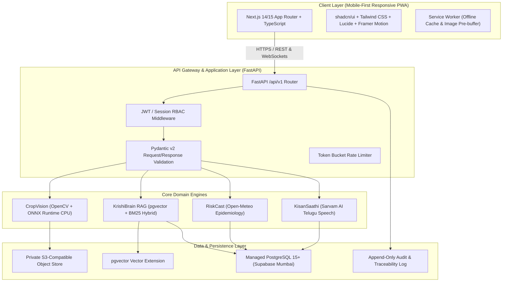
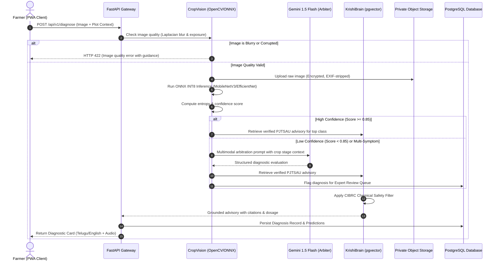
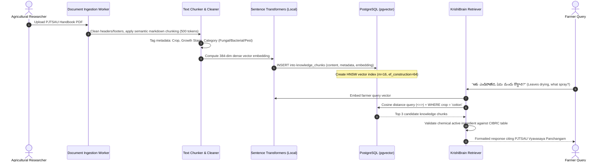

# KISANVISION — SYSTEM ARCHITECTURE SPECIFICATION

**Document Version:** 1.0.0  
**Status:** Approved for Stage 1 Baseline  
**Scope:** End-to-End System Design, Component Responsibilities, Data Flow Lifecycles & Infrastructure Justification  
**Author:** Principal Software Architect, Senior Full-Stack Engineer, ML Research Engineer  

---

## 1. System Overview & Technology Stack Justifications

KisanVision is architected as a modular, decoupled **Service-Oriented Monorepo** designed to balance development velocity, strict data contracts, and the audited constraints of the local host environment (AMD Ryzen 5 5500U, 5.86 GB RAM, no NVIDIA CUDA GPU).



### 1.1 Technology Selection Justification

| Layer | Chosen Technology | Alternatives Rejected | Engineering Justification |
| :--- | :--- | :--- | :--- |
| **Frontend** | **Next.js 14/15 (App Router, TypeScript)** | Vite SPA, React Native / Flutter | Enables server-side rendering for fast first paint over rural 3G/4G, built-in PWA service worker capabilities, universal TypeScript types sharing, and zero runtime install friction for farmers via browser links. |
| **UI Components** | **shadcn/ui + Tailwind CSS + Lucide** | Material UI, Ant Design | Zero bundle runtime bloat (un-styled accessible Radix primitives copied directly into code); ultra-lightweight CSS generated by Tailwind v4; highly responsive for budget mobile devices. |
| **Backend API** | **FastAPI (Python 3.11 via `uv`)** | Django, Express / Node.js, Go | Native interop with Python ML ecosystem (PyTorch, OpenCV, ONNX); asynchronous I/O via `asyncio` for high-throughput LLM streaming; automatic OpenAPI contract generation via Pydantic v2. |
| **Database & Vector** | **PostgreSQL + `pgvector`** | Pinecone, Milvus, MongoDB | Eliminates the operational complexity and failure modes of maintaining a separate standalone vector database. Provides ACID relational joins between diagnostic records and high-dimensional semantic embeddings in a single query. |
| **Local CV Inference** | **ONNX Runtime (CPU, INT8 Quantized)** | PyTorch JIT, TensorFlow Lite | Audited host machine has no CUDA GPU; ONNX Runtime achieves >2x inference speedup over raw PyTorch on AMD Ryzen AVX2 instruction sets, with minimal memory footprint (<100 MB). |
| **Background Processing** | **FastAPI `BackgroundTasks` / Lightweight Asyncio Queue** | Celery + Redis | A full Redis + Celery worker cluster on Windows with 5.86 GB RAM adds 600 MB+ unnecessary memory overhead during development. FastAPI native background tasks handle async image logging and audit telemetry cleanly. Celery/Redis is reserved for enterprise horizontal scale. |

---

## 2. Component Responsibilities

1. **Frontend PWA (`apps/web`):**
   - Handles multi-device responsive UI with full Telugu, Hindi, and English localization.
   - Manages client-side camera access, image compression (via canvas before transmission), and audio recording.
   - Service worker caches diagnostic history, static UI assets, and emergency agronomy guides for offline access.
2. **FastAPI Application Gateway (`apps/api`):**
   - Central entry point with versioned endpoints under `/api/v1`.
   - Validates user sessions, enforces Role-Based Access Control (Farmer, Expert, Researcher, Admin).
   - Coordinates asynchronous multi-step diagnostic pipelines and dispatches webhooks.
3. **CropVision Engine (`packages/ml`):**
   - Validates incoming image quality via OpenCV (blur, contrast, leaf-area check).
   - Executes primary inference using optimized ONNX model on CPU.
   - Calculates prediction entropy and triggers Tier-2 multimodal cloud arbitration when uncertainty is elevated.
4. **KrishiBrain RAG Engine (`packages/rag`):**
   - Manages semantic vector retrieval from `pgvector` and lexical BM25 re-ranking against PJTSAU packages of practices.
   - Applies the **CIBRC Chemical Safety Guardrail**: strictly blocks unapproved chemical recommendations, enforces legal pesticide dosages, and includes pre-harvest waiting periods.
5. **RiskCast Engine (`packages/services/risk`):**
   - Ingests hourly meteorological feeds from Open-Meteo for the farm's mandal coordinates.
   - Evaluates rule-based biological models for fungal sporulation and insect pest emergence.
   - Generates daily spray safety advisories based on wind, humidity, and precipitation probability.
6. **ExpertConnect Service (`packages/services/expert`):**
   - Manages asynchronous review queues for agricultural extension officers and university scientists.
   - Logs double-blind expert validations to create clean candidate datasets for continuous learning.

---

## 3. Core Operational Data Flows

### 3.1 Image Upload & Diagnostic Inference Flow



---

### 3.2 RAG Ingestion and Retrieval Flow



---

### 3.3 Micro-Climate Risk Integration Flow
1. **Periodic Scheduler:** Background worker queries `farms` table for unique active mandal coordinates.
2. **Weather Ingest:** Calls Open-Meteo API for 7-day hourly temperature, relative humidity, precipitation, and wind speed.
3. **Epidemiological Analysis:** Evaluates active pathogen triggers:
   - *Rice Blast Rule:* Temperature 20–26°C AND Relative Humidity $\ge 90\%$ for $\ge 12$ consecutive hours.
   - *Chilli Anthracnose Rule:* Rainfall event followed by relative humidity $> 80\%$ and temperature $> 28^\circ\text{C}$.
4. **Spray Window Calculator:**
   - Evaluates upcoming 6-hour window: Wind speed $< 15\text{ km/h}$, Rain probability $< 20\%$, Temperature $< 35^\circ\text{C}$.
5. **Persistence & Alerting:** Updates `risk_assessments` table and dispatches urgent push notifications for high-risk mandals.

---

### 3.4 Expert Review Workflow
1. When an AI prediction has confidence $< 0.85$, or an Out-Of-Distribution (OOD) flag is raised, or a farmer clicks *"Request Expert Review"*, the diagnosis request transitions to status `PENDING_EXPERT_REVIEW`.
2. The review record appears in the web dashboard of the assigned Mandal Agricultural Extension Officer / KVK Scientist.
3. The expert views:
   - High-resolution original leaf image with interactive pan/zoom.
   - Model prediction probability distribution and saliency heatmap.
   - Farm context: Plot history, crop variety, sowing date, previous chemical interventions.
4. The expert selects:
   - `CONFIRM_PREDICTION`: Validates the AI class.
   - `OVERRIDE_PREDICTION`: Replaces with the correct agronomic condition from the official taxonomy.
   - `ADD_CUSTOM_ADVISORY`: Attaches custom voice or text guidance.
5. On submission:
   - Database record updates to `REVIEWED`.
   - Farmer receives immediate in-app and SMS alert.
   - The verified image is flagged as a high-value candidate for model retraining.

---

## 4. Authentication, Authorization & Security Architecture

### 4.1 Authentication Scheme
- **Farmer Authentication:** Phone number + One-Time Password (OTP) via SMS, generating a secure HTTP-only cookie with a signed JSON Web Token (JWT).
- **Expert & Administrator Authentication:** Email + Strong Password + Time-based One-Time Password (TOTP) Multi-Factor Authentication (MFA).

### 4.2 Role-Based Access Control (RBAC) Matrix

| Resource / Endpoint | Farmer | Agricultural Expert | ML Researcher | System Admin |
| :--- | :---: | :---: | :---: | :---: |
| `/api/v1/farms` (Own Farm) | **CRUD** | Read (Assigned) | Read (De-identified) | **CRUD** |
| `/api/v1/diagnose` | **Execute** | **Execute** | **Execute** | **Execute** |
| `/api/v1/expert-reviews/queue` | No Access | **Read / Write** | Read | **CRUD** |
| `/api/v1/models/evaluation` | No Access | No Access | **Read / Export** | **CRUD** |
| `/api/v1/admin/audit-logs` | No Access | No Access | No Access | **Read Only** |

### 4.3 Tenant Isolation & Data Protection
- Every farm entity is tied to an immutable `tenant_id` / `owner_id`.
- SQLAlchemy query filters automatically inject `WHERE farm.owner_id = current_user.id` on all farmer data operations.
- All stored farmer images have EXIF GPS metadata stripped; spatial location is decoupled and stored only at the Mandal level unless explicit farmer consent is granted for farm survey mapping.

---

## 5. Error Handling & Observability

### 5.1 Standardized API Error Response Contract
All error states return RFC 7807 compliant JSON payloads:
```json
{
  "type": "https://kisanvision.in/errors/image-quality-failure",
  "title": "Image Quality Check Failed",
  "status": 422,
  "detail": "The uploaded photograph is too blurry for reliable disease classification.",
  "code": "IMAGE_BLURRY",
  "remediation": "దయచేసి ఆకును దగ్గరగా పెట్టి, కెమెరా కదలకుండా స్థిరంగా ఫోటో తీయండి.",
  "timestamp": "2026-11-07T14:55:00Z"
}
```

### 5.2 Structured Logging & Monitoring
- Backend logs formatted as structured JSON containing `request_id`, `user_id`, `endpoint`, `latency_ms`, and `status_code`.
- Critical agricultural safety violations (e.g., attempt to output unapproved pesticide) trigger high-priority alerts to the platform operations log.
