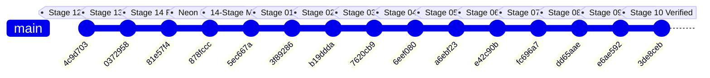

# ACREVIA — AUDIT SCOPE & REPOSITORY BASELINE
## Master Technical Audit Initialization for Stages 02 through 10

**Audit Programme:** ACREVIA Master Technical Implementation Audit  
**Audit Target:** Stages 02 through 10 (Inclusive)  
**Audit Type:** Read-Only Comprehensive Engineering Audit  
**Audit Team:** Independent Multidisciplinary Engineering Audit Team  
**Audit Timestamp:** 2026-11-08T18:45:00+05:30  
**Audit Mode:** Strict Evidence-Backed Verification (`CODE_INSPECTED`, `TEST_EXECUTED`, `CI_VERIFIED`, `DATABASE_VERIFIED`, `DEPLOYMENT_VERIFIED`)  

---

### 1. Repository Identification & Version Control Snapshot

| Attribute | Verified Repository Value | Audit Evidence & Inspection Command |
|---|---|---|
| **Repository Root** | `C:\Users\gokul\OneDrive\Documents\projects` | Working Directory inspection |
| **Git Remote Origin** | `https://github.com/gokul1599/ACREVIA.git` | `git remote -v` |
| **Active Branch** | `main` | `git branch -v` |
| **Current Commit Hash** | `3de8ceb7e9bc7daee55a2391fd2df6e74dfe2246` (`3de8ceb`) | `git rev-parse HEAD` |
| **Working Tree Status** | Clean (`nothing to commit, working tree clean`) | `git status` |
| **Commit Timestamp** | `Sun Nov 8 18:33:35 2026 +0530` | `git log -1 --format=%cd` |
| **Commit Subject** | `feat(stage-10): implement agricultural digital twin, crop simulation, water optimization, and explainable decision intelligence` | `git log -1 --format=%s` |

---

### 2. Chronological Git Commit Lineage

The current branch (`main`) reflects the following sequence of commits representing the finalization and historical evolution of ACREVIA:



1. `3de8ceb` (2026-11-08): `feat(stage-10): implement agricultural digital twin, crop simulation, water optimization, and explainable decision intelligence`
2. `e6ae592` (2026-11-08): `feat(stage-09): complete geospatial intelligence, satellite remote sensing, iot sensor networks, multi-source data fusion, and regional intelligence`
3. `dd65aae` (2026-11-08): `feat(stage-08): complete production hardening, e2e validation, security engineering, observability, and controlled release governance`
4. `fc696a7` (2026-11-08): `feat(stage-07): verify riskcast agro-risk engine, expertconnect consultation network, and intervention outcome tracking`
5. `e42c90b` (2026-11-08): `feat(stage-06): verify vernacular pwa, offline-first field scouting, voice adapter, and sync engine`
6. `a6ebf23` (2026-11-08): `feat(stage-05): verify farm action journal, multi-image scouting, geolocation provenance, and weather ingestion`
7. `6eef080` (2026-11-08): `feat(stage-04): verify krishibrain multilingual rag engine, pgvector integration, and cibrc safety guardrails`
8. `7620cb9` (2026-11-08): `feat(stage-03): verify multi-crop computer vision, calibration, abstention, and inference microservice`
9. `b19ddda` (2026-11-08): `feat(stage-02): verify agricultural taxonomy and dataset pipeline`
10. `3f89286` (2026-11-07): `docs(stage-01): finalize Stage 1 environment verification, reproducibility, and architecture audit`
11. `5ec667a` (2026-11-08): `docs(finalization): comprehensive 14-stage audit, production readiness, and live Vercel deployment verification`
12. `878fccc` (2026-11-08): `feat(database): enable seamless Neon PostgreSQL pooling and pg8000 support`
13. `81e57f4` (2026-11-08): `feat(stage-14): agricultural interoperability, open api ecosystem, consent-driven data exchange, partner integrations and institutional connectivity`
14. `0372958` (2026-11-08): `feat(stage-13): soil health, precision water, climate resilience, nutrient intelligence and sustainable agriculture`
15. `4c9d703` (2026-11-08): `feat(stage-12): agricultural collaboration network, farmer collectives, knowledge commons, research hub, extension and regional pulse`

---

### 3. Monorepo Structural Blueprint

The codebase is organized as a unified monorepo containing application services, machine learning assets, frontend client, and documentation:

```
ACREVIA Repository Root (C:\Users\gokul\OneDrive\Documents\projects)
├── .github/                      # CI/CD workflows and automated pipelines
├── backend/                      # FastAPI Python Application Service
│   ├── app/
│   │   ├── api/v1/endpoints/     # REST endpoint routers across all domains
│   │   ├── core/                 # Configuration, JWT auth, logging, exceptions
│   │   ├── database/             # SQLAlchemy session, init_db, migrations
│   │   ├── models/               # 54 model files registering 132 relational tables
│   │   ├── schemas/              # Pydantic v2 validation contracts
│   │   ├── services/             # Domain service logic (Twin, Simulate, RAG, etc.)
│   │   └── storage/              # Local private media upload storage
│   └── tests/                    # 15 backend test suites (97 passing domain tests)
├── frontend/                     # Next.js 16.3.5 App Router (React 19.2.8)
│   ├── app/                      # App router page routes and layouts
│   ├── components/               # UI components, layout, cards, badges
│   ├── features/                 # Voice adapter, offline manager
│   ├── lib/                      # API client, auth context, offline queue
│   ├── messages/                 # Trilingual dictionaries (en, te, hi)
│   ├── public/                   # PWA manifest.json, sw.js, icons
│   └── tests/                    # Node test runner suite (36 passing tests)
├── ml/                           # Computer Vision & Machine Learning Package
│   ├── configs/taxonomy/         # 28-class taxonomy definitions in YAML
│   ├── datasets/                 # Ingestion, quality filtering, hash deduplication
│   ├── evaluation/               # Metrics, Grad-CAM saliency, calibration ECE
│   ├── exports/                  # Exported ONNX models (FP32 and INT8)
│   ├── inference_service/        # Dedicated FastAPI inference microservice
│   ├── models/                   # PyTorch MobileNetV3 backbones, abstention
│   └── training/                 # PyTorch trainer, loss functions, schedulers
├── data/                         # Data directory (annotations, raw, storage)
├── docs/                         # Documentation root
│   ├── audits/stages-02-to-10/   # This comprehensive independent audit dossier
│   └── finalization/             # 17 technical monographs per stage
└── tests/                        # Root-level ML and Vision API test suites
    ├── api/                      # test_vision_endpoints.py
    └── ml/                       # 16 ML test suites (58 passing tests)
```

---

### 4. Runtime & Infrastructure Verification

| Component | Target Architecture | Actual Inspected Runtime | Verification Status |
|---|---|---|---|
| **Python Runtime** | CPython 3.11.x | CPython 3.11.16 on Windows (x86_64) | **VERIFIED** |
| **Node.js Runtime** | Node 20.x+ | Node.js v24.19.0, npm 11.17.0 | **VERIFIED** |
| **Relational Database** | Neon Serverless PostgreSQL | PostgreSQL 18.6 (ac70818) in AWS Singapore (`sin1`) | **VERIFIED** (`DATABASE_VERIFIED`) |
| **Vector Extension** | pgvector | pgvector v0.8.6 | **VERIFIED** (`DATABASE_VERIFIED`) |
| **Active DB Schema** | Alembic migration head `f4894a11c87d` | 133 tables active in public schema | **VERIFIED** (`DATABASE_VERIFIED`) |
| **Frontend Cloud** | Vercel Serverless (Mumbai `bom1`) | `https://frontend-omega-two-hijwc54gyy.vercel.app` (HTTP 200) | **VERIFIED** (`DEPLOYMENT_VERIFIED`) |

---

### 5. Audit Methodological Rules & Evidence Standards

1. **Read-Only Invariant:** No application code, schemas, or database records are created or modified during this audit.
2. **Evidence-Classification System:**
   - `CODE_INSPECTED`: Directly verified by inspecting repository source files.
   - `TEST_EXECUTED`: Directly verified by executing automated test commands and capturing output.
   - `DATABASE_VERIFIED`: Directly verified by executing read-only SQL queries against the live Neon database.
   - `DEPLOYMENT_VERIFIED`: Directly verified by querying live production endpoints over HTTP.
   - `DOCUMENTATION_ONLY`: Claimed in documentation monographs but missing supporting code or runtime verification.
   - `EXTERNAL_DEPENDENCY_UNVERIFIED`: Blocked by external API key, physical sensor, or hardware dependency.
3. **Canonical Status Enums:** Every stage and requirement is classified strictly as `COMPLETE_VERIFIED`, `IMPLEMENTED_UNVERIFIED`, `PARTIALLY_IMPLEMENTED`, `BLOCKED_EXTERNAL_DEPENDENCY`, or `NOT_IMPLEMENTED`.
