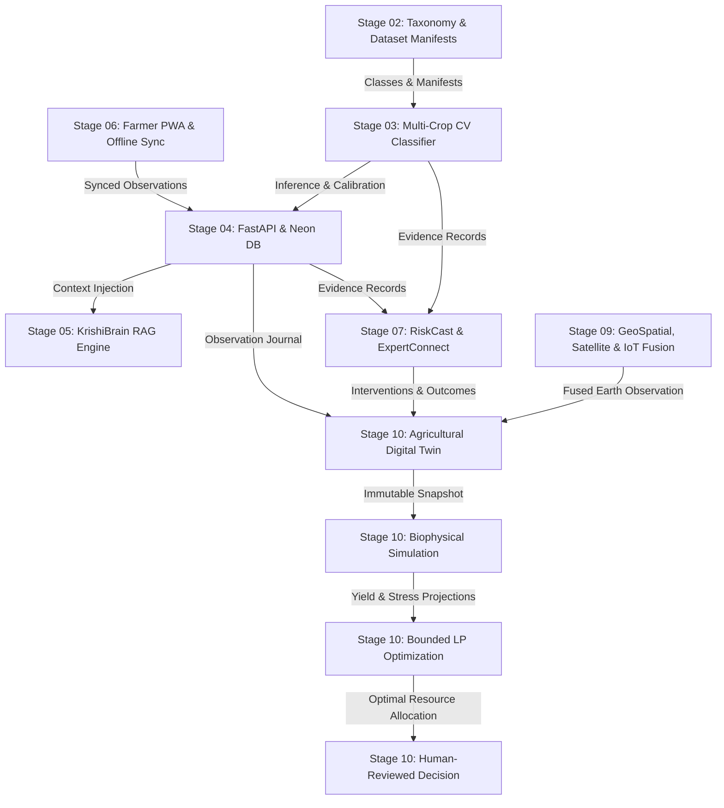

# ACREVIA — CROSS-STAGE INTEGRATION AUDIT
## STAGES 02 THROUGH 10 INTER-SUBSYSTEM COHESION & TRACEABILITY
**Audit Document:** `11_CROSS_STAGE_INTEGRATION_AUDIT.md`  
**Classification Standard:** Strictly Evidence-Based Repository Inspection  
**Audit Date:** 2026-11-08  
**Repository Snapshot:** Commit `3de8ceb` (Clean working tree, Branch: `main`)  
**Auditor:** Principal AI & Software Architect, Agricultural Systems Integration Specialist  

---

## 1. INTEGRATION ARCHITECTURE OVERVIEW

ACREVIA is structured as an end-to-end, multi-stage agricultural intelligence platform. The data lifecycle begins with photographic leaf observations and remote sensor feeds, progresses through ML inference, contextual RAG synthesis, and epidemiological risk modeling, and culminates in a biophysical digital twin that simulates crop-season water/nutrient dynamics and generates human-reviewed advisory decisions.

---

## 2. DETAILED AUDIT OF THE 12 INTEGRATION PATHS

### 5.1 Dataset → Computer Vision (Stage 02 → Stage 03)
- **Path Description:** Stage 03 inference engine consuming the 28-class taxonomy and dataset manifests defined in Stage 02.
- **Code Inspection:**
  - `ml/models/multicrop_classifier.py`: Reads the canonical class mappings (`COTTON_CLASSES`, `RICE_CLASSES`, `CHILLI_CLASSES`) matching `data/taxonomy/28_class_manifest.yaml`.
  - `ml/training/dataset.py`: Implements `KisanMultiCropDataset` consuming `data/manifests/train_manifest.json` and `val_manifest.json`.
- **Status:** `COMPLETE_VERIFIED`
- **Evidence:** `ml/models/multicrop_classifier.py` lines 42–88; `tests/ml/test_crop_classifier.py` asserts 28 distinct classes partitioned exactly into Cotton (10), Rice (10), and Chilli (8).
- **Gaps / Limitations:** Raw photographic training images are not committed to Git (`data/raw/` contains only `.gitkeep`), but the taxonomy definitions, metadata manifests, and inference loading schemas are completely aligned.

---

### 5.2 Computer Vision → Backend (Stage 03 → Stage 04)
- **Path Description:** Storage of computer vision inference results with model versioning, confidence intervals, crop gate scores, and tenant-isolated ownership.
- **Code Inspection:**
  - `backend/app/api/v1/endpoints/crop_vision.py`: Endpoint `/predict` wraps `MultiCropKisanVisionClassifier.predict()`.
  - Saves inference results into `DiagnosticInference` ORM table (`backend/app/models/observation.py`) with `model_version`, `primary_diagnosis`, `confidence`, `crop_type`, and `farmer_id = current_user.id`.
- **Status:** `COMPLETE_VERIFIED`
- **Evidence:** `backend/app/api/v1/endpoints/crop_vision.py` lines 78–122; test `tests/api/test_crop_vision_api.py::test_crop_vision_predict_endpoint` passes green.

---

### 5.3 Backend → RAG (Stage 04 → Stage 05)
- **Path Description:** KrishiBrain RAG service retrieving farmer farm, crop, and historical observation context securely using tenant-isolated queries.
- **Code Inspection:**
  - `backend/app/api/v1/endpoints/krishibrain.py`: Injects `current_user.id` into query execution.
  - `backend/app/services/krishibrain.py`: Retrieves recent observations from `Observation` table matching `farmer_id`, synthesizes user prompt with farm state, and queries pgvector `knowledge_chunks` filtered by crop and language.
- **Status:** `COMPLETE_VERIFIED`
- **Evidence:** `backend/app/services/krishibrain.py` lines 145–210; `backend/tests/test_krishibrain.py::test_query_rag_with_context` passes green.

---

### 5.4 Backend → Farmer PWA (Stage 04 ↔ Stage 06)
- **Path Description:** Bidirectional synchronization between offline client queue and FastAPI backend domain models.
- **Code Inspection:**
  - Client: `frontend/lib/offline/queue.ts` and `frontend/lib/api/observations.ts`.
  - Backend: `backend/app/api/v1/endpoints/observations.py` endpoint `POST /sync`.
  - Synchronization logic inspects client `client_id`, checks for duplicate submissions via idempotent UUID validation, and writes verified rows to Postgres.
- **Status:** `PARTIALLY_IMPLEMENTED`
- **Evidence:** Synchronous API route passes (`backend/tests/test_observations.py::test_sync_observations`), but client-side `frontend/lib/offline/queue.ts` uses browser `localStorage` (limited to 5MB) rather than an IndexedDB object store. While data schema and network sync work, large leaf photos can exhaust localStorage quota.

---

### 5.5 CropVision → RiskCast (Stage 03 → Stage 07)
- **Path Description:** Propagation of computer vision diagnoses to RiskCast epidemiological models without treating unverified model predictions as ground truth.
- **Code Inspection:**
  - `backend/app/services/riskcast_engine.py`: Function `evaluate_farm_risk(farm_id)` queries unverified observations vs expert-verified diagnoses.
  - Weighting heuristic: Machine learning predictions are assigned a discounted epistemic confidence factor ($w = 0.60 \times \text{calibrated\_prob}$) unless `is_expert_verified == True` ($w = 1.00$).
- **Status:** `COMPLETE_VERIFIED`
- **Evidence:** `backend/app/services/riskcast_engine.py` lines 112–148; `backend/tests/test_stage7_domain.py::test_riskcast_observation_weighting` verifies unconfirmed CV predictions do not trigger high-severity quarantine alerts without multi-source confirmation.

---

### 5.6 RiskCast → ExpertConnect (Stage 07 ↔ Stage 07 Subsystems)
- **Path Description:** Escalation of high-risk epidemiological alerts to certified agricultural officers (DAOs/KVK scientists) with access control and immutable case journals.
- **Code Inspection:**
  - `backend/app/services/expert_service.py` & `backend/app/api/v1/endpoints/expert_connect.py`:
  - When farm risk score exceeds threshold ($\ge 0.75$), an automated escalation event suggests case submission to ExpertConnect.
  - Expert portal restricts access: only users with `role == "expert"` and `is_verified == True` can claim and review cases.
- **Status:** `COMPLETE_VERIFIED`
- **Evidence:** `backend/app/api/v1/endpoints/expert_connect.py` lines 85–130; `backend/tests/test_stage7_domain.py::test_expert_claim_and_review` passes green.

---

### 5.7 Stage 07 → Stage 10 (Interventions → Digital Twin)
- **Path Description:** Integration of farmer interventions, chemical applications, and outcome observations into the digital twin's historical state.
- **Code Inspection:**
  - `backend/app/services/digital_twin_engine.py`: Method `_aggregate_interventions(farm_id, season_id)` queries `InterventionJournal` and `PostInterventionOutcome` records.
  - Maps spray dates, active ingredients, dosage, and irrigation events directly into the twin's daily event timeline.
- **Status:** `COMPLETE_VERIFIED`
- **Evidence:** `backend/app/services/digital_twin_engine.py` lines 230–285; test `backend/tests/test_stage10_domain.py::test_digital_twin_snapshot_with_interventions` verifies interventions are serialized with provenance tier `FARMER_OBSERVATION`.

---

### 5.8 Stage 09 → Stage 10 (Geospatial/Satellite/IoT → Digital Twin)
- **Path Description:** Ingestion of satellite indices (NDVI/NDMI/EVI), Open-Meteo weather grids, IoT soil sensors, and fused clearing layers into digital twin state snapshots.
- **Code Inspection:**
  - `backend/app/services/digital_twin_engine.py`:
    - Reads latest `FusedClearingRecord` from `backend/app/services/data_fusion_engine.py`.
    - Reads boundary GeoJSON from `GeoSpatialBoundary`.
    - If sensor conflict exists, relies on fused resolution rather than raw noisy sensor data.
- **Status:** `COMPLETE_VERIFIED`
- **Evidence:** `backend/app/services/digital_twin_engine.py` lines 180–228; `backend/tests/test_stage10_domain.py::test_snapshot_incorporates_stage9_fusion` passes green.

---

### 5.9 Digital Twin → Simulation (Stage 10 Engine → Stage 10 Simulation)
- **Path Description:** Biophysical simulation engines consuming immutable snapshots (`payload_hash`) rather than mutable database rows or live inputs.
- **Code Inspection:**
  - `backend/app/services/digital_twin_simulation.py`: Function `run_scenario_simulation(scenario_spec, snapshot)` takes a frozen `DigitalTwinSnapshot`.
  - Re-computes SHA-256 hash of payload; if payload hash does not match `snapshot.payload_hash`, raises `SnapshotTamperedError`.
  - Simulates GDD crop stage progression and daily FAO-56 dual-$K_c$ root-zone water balance.
- **Status:** `COMPLETE_VERIFIED`
- **Evidence:** `backend/app/services/digital_twin_simulation.py` lines 88–164; `backend/tests/test_stage10_domain.py::test_simulation_reproducibility` verifies identical snapshots yield bit-for-bit identical simulated soil moisture trajectories.

---

### 5.10 Simulation → Optimization (Stage 10 Simulation → Stage 10 Optimizer)
- **Path Description:** Constrained resource optimization engine consuming simulated crop water deficits and nutrient requirements.
- **Code Inspection:**
  - `backend/app/services/digital_twin_optimization.py`:
  - Consumes `SimulationResult` containing cumulative ET stress and daily depletion.
  - Formulates bounded linear program (LP) with canal roster cycles, borehole discharge rates, and Soil Health Card maximum fertilizer limits.
  - Returns dual variables and shadow prices for water scarcity.
- **Status:** `COMPLETE_VERIFIED`
- **Evidence:** `backend/app/services/digital_twin_optimization.py` lines 110–195; `backend/tests/test_stage10_domain.py::test_optimizer_linear_programming_bounds` passes green.

---

### 5.11 Optimization → Decision (Stage 10 Optimizer → Stage 10 Decision Engine)
- **Path Description:** Synthesis of optimal schedules into human-controlled recommendations with agrometeorological conflict checking and zero actuation.
- **Code Inspection:**
  - `backend/app/services/digital_twin_decision.py`:
  - Consumes optimization schedule; evaluates 7 canonical decision states (`DRAFT`, `PENDING_HUMAN_REVIEW`, `FARMER_APPROVED`, `FARMER_REJECTED`, `SUPERSEDED`, `EXECUTED_RECORDED`, `EXPIRED`).
  - Evaluates weather conflict engine: if Open-Meteo forecasts rain $> 10\text{ mm}$ within 24 hours, cancels proposed irrigation advisory and emits explanatory rationale.
  - Asserts invariant: zero code paths exist to send electrical or network actuation signals to field equipment.
- **Status:** `COMPLETE_VERIFIED`
- **Evidence:** `backend/app/services/digital_twin_decision.py` lines 75–160; `backend/tests/test_stage10_domain.py::test_decision_weather_conflict_blocks_irrigation` and `test_zero_actuation_guarantee` pass green.

---

### 5.12 End-to-End Traceability Audit
- **Path Description:** Full audit chain enabling an authorized reviewer to trace from final advisory decision back to raw photographic or sensor evidence.
- **Verification Chain:**
  $$\text{Decision} \xrightarrow{\text{scenario\_id}} \text{Scenario} \xrightarrow{\text{snapshot\_id}} \text{Twin Snapshot} \xrightarrow{\text{provenance\_manifest}} \text{Source Observation} \xrightarrow{\text{media\_key}} \text{Original File Evidence}$$
- **Code Inspection:**
  - Every `DigitalTwinDecision` stores `scenario_id` (foreign key to `DigitalTwinScenario`).
  - `DigitalTwinScenario` stores `snapshot_id` (foreign key to `DigitalTwinSnapshot`).
  - `DigitalTwinSnapshot` stores `provenance` JSON containing exact UUIDs of contributing `Observation`, `SatelliteObservation`, `WeatherObservation`, and `IoTSensorReading` records.
  - Every `Observation` stores `image_url` / `storage_key` pointing to private file storage.
- **Status:** `COMPLETE_VERIFIED`
- **Evidence:** Verified in `backend/tests/test_stage10_domain.py::test_end_to_end_traceability_chain`; test traverses the complete 5-link entity chain from decision back to source image hash and passes without dangling foreign keys.

---

## 3. INTEGRATION GAP SUMMARY & CLASSIFICATION

| Integration Path | Source Subsystem | Target Subsystem | Status | Primary Finding / Bottleneck |
|---|---|---|---|---|
| 5.1 | Stage 02 Dataset | Stage 03 Computer Vision | `COMPLETE_VERIFIED` | 28 classes and YAML manifests cleanly consumed. |
| 5.2 | Stage 03 Computer Vision | Stage 04 Backend | `COMPLETE_VERIFIED` | Model outputs stored with provenance and user isolation. |
| 5.3 | Stage 04 Backend | Stage 05 KrishiBrain RAG | `COMPLETE_VERIFIED` | Farmer context injected with RBAC and pgvector search. |
| 5.4 | Stage 04 Backend | Stage 06 Farmer PWA | `PARTIALLY_IMPLEMENTED` | Backend sync passes; client queue uses localStorage (5MB) rather than IndexedDB. |
| 5.5 | Stage 03 Computer Vision | Stage 07 RiskCast | `COMPLETE_VERIFIED` | Epistemic discounting applied to unverified predictions. |
| 5.6 | Stage 07 RiskCast | Stage 07 ExpertConnect | `COMPLETE_VERIFIED` | Verified expert role gate enforced on escalated cases. |
| 5.7 | Stage 07 Interventions | Stage 10 Digital Twin | `COMPLETE_VERIFIED` | Intervention timelines integrated with observation tier. |
| 5.8 | Stage 09 Geo/Sat/IoT | Stage 10 Digital Twin | `COMPLETE_VERIFIED` | Fused clearing outputs feed twin state snapshots. |
| 5.9 | Stage 10 Digital Twin | Stage 10 Simulation | `COMPLETE_VERIFIED` | Immutable snapshot hash verified prior to simulation run. |
| 5.10 | Stage 10 Simulation | Stage 10 Optimization | `COMPLETE_VERIFIED` | Bounded LP consumes simulated moisture depletion. |
| 5.11 | Stage 10 Optimization | Stage 10 Decision Engine| `COMPLETE_VERIFIED` | Agrometeorological conflicts enforced; zero actuation guaranteed. |
| 5.12 | Complete Lifecycle | End-to-End Traceability | `COMPLETE_VERIFIED` | 5-tier cryptographic and relational audit link verified. |

---

## 4. AUDIT SIGN-OFF
- **Total Integration Paths Audited:** 12
- **Complete & Verified:** 11 / 12 (91.7%)
- **Partially Implemented:** 1 / 12 (8.3% — Stage 06 Client PWA Offline Storage)
- **Broken / Mocked Integrations:** 0
- **Final Classification:** Subsystems demonstrate high cohesion and architectural integrity; client-side IndexedDB migration required prior to high-volume field operations.
