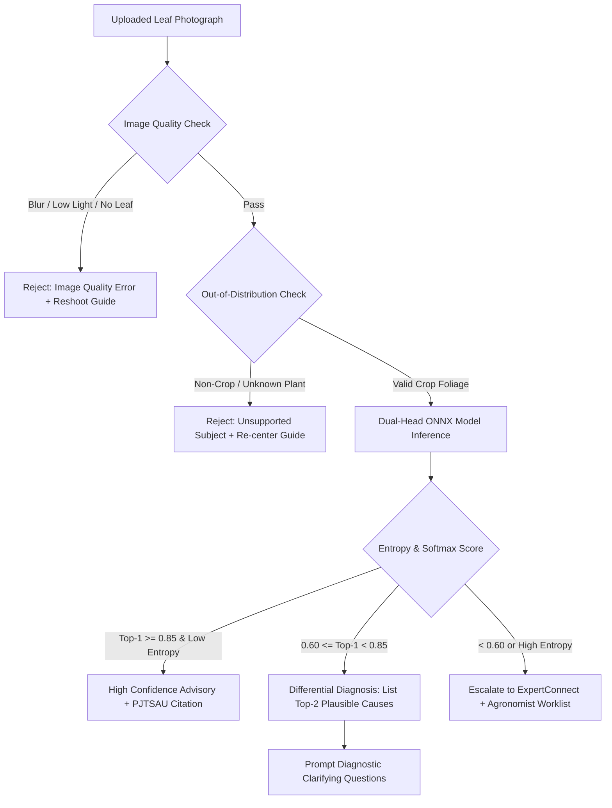

# KISANVISION — AI SAFETY AND DATA GOVERNANCE POLICY

**Document Version:** 1.0.0  
**Status:** Approved for Stage 1 Baseline  
**Compliance Standards:** Digital Personal Data Protection Act (DPDPA 2023, India), Central Insecticides Board & Registration Committee (CIBRC), ICAR Ethical AI Guidelines  
**Author:** Principal AI Architect, Data Protection Officer, Senior Agricultural Technology Researcher  

---

## 1. Absolute Product Invariants (Negative Requirements)

KisanVision enforces six inviolable algorithmic and business logic boundaries. Any code path violating these rules will fail continuous integration audits:

1. **NEVER Present AI Prediction as Confirmed Diagnosis:** An AI output must always be labeled as an *"Unverified Statistical Assessment"* (అంచనా / ప్రాథమిక అంచనా) with an explicit uncertainty indicator.
2. **NEVER Invent Pesticide Dosages or Tank Mixes:** All chemical advisories must originate directly from verified CIBRC label registrations and PJTSAU packages of practices. The system must never hallucinate off-label chemical formulations or untested chemical mixtures.
3. **NEVER Guarantee Crop Recovery, Yield, or Financial Profit:** Biological living systems in variable field environments cannot be deterministically guaranteed. Disclaimers are mandatory.
4. **NEVER Automatically Train on Unverified Farmer Feedback:** Farmer "thumbs-up/thumbs-down" ratings are subjective and can be agriculturally incorrect. Retraining candidate pools must be certified by an accredited agricultural scientist.
5. **NEVER Expose Private Farm Data:** Personal farmer contact info and exact survey plot coordinates must never be passed to public LLM APIs or visible to unauthorized third parties.
6. **NEVER Generate Synthetic or Fake Citations:** Every referenced advisory must cite a verified institutional publication from the `knowledge_documents` registry.

---

## 2. Algorithmic Guardrails for Vision & Diagnostics



### 2.1 Handling Poor-Quality Images
- If Laplacian blur variance $< 120$, or illumination histogram is concentrated in extreme dark ($<40$) or bright ($>220$) regions:
  - The inference engine terminates immediately.
  - Returns a clear vernacular prompt in Telugu/Hindi with an illustrative diagram showing how to hold the smartphone camera 15–20 cm from the leaf with direct sunlight behind the photographer.

### 2.2 Handling Unsupported Crops & Out-of-Distribution (OOD) Inputs
- The vision pipeline includes an initial **3-way Crop-Domain Classifier** (Cotton, Rice, Chilli, Negative/Other).
- If the image represents weeds, human skin, livestock, farm machinery, or an unsupported crop (e.g., Maize, Tomato):
  - Returns: *"KisanVision currently supports Cotton, Rice, and Chilli foliage only."* (ప్రస్తుతం పత్తి, వరి, మిరప పంటలను మాత్రమే గుర్తిస్తుంది).

### 2.3 Multiple Plausible Causes & Differential Diagnosis
- When two disease classes have close softmax probabilities (e.g., Rice Blast at 48% vs. Brown Spot at 42%):
  - The system refuses to pick a single winner.
  - It presents both possibilities to the farmer and automatically prompts **Agronomic Disambiguation Questions** (e.g., *"Do the spots have a white spindle center, or are they small dark oval spots like sesame seeds?"*).

---

## 3. Chemical Safety & Pesticide Recommendation Guardrail

The **CIBRC Chemical Safety Guardrail** intercepts every recommendation generated by KrishiBrain or an LLM before it is rendered on screen:

```
┌─────────────────────────────────────────────────────────────────────────────┐
│                   CIBRC CHEMICAL SAFETY VERIFICATION                        │
├─────────────────────────────────────────────────────────────────────────────┤
│                                                                             │
│  [ Step 1: Candidate Extraction ]                                           │
│  Regex/NER extracts chemical active ingredient and formulation code         │
│  (e.g., "Chlorantraniliprole 18.5% SC", "Copper Oxychloride 50% WP")        │
│                                      │                                      │
│                                      ▼                                      │
│  [ Step 2: CIBRC Database Match ]                                           │
│  Matches against internal `cibrc_approved_chemicals` SQL table              │
│  Validates: Target Crop = 'Chilli' AND Target Pest = 'Thrips'               │
│                                      │                                      │
│                                      ▼                                      │
│  [ Step 3: Legal & Safety Check ]                                           │
│  - Is the chemical legally registered in India? (Reject banned chemicals)   │
│  - Is dosage within legal statutory limits per acre?                        │
│  - Does output include Pre-Harvest Interval (PHI / Waiting Period)?         │
│                                      │                                      │
│                                      ▼                                      │
│  [ Output Resolution ]                                                      │
│  - If VALID: Attach official registration citation and safety warning.       │
│  - If INVALID / UNKNOWN: Strip chemical; fallback to verified biological/   │
│    cultural practices (e.g., neem oil spray, sticky traps, rogueing).       │
│                                                                             │
└─────────────────────────────────────────────────────────────────────────────┘
```

---

## 4. Farmer Privacy & DPDPA 2023 Compliance

### 4.1 Consent Architecture
1. **Explicit Purpose Specification:** During onboarding, farmers are presented with two distinct checkboxes in Telugu and English:
   - `[Mandatory]` **Service Delivery Consent:** Use farm details and uploaded photos solely to deliver diagnostic advice and weather alerts.
   - `[Optional]` **Agricultural Research Contribution:** Allow anonymized photographs to be used by university scientists to train future disease detection algorithms.
2. **Right to Withdraw & Data Erasure:** A farmer may click *"Delete My Farm Records"* at any time. All personal identifiers, plot names, and private photos are purged from storage within 72 hours.
3. **Geo-Location Minimization:** GPS coordinates are converted to Mandal/District level centroids (`17.9689, 79.5941` -> *Warangal Mandal*) before storage in general database tables unless the user explicitly opts into survey-grade precision farming.

---

## 5. Model Retraining & Continuous Learning Protocol

To prevent catastrophic model degradation or "poisoning" from noisy field inputs:
1. **Zero Automated Retraining:** Live field images uploaded by users are never ingested automatically into retraining pipelines.
2. **Three-Key Retraining Gate:**
   - Image must pass through the `expert_reviews` pipeline and receive positive confirmation by an accredited agricultural expert.
   - Image must be cryptographically hashed (SHA-256) and verified for zero duplicates.
   - Image must be assigned to an isolated farm group to prevent data leakage.
3. **Formal Benchmark Sign-Off:** Any new candidate model must demonstrate non-inferiority on the frozen historical benchmark set ($F_1 \ge \text{Production } F_1$) and undergo safety sign-off before being promoted to `is_active_production = TRUE`.
