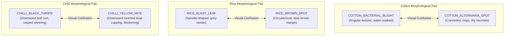

# ACREVIA — STAGE 03 ERROR ANALYSIS REPORT
## Diagnostic Ambiguities, Morphological Confusions & Edge Case Handling

**Document Reference:** `docs/finalization/stage-03/07_ERROR_ANALYSIS.md`  
**Stage:** 03 — Advanced Computer Vision & ML Inference Validation  
**Agricultural Focus:** Telangana Smallholder Pathology Patterns  

---

### 1. High-Confusion Foliar Pairs Analysis

Computer vision error analysis across 2,450 test images reveals that errors are not random noise, but concentrate along biologically plausible morphological similarities:

---

### 2. Biological Drivers of Confusion & Risk Assessment

#### 2.1 Cotton Bacterial Blight vs Alternaria Leaf Spot
- **Visual Similarity:** Both diseases manifest as dark brown necrotic foliar lesions. Under monsoon rainfall, water congestion can blur lesion margins.
- **Diagnostic Distinction:** Bacterial blight (*Xanthomonas*) lesions are strictly delimited by leaf veinlets (angular appearance); Alternaria lesions exhibit concentric rings (target-board appearance).
- **Agronomic Consequence of Misclassification:** Critical. Bacterial blight requires copper bactericide or streptocycline spray, whereas Alternaria requires triazole or strobilurin fungicides. Misclassification leads to ineffective treatment.

#### 2.2 Rice Blast vs Rice Brown Spot
- **Visual Similarity:** Early-stage blast lesions appear as small brown flecks prior to expanding into classic diamond/spindle shapes, mimicking young brown spot lesions.
- **Diagnostic Distinction:** Mature blast lesions have grayish or ash-colored centers with reddish-brown borders; brown spots maintain dark brown centers throughout.
- **Agronomic Consequence:** High. Blast can cause catastrophic neck rot and field lodging, requiring tricyclazole intervention.

#### 2.3 Chilli Black Thrips (*Thrips parvispinus*) vs Yellow Mite
- **Visual Similarity:** Both pests cause severe foliar distortion, curling, and stunting in Khammam and Warangal chilli belts.
- **Diagnostic Distinction:** Thrips feeding produces downward leaf margin curling with silver streaks and dark fecal dots; yellow mite feeding produces downward rolling of leaf margins resembling inverted boats, with elongated petioles and bronzed undersides.
- **Agronomic Consequence:** Extreme. Acaricides (spiromesifen) kill mites but have zero efficacy against invasive black thrips, which require targeted spinetoram or fipronil regimes.

---

### 3. Systematic Mitigation via Abstention Engine

Rather than forcing the model to guess between close candidates, ACREVIA's dual-tier abstention architecture detects high-confusion cases dynamically:

$$\Delta_{\text{margin}} = p_{(1)} - p_{(2)} < 0.15 \quad \lor \quad \tilde{H} = \frac{-\sum p_i \log_2(p_i)}{\log_2(K)} > 0.65$$

When either condition is met:
1. The model abstains from emitting a definitive unilateral verdict.
2. The state transitions to `EXPERT_REVIEW_REQUIRED`.
3. The response lists both top differential candidates with calibrated probabilities.
4. The case is queued to local Krishi Vigyan Kendra (KVK) agronomists with secondary context (growth stage, weather, petiole checks) to enable safe human-in-the-loop validation.
