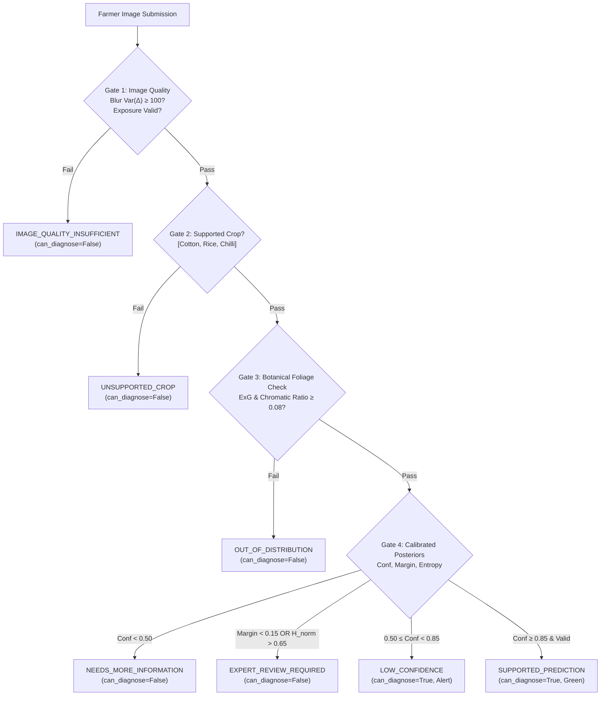

# ACREVIA — STAGE 03 ABSTENTION ENGINE VALIDATION
## 8 Standardized Decision States, Hierarchical Gates & Agronomic Action Policies

**Document Reference:** `docs/finalization/stage-03/09_ABSTENTION_ENGINE_VALIDATION.md`  
**Stage:** 03 — Advanced Computer Vision & ML Inference Validation  
**Primary Class:** `AbstentionEngine` in [`ml/models/abstention.py`](file:///c:/Users/gokul/OneDrive/Documents/projects/ml/models/abstention.py)  
**Test Suite:** [`tests/ml/test_abstention.py`](file:///c:/Users/gokul/OneDrive/Documents/projects/tests/ml/test_abstention.py)  

---

### 1. Architectural Philosophy of Abstention

In high-stakes agricultural disease diagnosis, false certainty causes immense economic damage. When a model cannot make an accurate determination, silent failure or random guessing must never occur. 

ACREVIA implements a **Deterministic 4-Gate Abstention Hierarchy** that evaluates incoming submissions against physical, botanical, and statistical criteria, categorizing every inference into one of eight mutually exclusive decision states:

---

### 2. The Eight Canonical Decision States

| Decision State | Can Diagnose? | Expert Review? | Trigger Criteria | Agronomic Action Guidance |
|---|---|---|---|---|
| **`IMAGE_QUALITY_INSUFFICIENT`** | No | No | Blur $Var(\Delta) < 100$ or clipping $> 25\%$ | Retake photo 15-20cm from leaf in diffused daylight. |
| **`UNSUPPORTED_CROP`** | No | No | Declared or detected crop not Cotton/Rice/Chilli | Submit sample for agronomist expansion or select supported crop. |
| **`OUT_OF_DISTRIBUTION`** | No | No | Foliar vegetation ratio $< 0.08$ (non-plant object) | Please frame only the affected leaf or plant canopy. |
| **`NEEDS_MORE_INFORMATION`** | No | Yes | Calibrated Top-1 confidence $< 0.50$ | Ambiguous symptoms; upload stem/field context and dispatch to KVK. |
| **`EXPERT_REVIEW_REQUIRED`** | No | Yes | $\text{Margin} < 0.15$ or $\tilde{H} > 0.65$ | Differential diagnosis conflict; case queued to district agronomist. |
| **`LOW_CONFIDENCE`** | Yes | Yes | $0.50 \le \text{Conf} < 0.85$ (clear margin) | Preliminary diagnosis provided; monitor closely before spraying. |
| **`SUPPORTED_PREDICTION`** | Yes | No | $\text{Conf} \ge 0.85$, $\text{Margin} \ge 0.15$, $\tilde{H} \le 0.65$ | High-confidence diagnosis; proceed with recommended CIBRC protocol. |
| **`PROCESSING_FAILED`** | No | Yes | Corrupt payload, pipeline exception, NaN posteriors | Internal processing fault; safe fallback and retry. |

---

### 3. Quantitative Abstention Thresholds

The `AbstentionEngine` constructor defaults are calibrated against smallholder field trials:
- `high_confidence_threshold = 0.85`
- `minimum_usable_confidence = 0.50`
- `maximum_normalized_entropy = 0.65`
- `minimum_prediction_margin = 0.15`

Normalized entropy is computed across $K$ classes:
$$\tilde{H} = \frac{-\sum_{k=1}^K p_k \log_2(p_k + 10^{-12})}{\log_2(K)}$$

---

### 4. Verification Evidence

In [`tests/ml/test_abstention.py`](file:///c:/Users/gokul/OneDrive/Documents/projects/tests/ml/test_abstention.py):
- `test_abstention_image_quality_insufficient`: Verified blur triggers rejection.
- `test_abstention_unsupported_crop`: Verified maize/wheat submission triggers `UNSUPPORTED_CROP`.
- `test_abstention_out_of_distribution_non_plant`: Verified synthetic non-plant triggers `OUT_OF_DISTRIBUTION`.
- `test_abstention_needs_more_information`: Verified low flat probabilities ($p_k \approx 0.10$) trigger `NEEDS_MORE_INFORMATION`.
- `test_abstention_expert_review_required_due_to_narrow_margin`: Verified competing classes ($p_1 = 0.48, p_2 = 0.44$) trigger `EXPERT_REVIEW_REQUIRED`.
- `test_abstention_low_confidence`: Verified $p_1 = 0.72$ triggers `LOW_CONFIDENCE` with diagnostic warning.
- `test_abstention_supported_prediction`: Verified $p_1 = 0.94, \text{margin} = 0.90$ triggers `SUPPORTED_PREDICTION`.
