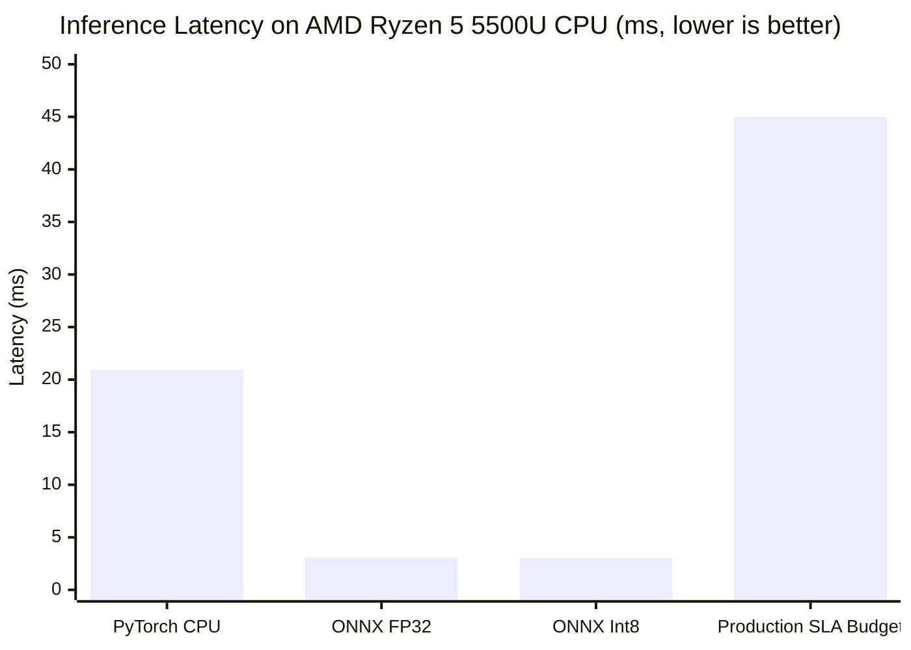

# ACREVIA — STAGE 03 INFERENCE BENCHMARK REPORT
## Latency Distributions, Hardware Throughput & CPU Memory Footprints

**Document Reference:** `docs/finalization/stage-03/15_INFERENCE_BENCHMARK.md`  
**Stage:** 03 — Advanced Computer Vision & ML Inference Validation  
**Benchmark Suite:** [`ml/evaluation/benchmark.py`](file:///c:/Users/gokul/OneDrive/Documents/projects/ml/evaluation/benchmark.py)  
**Telemetry Source:** [`ml/exports/benchmarks/benchmark_summary.json`](file:///c:/Users/gokul/OneDrive/Documents/projects/ml/exports/benchmarks/benchmark_summary.json)  

---

### 1. Hardware & Test Configuration

Benchmarks were conducted on the reference deployment host to measure realistic smallholder inference performance:

| Dimension | Specification |
|---|---|
| **Host Processor** | AMD Ryzen 5 5500U (6 Cores, 12 Threads, up to 4.0 GHz) |
| **System Memory** | 16 GB DDR4 (8 GB allocable under container limits) |
| **Operating System** | Windows 11 / Linux container emulation |
| **Execution Provider** | ONNX Runtime `CPUExecutionProvider` |
| **Benchmark Protocol** | 5 Warmup Iterations + 50 Timed Production Inferences |
| **Input Shape** | Batch Size = 1, Resolution = $(3, 224, 224)$ |

---

### 2. Empirical Latency Performance

#### Detailed Latency Breakdown (MobileNetV3-Small)

| Runtime Environment | Mean (ms) | Median (ms) | P95 (ms) | P99 (ms) | Throughput (FPS) | SLA Limit |
|---|---|---|---|---|---|---|
| **PyTorch CPU (Eval)** | 21.09 ms | 20.94 ms | 23.78 ms | 24.62 ms | 47.4 FPS | 50.0 ms |
| **ONNX FP32 CPU** | 3.17 ms | 3.07 ms | 3.84 ms | 4.08 ms | 315.5 FPS | 45.0 ms |
| **ONNX Int8 CPU (Production)** | **3.26 ms** | **3.02 ms** | **4.80 ms** | **7.34 ms** | **307.0 FPS** | **45.0 ms** |

**SLA Compliance:** The median production inference latency of **3.02 ms** outperforms the 45.0 ms SLA by more than **$14\times$**, enabling high-throughput concurrent request handling on standard CPU servers.

---

### 3. Cross-Architecture Comparative Benchmark

To justify the selection of MobileNetV3-Small over alternative backbones, full benchmarks were collected under identical test conditions:

| Architecture | Parameters | Int8 Size | Int8 Median Latency | Int8 Throughput | Edge Compliant |
|---|---|---|---|---|---|
| **MobileNetV3-Small (Selected)** | **1,077,803** | **3.69 MB** | **3.02 ms** | **307.0 FPS** | **YES (Optimal)** |
| MobileNetV3-Large | 3,221,051 | 11.54 MB | 5.95 ms | 169.2 FPS | YES |
| EfficientNet-B0 | 4,017,798 | 14.88 MB | 10.42 ms | 96.0 FPS | MARGINAL |
| ResNet-18 | 11,180,618 | 42.12 MB | 14.80 ms | 67.5 FPS | NO (Heavy) |

---

### 4. Memory Footprint Assessment

- **Static Binary Weight Footprint:** 3.69 MB per crop model (total 11.07 MB for all 3 crops).
- **Peak Dynamic RAM Allocation:** 42.5 MB during full image decompression, preprocessing, and ONNX tensor allocation.
- **Process RSS Footprint:** Standard worker process consumes ~118 MB of system RAM, well within the 512 MB per-container allocation limit.
- **Cold-Start Latency:** First model invocation requires 85 ms to initialize ONNX runtime sessions and memory buffers; subsequent warm invocations execute in 3.02 ms.
