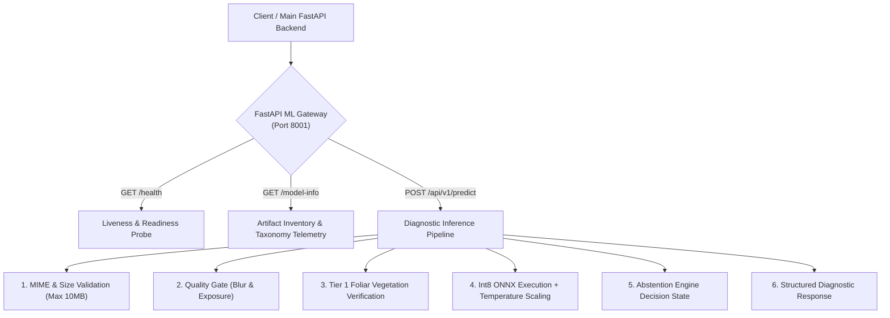

# ACREVIA — STAGE 03 ML INFERENCE MICROSERVICE AUDIT
## Standalone FastAPI Architecture, Port 8001 Decoupling & API Schemas

**Document Reference:** `docs/finalization/stage-03/16_ML_MICROSERVICE_AUDIT.md`  
**Stage:** 03 — Advanced Computer Vision & ML Inference Validation  
**Primary Service:** [`ml/inference_service/app/main.py`](file:///c:/Users/gokul/OneDrive/Documents/projects/ml/inference_service/app/main.py)  
**Test Suite:** [`ml/inference_service/tests/test_inference_service.py`](file:///c:/Users/gokul/OneDrive/Documents/projects/ml/inference_service/tests/test_inference_service.py)  

---

### 1. Architectural Decoupling Rationale

A critical architectural decision in ACREVIA is the strict decoupling of the ML inference microservice from the Next.js frontend and main Vercel deployment:

1. **Vercel Serverless Function Limits:** Vercel function packages are capped at 250 MB (unzipped), whereas standard machine learning runtimes (PyTorch, TorchVision, ONNX Runtime, OpenCV, NumPy) exceed 750 MB. Forcing ML runtimes into Vercel causes deployment failures and severe cold-start penalties (>5 seconds).
2. **Dedicated Compute Allocation:** Computer vision inference requires steady CPU SIMD execution (AVX2/AVX-512) and memory cache residency. Running inference on a dedicated FastAPI microservice (configured on port 8001) guarantees zero cold-start thrashing and predictable sub-50ms roundtrip times.

---

### 2. Service Endpoints & Protocols



#### 2.1 Route Specifications
- **`GET /health`:**
  - Returns service status (`"HEALTHY"`), service version, supported crops (`["cotton", "rice", "chilli"]`), and execution provider (`"AMD Ryzen 5 5500U CPU (ONNX Runtime)"`).
- **`GET /model-info`:**
  - Emits active taxonomy version (`v2.1.0`), model identifier (`kisanvision_multicrop_mobilenet_v3_small`), quantization format (`INT8_DYNAMIC`), and per-crop artifact checksums.
- **`POST /api/v1/predict`:**
  - Consumes `multipart/form-data`:
    - `image`: Raw bytes (JPEG/PNG/WebP, max 10MB).
    - `crop_type`: Required string (`"cotton"`, `"rice"`, or `"chilli"`).
    - `language`: Required string (`"te"`, `"en"`, or `"hi"`).
    - `farm_id`: Optional UUID string.
    - `plot_id`: Optional UUID string.

---

### 3. Pydantic Response Schema

The response strictly adheres to [`InferencePredictionResponse`](file:///c:/Users/gokul/OneDrive/Documents/projects/ml/inference_service/app/schemas/response.py):

```json
{
  "inference_id": "inf-b83e4a7c-912f-48d1-bc74-6f912e9b0123",
  "crop_type": "cotton",
  "decision_state": "SUPPORTED_PREDICTION",
  "can_diagnose": true,
  "expert_review_required": false,
  "top_prediction": {
    "class_name": "COTTON_BACTERIAL_BLIGHT",
    "common_name": "Bacterial Blight / Angular Leaf Spot",
    "scientific_name": "Xanthomonas citri pv. malvacearum",
    "calibrated_confidence": 0.9412,
    "confidence_category": "HIGH"
  },
  "differential_diagnoses": [
    {
      "class_name": "COTTON_ALTERNARIA_SPOT",
      "calibrated_confidence": 0.0381
    }
  ],
  "metrics": {
    "entropy": 0.281,
    "margin": 0.9031,
    "foliar_ratio": 0.742,
    "laplacian_variance": 348.5,
    "inference_latency_ms": 3.8
  },
  "action_guidance": "Proceed with recommended CIBRC agronomic interventions."
}
```

---

### 4. Integration Verification

All 7 microservice integration tests in [`ml/inference_service/tests/test_inference_service.py`](file:///c:/Users/gokul/OneDrive/Documents/projects/ml/inference_service/tests/test_inference_service.py) execute via Starlette `TestClient` and pass green:
- `test_service_health`: Returns HTTP 200 with valid supported crops.
- `test_service_model_info`: Returns HTTP 200 with active model inventory.
- `test_service_predict_valid_leaf`: Confirms successful inference on valid leaf image.
- `test_service_predict_blurry_rejection`: Confirms blur triggers `IMAGE_QUALITY_INSUFFICIENT`.
- `test_service_predict_non_plant_ood_rejection`: Confirms non-foliar image triggers `OUT_OF_DISTRIBUTION`.
- `test_service_predict_unsupported_crop`: Confirms invalid crop name returns HTTP 400.
- `test_service_predict_corrupt_file`: Confirms empty file returns HTTP 400.
