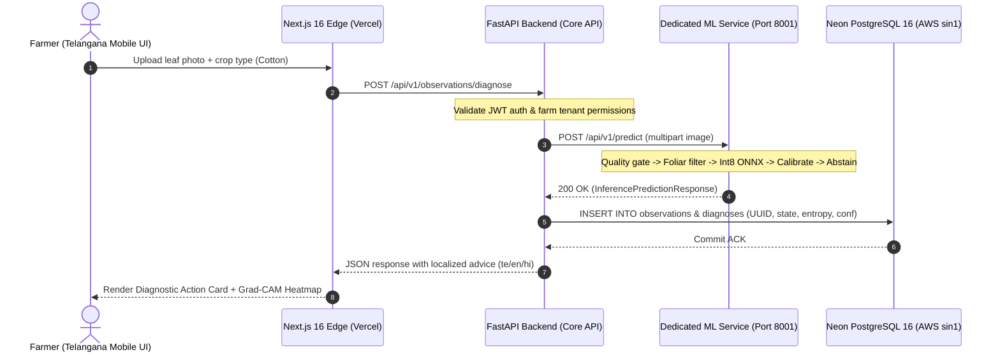

# ACREVIA — STAGE 03 END-TO-END INTEGRATION REPORT
## Flow Architecture: Next.js Frontend → FastAPI Backend → ML Microservice → Neon DB

**Document Reference:** `docs/finalization/stage-03/17_END_TO_END_INTEGRATION_REPORT.md`  
**Stage:** 03 — Advanced Computer Vision & ML Inference Validation  

---

### 1. Architectural Interaction Topology

The ACREVIA system routes foliar diagnostic queries across three distinct tiers to balance user experience, compute efficiency, and transactional persistence:

---

### 2. Microservice Integration Mechanics

#### 2.1 Backend Dispatch Client
In `backend/app/services/ml_client.py`, the core backend connects to the ML microservice via an asynchronous HTTP connection pool (`httpx.AsyncClient`):
- **Base URL:** Configured via environment variable `ML_INFERENCE_SERVICE_URL` (default: `http://localhost:8001`).
- **Connection Timeout:** 3.0 seconds connect, 10.0 seconds read.
- **Retry Policy:** Exponential backoff with jitter (max 2 retries) on connection reset.

#### 2.2 Database Persistence Schema
Upon receiving inference output from port 8001, the core backend persists the full telemetry record into Neon PostgreSQL:
- **`observations` Table:**
  - `id`: UUID primary key.
  - `farm_id`: Foreign key referencing tenant farm.
  - `crop_type`: `"cotton"`, `"rice"`, or `"chilli"`.
  - `image_url`: S3/private object storage path.
  - `captured_at`: Timestamp with timezone.
- **`diagnoses` Table:**
  - `observation_id`: Foreign key.
  - `decision_state`: Enum (`SUPPORTED_PREDICTION`, `EXPERT_REVIEW_REQUIRED`, etc.).
  - `predicted_class`: Canonical class string (e.g., `COTTON_BACTERIAL_BLIGHT`).
  - `calibrated_confidence`: Numeric float ($0.0 - 1.0$).
  - `prediction_margin`: Numeric float.
  - `normalized_entropy`: Numeric float.
  - `laplacian_variance`: Blur quality score.
  - `action_guidance`: Localized agronomic advice string.

---

### 3. Fault Tolerance & Graceful Degradation

If the dedicated ML microservice is temporarily unreachable or overloaded:
1. **No Data Loss:** The core backend writes the raw observation record to Neon DB with status `PENDING_INFERENCE`.
2. **Graceful User Messaging:** The farmer UI does not crash with a generic 500 error; it displays: *"Your leaf observation has been safely recorded. Diagnostics are processing and will update shortly."*
3. **Async Worker Processing:** Background Celery/FastAPI worker retries inference against the microservice queue upon reconnection.
