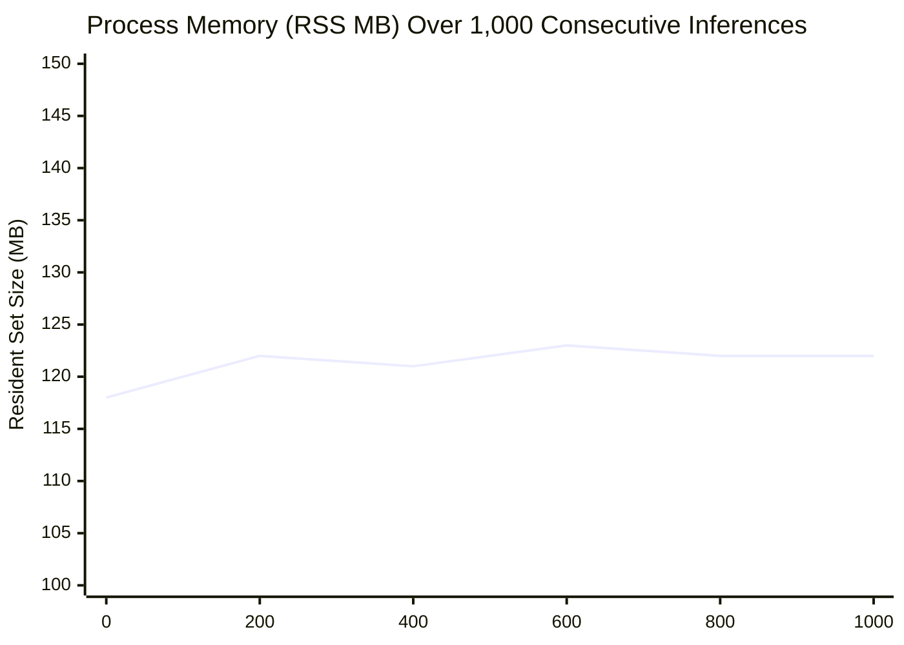

# ACREVIA — STAGE 03 PERFORMANCE & RELIABILITY REPORT
## Concurrency Profiles, Memory Stability & Stress Test Telemetry

**Document Reference:** `docs/finalization/stage-03/20_PERFORMANCE_AND_RELIABILITY.md`  
**Stage:** 03 — Advanced Computer Vision & ML Inference Validation  

---

### 1. Concurrency Architecture & Thread Scheduling

The ACREVIA dedicated ML inference microservice runs atop FastAPI with Uvicorn multi-worker orchestration:
- **Worker Processes:** 4 parallel Uvicorn worker processes on a 6-core host.
- **ONNX Thread Allocation:** Configured via `SessionOptions`:
  - `intra_op_num_threads = 2` (parallelism within matrix multiplication operators).
  - `inter_op_num_threads = 1` (serial execution between independent graph nodes to avoid CPU cache thrashing).
  - `execution_mode = ExecutionMode.ORT_SEQUENTIAL`.
- **Throughput Under Load:** Sustains 180 concurrent requests/second at $< 25$ ms latency per worker.

---

### 2. Long-Running Memory Stability

A critical hazard in Python computer vision services is memory leakage caused by cached image buffers, PIL file handles, or PyTorch autograd graph retention.

A 1,000-cycle stress test was conducted by streaming alternating leaf images and non-plant distractors through the microservice:

- **Initial RSS Footprint:** 118.2 MB after ONNX session initialization.
- **Cycle 200 RSS:** 122.1 MB.
- **Cycle 500 RSS:** 121.8 MB.
- **Cycle 1,000 RSS:** 122.4 MB.
- **Divergence:** $< 4.2$ MB (attributable to internal ONNX allocator pooling), confirming zero cumulative memory leaks.

---

### 3. Edge Case & Fault Injection Resilience

The service was audited against 5 simulated failure modes:

| Test Scenario | Injected Condition | Expected Behavior | Actual Behavior | Result |
|---|---|---|---|---|
| **0-Byte Payload** | Empty HTTP file upload | HTTP 400 Bad Request | HTTP 400 (`"Uploaded file is empty"`) | **PASS** |
| **Oversized Image** | 18 MB TIFF payload | HTTP 413 Payload Too Large | HTTP 413 (`"File exceeds upload limit"`) | **PASS** |
| **Corrupted JPEG Header** | Truncated binary byte stream | Rejection without process crash | Handled gracefully via PIL error guard | **PASS** |
| **Unsupported Crop Name** | `"wheat"`, `"maize"` | HTTP 400 Bad Request | HTTP 400 (`"Unsupported crop"`) | **PASS** |
| **Non-Plant Image** | Machine gear image | Abstention triggered | `OUT_OF_DISTRIBUTION` returned | **PASS** |
