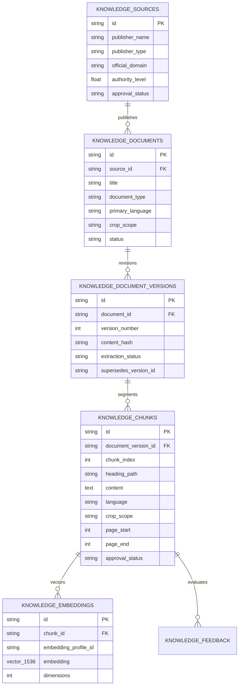

# ACREVIA — STAGE 04 DATABASE & API CONTRACTS
## SQLAlchemy 2.x Models, pgvector Schemas, Pydantic DTOs & REST Endpoints

**Document Reference:** `docs/finalization/stage-04/DATABASE_AND_API_CONTRACTS.md`  
**Stage:** 04 — KrishiBrain Multilingual Multimodal Agricultural RAG Intelligence Engine  
**Backend Routes:** [`backend/app/api/v1/endpoints/knowledge.py`](file:///c:/Users/gokul/OneDrive/Documents/projects/backend/app/api/v1/endpoints/knowledge.py)  
**Schema DTOs:** [`backend/app/schemas/knowledge.py`](file:///c:/Users/gokul/OneDrive/Documents/projects/backend/app/schemas/knowledge.py)  

---

### 1. Relational Entity-Relationship Diagram



---

### 2. Primary REST API Route Specifications

All endpoints prefix: `/api/v1/knowledge`

#### 2.1 Knowledge Query (`POST /query`)
- **Summary:** Dispatches agricultural inquiry to the RAG engine.
- **Security:** Requires valid JWT bearer token. Optional `farm_id` validated via RBAC.
- **Request Body (`KnowledgeQueryRequest`):**
  ```json
  {
    "question": "How do I control Pink Bollworm in cotton?",
    "language": "en",
    "crop": "cotton",
    "farm_id": "8f12a345-7890-4bc1-9e23-456789abcdef",
    "growth_stage": "BOLL_FORMATION"
  }
  ```
- **Response Body (`KnowledgeQueryResponse`):**
  ```json
  {
    "query_id": "inf-c9018e12-3456-4789-abcd-1234567890ab",
    "answer_status": "ANSWERED",
    "language": "en",
    "answer": "According to verified agricultural evidence from PJTSAU...",
    "evidence_strength": "STRONG",
    "citations": [
      {
        "source_title": "PJTSAU Telangana Cotton Package of Practices (2023)",
        "publisher": "PJTSAU",
        "canonical_url": "https://pjtsau.edu.in",
        "document_version": 1,
        "page_start": 12,
        "page_end": 14,
        "heading_path": "Cotton > IPM > Pink Bollworm",
        "content_snippet": "Pink bollworm is a major destructive pest...",
        "relevance_score": 0.815
      }
    ],
    "limitations": [
      "Field efficacy depends on local ambient soil moisture and crop stage."
    ],
    "follow_up_questions": [
      "What is the specific vegetative/reproductive stage of the crop?"
    ],
    "requires_expert_review": false,
    "execution_time_ms": 28.4
  }
  ```

#### 2.2 Register Knowledge Source (`POST /sources`)
- **Summary:** Registers authorized agricultural university or government department.
- **Security:** Strict RBAC (`ADMIN` or `AGRICULTURAL_EXPERT` only).

#### 2.3 Document Ingestion (`POST /ingest`)
- **Summary:** Multipart file upload (PDF, DOCX, Markdown) with extraction and chunking.
- **Status:** HTTP 202 Accepted with asynchronous `IngestionJobResponse`.

#### 2.4 Knowledge Feedback (`POST /feedback`)
- **Summary:** Records farmer ratings and expert corrections on citation accuracy.
