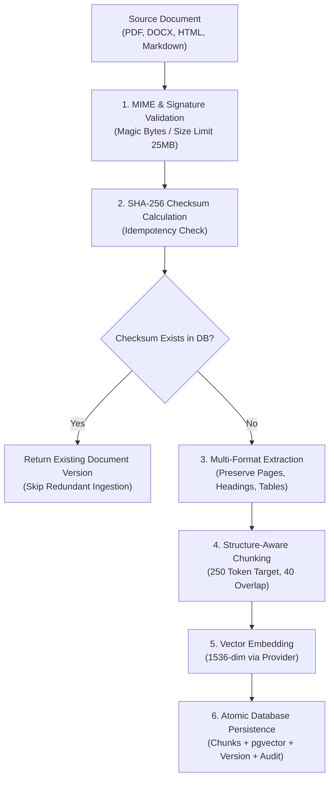

# ACREVIA — STAGE 04 DOCUMENT INGESTION ARCHITECTURE
## Multi-Format Extraction, Table-Aware Normalization, Idempotency & Versioning

**Document Reference:** `docs/finalization/stage-04/DOCUMENT_INGESTION_ARCHITECTURE.md`  
**Stage:** 04 — KrishiBrain Multilingual Multimodal Agricultural RAG Intelligence Engine  
**Primary Engine:** [`backend/app/services/knowledge/ingestion/ingestion_service.py`](file:///c:/Users/gokul/OneDrive/Documents/projects/backend/app/services/knowledge/ingestion/ingestion_service.py)  
**Extractors:** [`backend/app/services/knowledge/extraction/extractors.py`](file:///c:/Users/gokul/OneDrive/Documents/projects/backend/app/services/knowledge/extraction/extractors.py)  

---

### 1. Ingestion Pipeline Architecture

The document ingestion pipeline transforms heterogeneous agricultural bulletins (PDFs, DOCX files, HTML circulars, Markdown manuals) into standardized, versioned, and searchable vector chunks:



---

### 2. Multi-Format Extraction Capabilities

The `DocumentExtractor` class implements format-specialized parsers:

#### 2.1 PDF Extraction (`_extract_pdf`)
- Utilizes `pypdf.PdfReader` to iterate page by page.
- Extracts raw text while associating every extracted paragraph with its physical 1-based page number (`page_num`).
- Heuristically identifies section headings using capitalization, indentation, and numbering (e.g., `"1.1 Pink Bollworm"`).

#### 2.2 DOCX Extraction (`_extract_docx`)
- Utilizes `python-docx` to inspect paragraph style hierarchies (`'Heading 1'`, `'Heading 2'`, `'Heading 3'`).
- Preserves document outline into `heading_path` (e.g., `"Cotton > Pest Management > Pink Bollworm"`).
- Extracts embedded tables into Markdown format.

#### 2.3 HTML Extraction (`_extract_html`)
- Utilizes `BeautifulSoup` to parse semantic DOM trees.
- Strips script, style, and navigation tags.
- Converts HTML `<table>` structures into clean Markdown tables, preserving column header semantics.

#### 2.4 Markdown & Plain Text
- Parses Markdown heading indicators (`#`, `##`, `###`) directly to establish parent-child heading trees.

---

### 3. Table-Aware Extraction & Dosage Integrity

A frequent point of failure in standard RAG pipelines is flattening agricultural pesticide and fertilizer dosage tables into a continuous string of words. When a table containing columns `[Chemical, Concentration, Dosage/Acre, PHI]` is flattened, the retrieval engine may associate the dose of a mild fungicide with an acute insecticide.

To eliminate this hazard:
1. All table extractors format rows into standard GitHub Flavored Markdown tables:
   ```markdown
   | Insecticide | Formulation | Dosage per Litre | Pre-Harvest Interval (PHI) |
   |---|---|---|---|
   | Spinetoram | 11.7% SC | 1.0 ml | 7 days |
   | Fipronil | 5% SC | 2.0 ml | 15 days |
   ```
2. The chunking engine treats tables as atomic units, refusing to slice across mid-row boundaries.

---

### 4. Idempotency & Version Control

- **Content Hashing:** The original file payload is hashed via SHA-256 before processing.
- **Idempotency Guarantee:** If a file with an identical `content_hash` is uploaded for the same document, the pipeline recognizes the duplicate, rejects redundant re-embedding, and returns the existing version ID with status `COMPLETED`.
- **Revision History:** When an amended edition of an existing guide is uploaded (new SHA-256), a new `KnowledgeDocumentVersion` is created with an incremented `version_number` and `supersedes_version_id` set to the previous version, ensuring historical traceability.
