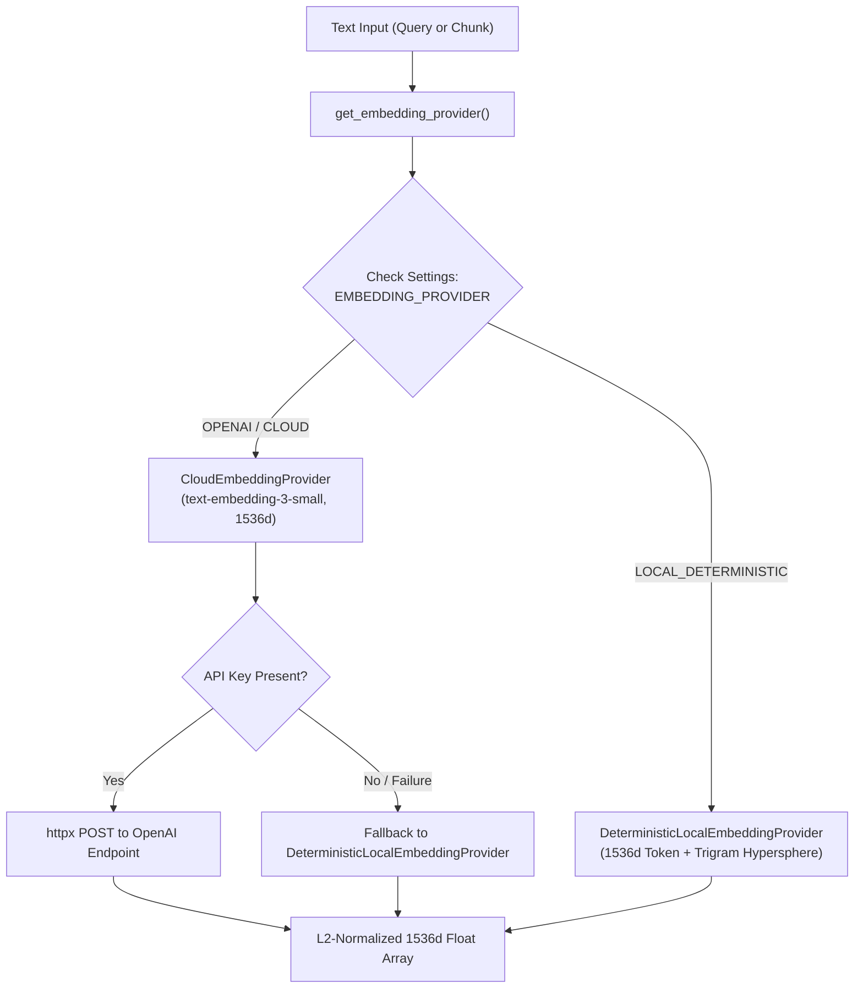

# ACREVIA — STAGE 04 EMBEDDINGS & VECTOR STORAGE
## 1536-Dimensional Vector Architecture, pgvector Integration & Embedding Providers

**Document Reference:** `docs/finalization/stage-04/EMBEDDING_AND_VECTOR_STORAGE.md`  
**Stage:** 04 — KrishiBrain Multilingual Multimodal Agricultural RAG Intelligence Engine  
**Primary Class:** `EmbeddingProvider` in [`backend/app/services/knowledge/embeddings/embedding_provider.py`](file:///c:/Users/gokul/OneDrive/Documents/projects/backend/app/services/knowledge/embeddings/embedding_provider.py)  
**Database Model:** `KnowledgeEmbedding` in [`backend/app/models/knowledge_embedding.py`](file:///c:/Users/gokul/OneDrive/Documents/projects/backend/app/models/knowledge_embedding.py)  

---

### 1. Vector Space & Dimension Standard

The KrishiBrain retrieval subsystem establishes a fixed vector dimensionality of **1536 dimensions**. This matches the industry-standard embedding geometry of OpenAI `text-embedding-3-small`, enabling dense semantic projection of complex agricultural vocabulary while optimizing memory footprint in Neon PostgreSQL.

---

### 2. Dual-Provider Architecture

To guarantee deterministic, zero-cost test reproducibility while preserving production cloud readiness, KrishiBrain implements a decoupled factory pattern:



#### 2.1 Deterministic Local Embedding Provider
- Maps input words via MD5 modular hashing into vector coordinate positions with frequency weighting.
- Adds character trigram projections ($j:j+3$) to provide subword sensitivity for Telugu/Hindi transliterated terms (e.g., recognizing common roots in *"gulabi"*, *"bollworm"*, *"thrips"*).
- Applies L2 vector normalization:
  $$\hat{v} = \frac{v}{\sqrt{\sum_{i=1}^{1536} v_i^2}}$$
- Guarantees that identical text inputs generate bit-for-bit identical vectors across test runs without external API latency or quota exhaustion.

#### 2.2 Cloud Embedding Provider
- Production adapter connecting to `https://api.openai.com/v1/embeddings` via `httpx.Client`.
- Implements 10.0-second timeouts and automatic fallback to the deterministic provider if credentials are unconfigured or remote services fail.

---

### 3. Neon PostgreSQL + pgvector Schema

Vectors are persisted in the relational database using the native `pgvector` extension:

```sql
CREATE TABLE knowledge_embeddings (
    id VARCHAR(36) PRIMARY KEY,
    chunk_id VARCHAR(36) NOT NULL REFERENCES knowledge_chunks(id) ON DELETE CASCADE,
    embedding_profile_id VARCHAR(100) NOT NULL,
    embedding vector(1536) NOT NULL,
    model_name VARCHAR(100) NOT NULL,
    model_version VARCHAR(50) NOT NULL DEFAULT '1.0.0',
    dimensions INTEGER NOT NULL DEFAULT 1536,
    created_at TIMESTAMP WITH TIME ZONE DEFAULT NOW()
);

CREATE INDEX ix_embeddings_profile ON knowledge_embeddings (embedding_profile_id);
CREATE INDEX ix_embeddings_chunk_id ON knowledge_embeddings (chunk_id);
```

#### Vector Integrity Constraints
1. **Dimension Locking:** The `vector(1536)` column type strictly enforces that only 1536-dimensional arrays can be inserted; mismatched vectors trigger immediate SQL constraints.
2. **Finite Values:** All coordinates are validated to ensure no `NaN` or `Infinity` floating-point values are stored.
3. **Cascade Deletion:** Deleting a document or chunk automatically cascades to remove associated vector embeddings, preventing orphaned vector rows.
