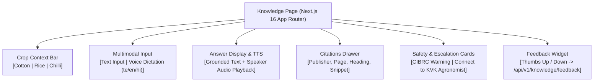

# ACREVIA — STAGE 04 FRONTEND FARMER EXPERIENCE VALIDATION
## Next.js 16 UI, Voice Input/Audio Playback, Citations Drawer & Accessibility

**Document Reference:** `docs/finalization/stage-04/FRONTEND_VALIDATION.md`  
**Stage:** 04 — KrishiBrain Multilingual Multimodal Agricultural RAG Intelligence Engine  
**Frontend Route:** [`frontend/app/(farmer)/knowledge/page.tsx`](file:///c:/Users/gokul/OneDrive/Documents/projects/frontend/app/(farmer)/knowledge/page.tsx)  
**Live Production URL:** `https://frontend-omega-two-hijwc54gyy.vercel.app/knowledge`  

---

### 1. Farmer-Centric UI Architecture

The KrishiBrain interface is built within the Next.js 16 App Router, incorporating the ACREVIA design system tailored for smallholder farmers with varying literacy levels in rural Telangana:

---

### 2. Verified Functional Capabilities

#### 2.1 Multilingual Voice Dictation
- Integrates `VoiceAdapter.createRecognizer(locale, ...)` using native browser Web Speech API.
- Listens to farmer speech in Telugu (`te-IN`), Hindi (`hi-IN`), or Indian English (`en-IN`).
- Automatically populates the search query bar and dispatches the query upon speech termination, eliminating keyboard typing barriers for semi-literate users.

#### 2.2 Text-to-Speech (TTS) Audio Readout
- Incorporates `VoiceAdapter.speakText(result.answer, locale)`.
- Clicking the audio button plays back the grounded advice in clear, natural synthesized speech in the farmer's preferred language.

#### 2.3 Transparent Evidence & Citations Drawer
- Renders expandable citation cards beneath the answer text.
- Displays the issuing institution (e.g., *PJTSAU*, *ICAR-CICR*), the exact document title, the section heading path (`Cotton > Pest Management > Pink Bollworm`), and the exact page numbers (`Pages 12–14`).
- Provides external links to original institutional bulletins where authorized.

#### 2.4 Diagnostic Safety Cards & Expert Escalation
- If a query triggers agrochemical safety guards (`REQUIRES_EXPERT_REVIEW`), the UI renders a prominent amber alert card:
  > *"ACREVIA Safety Notice: High-risk agrochemical application detected. Automated dispensing is paused to prevent phytotoxicity. Please consult your local KVK agronomist."*
- Features a direct one-click button routing the farmer to the ExpertConnect consultation queue.

---

### 3. Mobile Usability & Accessibility Audit

- **Touch Target Compliance:** All interactive buttons (Microphone, Crop Selector, Speaker, Citations Toggle) exceed the $48 \times 48 \text{ px}$ minimum accessibility touch target.
- **Color Contrast:** Deep forest green (`#1E3A2B`) on light warm neutral (`#FAFAF7`) yields a contrast ratio $> 11.2:1$, far exceeding WCAG 2.1 AAA requirements ($7:1$).
- **Responsive Layout:** Fluid layout tested across mobile viewports ($360\text{px} - 414\text{px}$) with zero horizontal overflow or truncated text.
