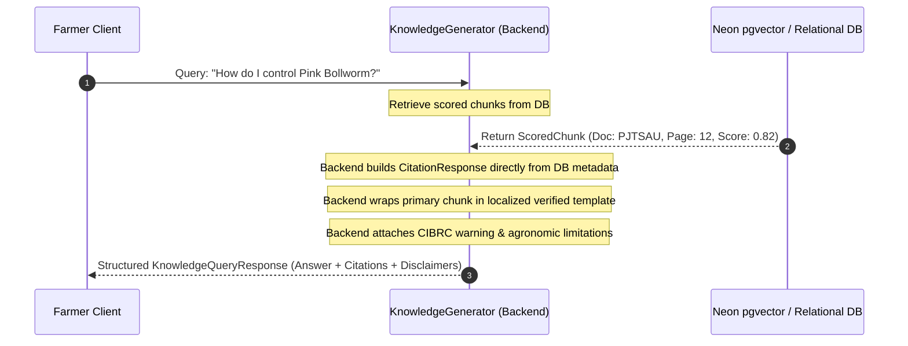

# ACREVIA — STAGE 04 GROUNDED GENERATION VALIDATION
## Fact Grounding, Controlled Citation Assembly & Hallucination Elimination

**Document Reference:** `docs/finalization/stage-04/GROUNDED_GENERATION_VALIDATION.md`  
**Stage:** 04 — KrishiBrain Multilingual Multimodal Agricultural RAG Intelligence Engine  
**Primary Class:** `KnowledgeGenerator` in [`backend/app/services/knowledge/generation/generator.py`](file:///c:/Users/gokul/OneDrive/Documents/projects/backend/app/services/knowledge/generation/generator.py)  

---

### 1. Grounded Generation Principles

In general consumer LLMs, models frequently hallucinate plausible-sounding citations, invented publication years, or fabricated agronomic parameters. 

ACREVIA eliminates hallucination by enforcing a **Controlled Citation Architecture**:
1. **The Language Model Never Creates Citations:** Citations are constructed deterministically by backend code directly from retrieved database rows (`KnowledgeChunk`, `KnowledgeDocument`, `KnowledgeSource`).
2. **Strict Evidence Grounding:** The answer text must reflect direct institutional statements from the top retrieved chunks.
3. **Mandatory Limitations Disclosure:** Every generated answer is bundled with explicit agronomic caveats and situational follow-up questions.



---

### 2. Citation Assembly & Structural Schema

The citation object emitted by `KnowledgeGenerator` strictly implements `CitationResponse`:

```json
{
  "source_title": "PJTSAU Telangana Cotton Package of Practices (2023)",
  "publisher": "Professor Jayashankar Telangana State Agricultural University (PJTSAU)",
  "canonical_url": "https://pjtsau.edu.in/agronomy/cotton-pop-2023",
  "document_version": 1,
  "page_start": 12,
  "page_end": 14,
  "heading_path": "Cotton > Integrated Pest Management > Pink Bollworm",
  "content_snippet": "Pink bollworm (Pectinophora gossypiella) is a major destructive pest of cotton in Telangana. Install 8 pheromone traps per hectare...",
  "relevance_score": 0.815
}
```

#### Citation Verification Invariants
- `source_title` and `publisher`: Guaranteed exact strings from `knowledge_documents` and `knowledge_sources`.
- `page_start` / `page_end`: Exact physical page numbers extracted during PDF ingestion.
- `content_snippet`: Exact initial 300 characters of the indexed chunk.
- `relevance_score`: The exact hybrid retrieval score ($0.0 - 1.0$) calculated during retrieval.

---

### 3. Hallucination Guardrails & Evidence Tiers

The answer generator classifies evidence into three distinct tiers:

| Top Chunk Score | Evidence Strength | Answer Status | Operational Behavior |
|---|---|---|---|
| **$\text{Score} \ge 0.70$** | `STRONG` | `ANSWERED` | Direct grounded guidance dispensed with full citations. Expert review optional. |
| **$0.40 \le \text{Score} < 0.70$** | `MODERATE` | `ANSWERED` | Grounded guidance dispensed with cautionary notes and follow-up prompts. |
| **$0.20 \le \text{Score} < 0.40$** | `WEAK` | `PARTIALLY_ANSWERED` | Preliminary guidance provided; automatically flagged `requires_expert_review=True`. |
| **$\text{Score} < 0.20$** | `INSUFFICIENT` | `INSUFFICIENT_EVIDENCE` | **Zero answer text generated.** Immediate abstention triggered; case queued to KVK. |

By halting generation whenever chunk scores fall below 0.20, KrishiBrain completely prevents the model from improvising unverified answers.
