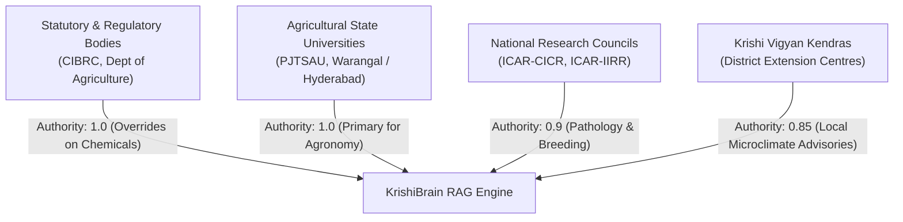

# ACREVIA — STAGE 04 KNOWLEDGE SOURCE GOVERNANCE
## Approved Institutional Categories, Authority Hierarchy, Lifecycle & Licensing

**Document Reference:** `docs/finalization/stage-04/KNOWLEDGE_SOURCE_GOVERNANCE.md`  
**Stage:** 04 — KrishiBrain Multilingual Multimodal Agricultural RAG Intelligence Engine  
**Data Model:** `KnowledgeSource` in [`backend/app/models/knowledge_source.py`](file:///c:/Users/gokul/OneDrive/Documents/projects/backend/app/models/knowledge_source.py)  

---

### 1. The Knowledge Governance Mandate

A fundamental principle of KrishiBrain is that **arbitrary internet content is never treated as authoritative agricultural knowledge**. 

In smallholder agriculture, incorrect advice on fertilizer application, sowing depths, or pest control can wipe out a farmer's seasonal investment. Therefore, every document entering KrishiBrain must trace its provenance to an approved, verified institutional source with recorded legal usage rights.

---

### 2. Approved Institutional Categories

ACREVIA establishes four distinct categories of authorized knowledge publishers:

1. **State Agricultural Universities (PJTSAU):**
   - Primary authority for Telangana agro-climatic zones, seasonal packages of practices, sowing windows, and locally adapted cultivar recommendations.
2. **National Agricultural Research Institutes (ICAR-CICR & ICAR-IIRR):**
   - Primary authority for crop-specific pathology compendiums, pest resistance monitoring (e.g., Pink Bollworm in Cotton, Brown Plant Hopper in Rice), and diagnostic identification keys.
3. **Statutory & Regulatory Bodies (CIBRC):**
   - Ultimate legal authority for registered agrochemical active ingredients, permitted formulations, label claims, maximum residue limits (MRL), pre-harvest intervals (PHI), and banned chemicals.
4. **Krishi Vigyan Kendras (District KVKs):**
   - Supplementary authority for localized district-level field advisories across Warangal, Khammam, Karimnagar, Nalgonda, and Adilabad.

---

### 3. Source Registry Data Contract

Every publisher is registered in the relational `knowledge_sources` table:

| Field Name | Type | Constraint | Description |
|---|---|---|---|
| `id` | String(36) | Primary Key (UUID) | Unique source identifier |
| `publisher_name` | String(150) | Not Null | Official entity name |
| `publisher_type` | String(50) | Not Null | `UNIVERSITY`, `RESEARCH_COUNCIL`, `GOVERNMENT_DEPT`, `KVK` |
| `official_domain` | String(100) | Not Null | Institutional domain (e.g., `pjtsau.edu.in`, `cibrc.gov.in`) |
| `authority_level` | Float | Default: 1.0 | Weighted retrieval priority factor |
| `licensing_status` | String(50) | Default: `GOVERNMENT_OPEN_ACCESS` | Copyright and reproduction permission status |
| `approval_status` | String(50) | Index, Not Null | `PENDING_REVIEW`, `APPROVED`, `REJECTED`, `SUSPENDED`, `EXPIRED` |
| `reviewer_id` | String(36) | Foreign Key (`users.id`) | Admin or expert who approved the source |
| `approved_at` | DateTime | Nullable | Timestamp of formal authorization |

---

### 4. Source Authority & Conflict Resolution Hierarchy

When two approved sources present conflicting recommendations, KrishiBrain applies deterministic precedence rules:

| Query Domain | Highest Authority | Secondary Authority | Subordinate Source | Conflict Resolution Policy |
|---|---|---|---|---|
| **Pesticide/Herbicide Registrations & Dosages** | **CIBRC (Statutory)** | PJTSAU Extension | ICAR Compendiums | **CIBRC strictly overrides.** If university bulletin recommends a chemical banned or restricted by CIBRC, CIBRC restriction wins. |
| **Sowing Time & Spacing for Telangana** | **PJTSAU (Local State)** | ICAR National | KVK District Notes | **PJTSAU local recommendation wins** over national ICAR general guidelines. |
| **Pathology Identification Keys** | **ICAR Specialized Institutes** | PJTSAU Compendiums | KVK Bulletins | **ICAR scientific taxonomy wins** for disease nomenclature and diagnostic criteria. |

#### Conflicting Guidance Protocol
If two sources of equal authority (e.g., two PJTSAU publications with different publication dates) contradict:
1. The later version date supersedes the earlier version.
2. The conflict is recorded in audit logs.
3. If uncertainty impacts farmer safety, KrishiBrain abstains from unilateral dispensing and triggers `REQUIRES_EXPERT_REVIEW`.

---

### 5. Licensing, Copyright & Citation Protection

- **Open Access Permitted:** Indian public agricultural publications under the National Policy on Open Access are ingested for educational smallholder guidance.
- **Fair Use Quoting:** Full document redistribution is blocked. KrishiBrain serves only structured snippets ($\le 300$ characters) as supporting evidence with exact page-level citations and canonical URLs.
