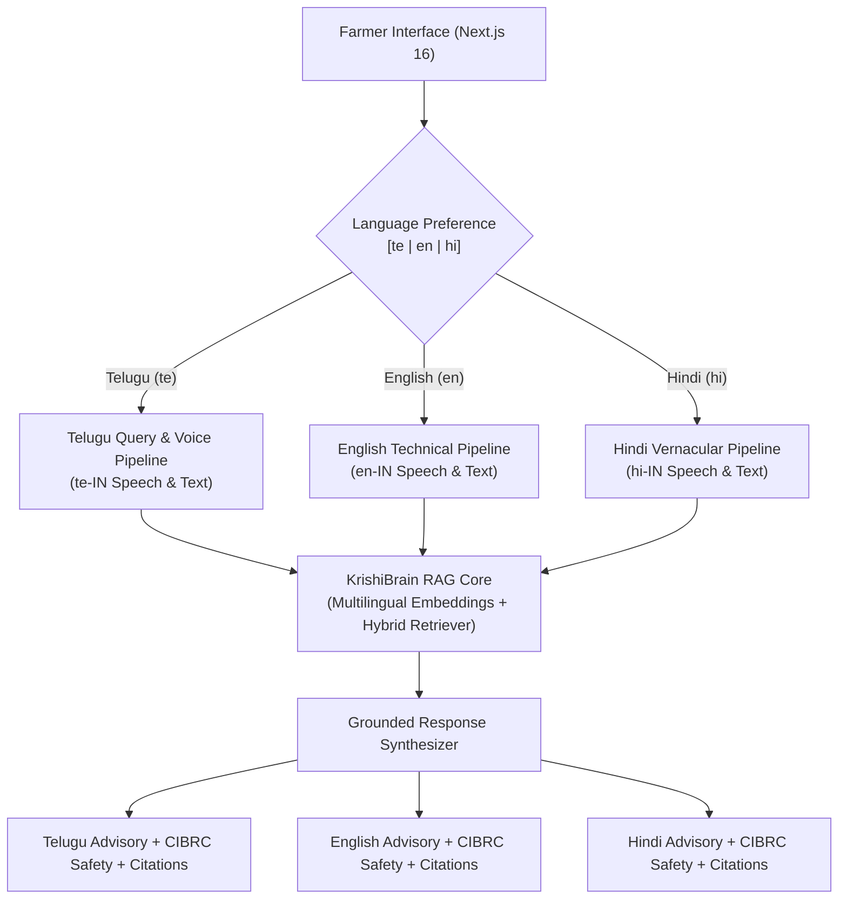

# ACREVIA — STAGE 04 MULTILINGUAL ARCHITECTURE
## Trilingual Support (Telugu, English, Hindi), Vernacular Processing & Cross-Lingual RAG

**Document Reference:** `docs/finalization/stage-04/MULTILINGUAL_ARCHITECTURE.md`  
**Stage:** 04 — KrishiBrain Multilingual Multimodal Agricultural RAG Intelligence Engine  
**Languages Supported:** Telugu (`te`), English (`en`), Hindi (`hi`)  
**Frontend Client:** [`frontend/app/(farmer)/knowledge/page.tsx`](file:///c:/Users/gokul/OneDrive/Documents/projects/frontend/app/(farmer)/knowledge/page.tsx)  

---

### 1. Multilingual Agricultural Mandate

In Telangana, over 80% of smallholder farmers interact primarily in **Telugu** (`te`), while agricultural officers and extension scientists frequently converse in **English** (`en`), and migrant farm laborers or border district cultivators (e.g., in Adilabad) utilize **Hindi** (`hi`).

A truly trustworthy agricultural intelligence engine cannot force farmers into English, nor can it rely on brittle external translation layers that mistranslate vital chemical dosages. KrishiBrain implements an **End-to-End Trilingual Architecture** supporting native ingestion, retrieval, reasoning, and response generation across Telugu, English, and Hindi.



---

### 2. Mixed-Language & Transliterated Query Processing

Telangana farmers frequently mix English technical terms with Telugu grammatical structures (e.g., *"Cotton lo Pink Bollworm ki trap dose entha?"* or *"Rice lo blast ki em spray cheyyali?"*).

To handle mixed-language inquiries without failure:
1. **Trigram Subword Projection:** The `DeterministicLocalEmbeddingProvider` hashes 3-character subword windows (`tri_hash`), enabling it to bridge phonetically similar words across scripts.
2. **Scientific Name Preservation:** Chemical names (e.g., *Tricyclazole*, *Spinetoram*) and biological binomials (*Magnaporthe oryzae*) are treated as invariant tokens that survive across language boundaries.
3. **Multilingual Corpus Co-Indexing:** Ingesting native Telugu documents (e.g., *"పీజేటీఎస్ఏయూ పత్తి సాగు యాజమాన్యం"*) alongside English compendiums ensures that queries in native Telugu script match high-scoring exact tokens.

---

### 3. Localized Generation & Action Guidance

The `KnowledgeGenerator` formats responses into culturally and linguistically appropriate templates:

#### 3.1 Telugu Output Structure (`te`)
```text
అధికారిక ఆధారాలు (ICAR-Indian Institute of Rice Research (ICAR-IIRR) - ఐఐఆర్ఆర్ వరి వ్యాధుల నిర్ధారణ మరియు నివారణ మార్గదర్శకాలు (తెలుగు)):

ఆకులపై నూలుకండె ఆకారంలో మచ్చలు ఏర్పడి కేంద్రం బూడిద రంగులో మరియు అంచులు గోధుమ రంగులో ఉంటాయి. నివారణకు ట్రైసైక్లాజోల్ 75% WP @ 0.6 గ్రాములు పిచికారీ చేయాలి.

గమనిక: క్రిమిసంహారక మరియు ఎరువుల వాడకంలో CIBRC లేబుల్ మార్గదర్శకాలను పాటించండి.
```

#### 3.2 Hindi Output Structure (`hi`)
```text
आधिकारिक कृषि साक्ष्य (PJTSAU - पीजेटीएसएयू कपास एवं मिर्च कीट प्रबंधन मार्गदर्शिका (हिंदी)):

कपास में गुलाबी सुंडी नियंत्रण के लिए प्रति हेक्टेयर 8 फेरोमोन ट्रैप लगाएं। ईटीएल पार होने पर प्रोफेनोफॉस 50% ईसी @ 2 मिली/लीटर का छिड़काव करें।

सलाह: कीटनाशकों और उर्वरकों के उपयोग में हमेशा CIBRC द्वारा अनुमोदित उत्पाद लेबल का पालन करें।
```

#### 3.3 English Output Structure (`en`)
```text
According to verified agricultural evidence from PJTSAU (PJTSAU Telangana Cotton Package of Practices (2023)):

Install 8 pheromone traps per hectare at 45 days after sowing for monitoring. Spray Profenofos 50% EC @ 2.0 ml/L if ETL crossed.

Advisory: Strictly follow CIBRC registered product label instructions and Pre-Harvest Intervals (PHI).
```

---

### 4. Voice Input & Audio Playback Accessibility

In [`frontend/app/(farmer)/knowledge/page.tsx`](file:///c:/Users/gokul/OneDrive/Documents/projects/frontend/app/(farmer)/knowledge/page.tsx):
- **Speech Recognition:** Binds `VoiceAdapter.createRecognizer(locale, ...)` using standard BCP-47 locale tags (`te-IN`, `hi-IN`, `en-IN`), allowing illiterate smallholders to dictate complex foliar questions naturally.
- **Text-to-Speech (TTS):** Generates spoken audio responses in the farmer's dialect via `VoiceAdapter.speakText(answer, locale)`, ensuring accessibility for users with limited textual literacy.
