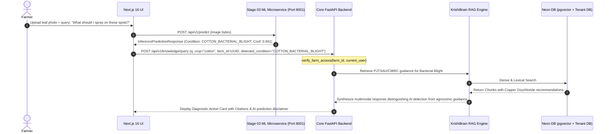

# ACREVIA — STAGE 04 MULTIMODAL CONTEXT ARCHITECTURE
## CropVision Integration, Epistemic Separation & Farm-Context Tenant Isolation

**Document Reference:** `docs/finalization/stage-04/MULTIMODAL_CONTEXT_ARCHITECTURE.md`  
**Stage:** 04 — KrishiBrain Multilingual Multimodal Agricultural RAG Intelligence Engine  
**Integration Points:** Stage 03 Dedicated ML Service & Core Farm Tenant Database  

---

### 1. Multimodal Architectural Topology

In smallholder field diagnostics, a question rarely occurs in isolation: a farmer typically photographs an affected leaf and simultaneously asks what actions to take. 

KrishiBrain integrates the visual diagnostic outputs from **CropVision (Stage 03)** and the spatial plot attributes from **Farm Management (Stage 04+)** into a cohesive evidence-grounded advisory:

---

### 2. Epistemic Separation of Prediction vs Ground Truth

A critical safety invariant mandated by ACREVIA governance is that **an AI vision prediction must never be represented to the farmer as an absolute medical or biological fact**:
1. **Clear Labeling:** In the response payload, the prediction is explicitly identified as an external observational hypothesis:
   > *"Observation Note: CropVision analysis indicates symptoms consistent with Bacterial Blight (Confidence: 94.1%). The model highlights vein-delimited angular lesions."*
2. **Independent Grounding:** The agronomic advice is grounded strictly in institutional literature:
   > *"Institutional Guidance (PJTSAU 2023): To manage Bacterial Blight in cotton, spray Copper Oxychloride 50% WP @ 2.5 g/L + Plantomycin @ 0.1 g/L. Avoid high nitrogen top-dressing."*

---

### 3. Farm-Level Context & Tenant Isolation

When a farmer submits a query referencing a specific `farm_id` or `plot_id`:
1. **Authorization Verification:** In [`backend/app/api/v1/endpoints/knowledge.py`](file:///c:/Users/gokul/OneDrive/Documents/projects/backend/app/api/v1/endpoints/knowledge.py), `verify_farm_access(farm_id, current_user, db)` asserts that the user is the owner or registered tenant of the specified farm.
2. **Cross-Tenant Boundary:** A farmer cannot attach another cultivator's farm ID or query private observation records belonging to other tenants.
3. **Contextual Pruning:** Only strictly necessary plot attributes (crop variety, current growth stage, soil category) are injected into retrieval filters. Private financial records or personal contact details are completely excluded from RAG pipelines.
