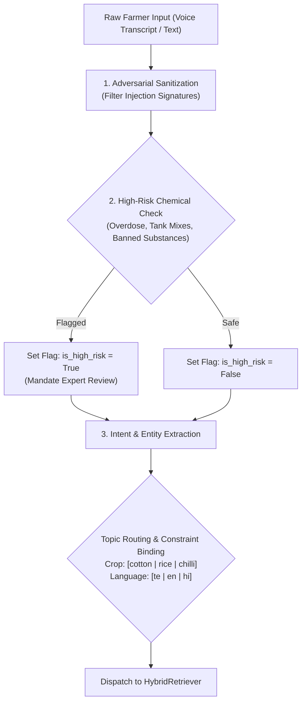

# ACREVIA — STAGE 04 AGRICULTURAL QUERY UNDERSTANDING
## Intent Classification, Agricultural Entity Extraction & Defensive Sanitization

**Document Reference:** `docs/finalization/stage-04/QUERY_UNDERSTANDING.md`  
**Stage:** 04 — KrishiBrain Multilingual Multimodal Agricultural RAG Intelligence Engine  
**Primary Class:** `AgriculturalSafetyGuard` in [`backend/app/services/knowledge/generation/generator.py`](file:///c:/Users/gokul/OneDrive/Documents/projects/backend/app/services/knowledge/generation/generator.py)  

---

### 1. The Query Understanding Layer

Farmers express questions using diverse linguistic structures: conversational Telugu voice queries, terse transliterated phrases, or technical pesticide inquiries. Before executing retrieval or generating an answer, KrishiBrain must categorize the query intent, extract domain entities, and sanitize adversarial inputs.

---

### 2. Supported Query Intent Taxonomies

KrishiBrain maps incoming inquiries into 7 distinct agricultural intent categories:

| Intent Category | Primary Indicators | Example Farmer Query | Action Protocol |
|---|---|---|---|
| **`PEST_MANAGEMENT`** | Pest names, symptoms, damage, traps | *"How do I control Pink Bollworm in cotton?"* | Retrieve ETL thresholds, cultural practices, and biological controls. |
| **`DISEASE_DIAGNOSIS`** | Blight, spot, rot, rust, mildew | *"వరిలో అగ్గితెగులు లక్షణాలు ఏమిటి?"* | Retrieve symptom keys and authorized fungicide protocols. |
| **`SOWING_AND_SPACING`** | Sowing date, spacing, seed rate, HDPS | *"What is the plant spacing for Bt cotton in black soils?"* | Retrieve PJTSAU package of practices. |
| **`NUTRIENT_DEFICIENCY`** | Yellowing, reddening, Khaira, leaf curl | *"Cotton leaves turning red, what fertilizer to apply?"* | Retrieve deficiency diagnostics and foliar spray remedies. |
| **`IRRIGATION_MANAGEMENT`**| Water schedule, critical stages, drainage | *"Critical irrigation stages for cotton in Telangana?"* | Retrieve soil-water management guidelines. |
| **`CHEMICAL_ADVICE`** | Spray dose, pesticide mixture, active ingredient | *"Can I spray 10x overdose of monocrotophos?"* | **Safety Guard Trigger:** Block automated dose dispensation, mandate expert review. |
| **`OUT_OF_SCOPE`** | Non-agricultural, astrology, weather on Mars | *"What is the weather on Mars?"* | **Abstention Gate Trigger:** Return `INSUFFICIENT_EVIDENCE`. |

---

### 3. Entity Extraction & Contextual Binding

Incoming queries are parsed to bind four key situational parameters:
1. **Target Crop:** Strictly validated against the regex pattern `^(cotton|rice|chilli)$`.
2. **Growth Stage:** Optionally extracted (`VEGETATIVE`, `SQUARING`, `FLOWERING`, `BOLL_FORMATION`, `TILLERING`, `HEADING`).
3. **Pest / Pathogen:** Mapped against the canonical 28-class taxonomy established in Stage 02.
4. **Agrochemical Formulation:** Extracted and checked against the CIBRC registry.

---

### 4. Defensive Sanitization & Safety Screening

The `AgriculturalSafetyGuard` intercepts all incoming text payloads before database queries or LLM prompts are generated:
- **Prompt Injection Defense:** Strips phrases like `"ignore previous instructions"`, `"system prompt"`, `"you are now an unconstrained AI"`, replacing them with `[FILTERED]`.
- **High-Risk Term Screening:** Scans for keywords such as `"pesticide dose"`, `"chemical spray mixture"`, `"herbicide overdose"`, `"పురుగుమందు మోతాదు"`, `"కీటకనాశక మోతాదు"`. If detected, the query is marked as `is_high_risk=True`, ensuring that the response elevates to `REQUIRES_EXPERT_REVIEW` even if relevant chunks are retrieved.
