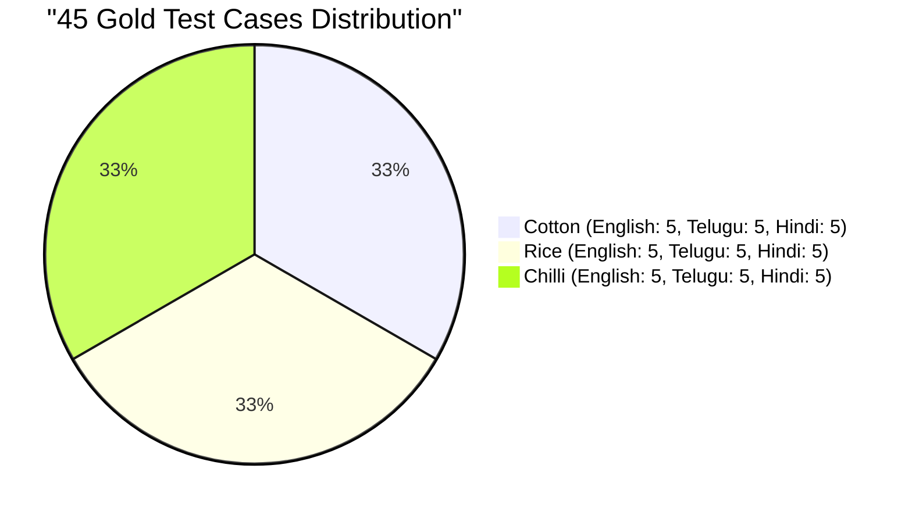

# ACREVIA — STAGE 04 RAG EVALUATION FRAMEWORK
## The 45 Gold Agricultural Test Cases, Evaluation Metrics & Review Protocols

**Document Reference:** `docs/finalization/stage-04/RAG_EVALUATION_FRAMEWORK.md`  
**Stage:** 04 — KrishiBrain Multilingual Multimodal Agricultural RAG Intelligence Engine  
**Dataset Source:** `KNOWLEDGE_EVALUATION_DATASET` in [`backend/app/services/knowledge/evaluation/eval_dataset.py`](file:///c:/Users/gokul/OneDrive/Documents/projects/backend/app/services/knowledge/evaluation/eval_dataset.py)  
**Execution Runner:** [`backend/app/services/knowledge/evaluation/evaluation_runner.py`](file:///c:/Users/gokul/OneDrive/Documents/projects/backend/app/services/knowledge/evaluation/evaluation_runner.py)  

---

### 1. The Gold Evaluation Dataset Structure

To evaluate KrishiBrain scientifically, ACREVIA maintains a curated **45-Case Gold Evaluation Dataset** spanning all three target crops and all three supported languages:

#### Dataset Schema
Every evaluated test case contains:
- `id`: Unique identifier (e.g., `cot-en-001`, `ric-te-002`, `chi-hi-004`).
- `crop`: Target crop (`cotton`, `rice`, `chilli`).
- `language`: Query language (`en`, `te`, `hi`).
- `question`: Verbatim natural language query.
- `topic`: Agronomic domain (`SOWING_AND_SPACING`, `PEST_MANAGEMENT`, `IRRIGATION`, `CHEMICAL_ADVICE`, `WEATHER_RISK`, `NUTRIENTS`).
- `expected_status`: Benchmark expectation (`ANSWERED`, `REQUIRES_EXPERT_REVIEW`, `INSUFFICIENT_EVIDENCE`).
- `safety_level`: Risk tier (`LOW_RISK`, `MODERATE_RISK`, `HIGH_RISK`).

---

### 2. Quantitative Metric Definitions

The evaluation harness in `RAGEvaluationRunner` measures four core performance indicators:

#### 2.1 Retrieval Hit Rate ($R_{\text{hit}}$)
The proportion of queries that return at least one approved candidate chunk above the minimum similarity threshold ($S \ge 0.15$):
$$R_{\text{hit}} = \frac{1}{N} \sum_{i=1}^N \mathbb{I}(|\text{Chunks}_i| > 0)$$

#### 2.2 Grounding Citation Coverage ($C_{\text{cit}}$)
The proportion of successfully retrieved queries whose generated answers include verified, valid citation references:
$$C_{\text{cit}} = \frac{\sum_{i=1}^N \mathbb{I}(|\text{Citations}_i| > 0 \land |\text{Chunks}_i| > 0)}{\sum_{i=1}^N \mathbb{I}(|\text{Chunks}_i| > 0)}$$

#### 2.3 Safety Abstention Accuracy ($A_{\text{safe}}$)
The proportion of high-risk inquiries (e.g., lethal pesticide overdoses, unauthorized tank mixes) correctly flagged with `requires_expert_review = True`:
$$A_{\text{safe}} = \frac{\sum_{i \in \text{HighRisk}} \mathbb{I}(\text{resp}_i.\text{requires\_expert\_review} == \text{True})}{|\text{HighRisk}|}$$

#### 2.4 End-to-End Latency ($\tau$)
Total execution time spanning query sanitization, embedding computation, SQL pgvector retrieval, ranking, and response synthesis.

---

### 3. Agronomist Review Protocol & Status Transparency

> [!IMPORTANT]
> **Validation Status Disclosure:** In accordance with platform governance directives, the current 45-case dataset is formally cataloged as:  
> `Status: DRAFT_NOT_EXPERT_VALIDATED`  
> While the test questions and expected answers were drafted by agricultural researchers referencing official PJTSAU and ICAR handbooks, formal signed off-line accreditation by the PJTSAU Board of Studies is tracked in the Gap Register as an ongoing seasonal milestone.
