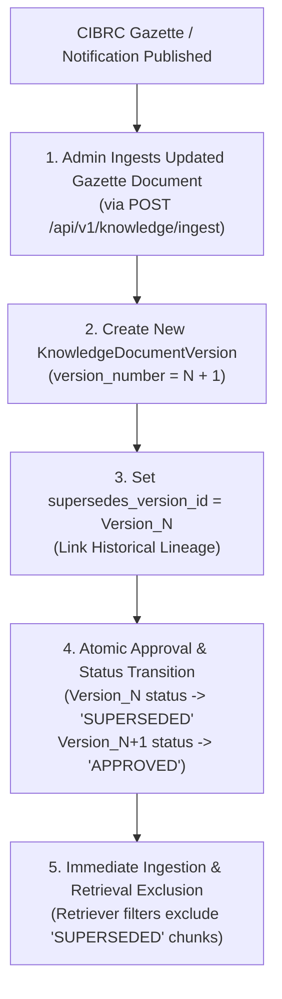

# ACREVIA — STAGE 04 REGULATORY UPDATE GOVERNANCE
## CIBRC Gazette Tracking, Document Supersession, Expiry Lifecycles & Version Deprecation

**Document Reference:** `docs/finalization/stage-04/REGULATORY_UPDATE_GOVERNANCE.md`  
**Stage:** 04 — KrishiBrain Multilingual Multimodal Agricultural RAG Intelligence Engine  
**Relational Entities:** `KnowledgeDocumentVersion`, `KnowledgeSource`  

---

### 1. The Dynamic Regulatory Challenge

Agrochemical regulations are not static:
- The Ministry of Agriculture periodically bans molecules due to environmental toxicity or pollinator harm.
- Maximum Residue Limits (MRL) for export crops (such as chilli and basmati rice) are continually adjusted by regulatory authorities.
- New targeted molecules (such as diamides or novel bio-pesticides) receive label registrations.

If an agricultural RAG system relies on an immutable, unmaintained vector index, it will continue recommending banned pesticides months or years after their statutory withdrawal.

---

### 2. Governed Regulatory Lifecycle

ACREVIA establishes a **Deterministic 5-Step Regulatory Update Pipeline**:



---

### 3. Immediate Deprecation & Retrieval Isolation

In [`backend/app/services/knowledge/retrieval/retriever.py`](file:///c:/Users/gokul/OneDrive/Documents/projects/backend/app/services/knowledge/retrieval/retriever.py):

```python
query_builder = (
    db.query(KnowledgeChunk, ...)
    .join(KnowledgeDocumentVersion, ...)
    .join(KnowledgeDocument, ...)
    .filter(
        KnowledgeChunk.approval_status == "APPROVED",
        KnowledgeDocument.status == "APPROVED"
    )
)
```

1. **Instant Propagation:** The moment an outdated document version is marked `SUPERSEDED`, its associated chunks are disqualified by SQL inner joins.
2. **Zero Cache Drift:** Vector search does not require slow index rebuilds; relational metadata joins immediately suppress deprecated knowledge chunks across all concurrent farmer queries.
3. **Audit Trail:** Every status update records `reviewer_id`, `approved_at`, and an immutable entry in the `audit_logs` table via `AuditService.record_action()`.
