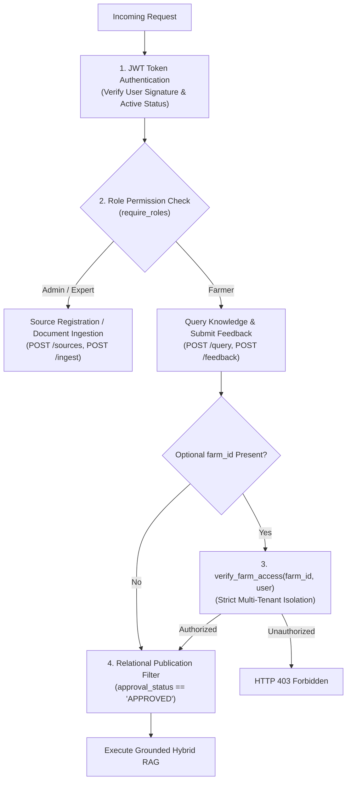

# ACREVIA — STAGE 04 SECURITY & PRIVACY AUDIT REPORT
## RBAC Enforcement, Tenant Isolation, Audit Logging & Data Minimization

**Document Reference:** `docs/finalization/stage-04/SECURITY_AND_PRIVACY_AUDIT.md`  
**Stage:** 04 — KrishiBrain Multilingual Multimodal Agricultural RAG Intelligence Engine  
**Security Dependencies:** [`backend/app/security/dependencies.py`](file:///c:/Users/gokul/OneDrive/Documents/projects/backend/app/security/dependencies.py)  

---

### 1. Security Architecture & Threat Boundaries

The KrishiBrain subsystem processes queries from thousands of distinct smallholder farmers while maintaining institutional publishing workflows. The security architecture enforces strict boundaries across four distinct tiers:



---

### 2. Role-Based Access Control (RBAC) Verification

In [`backend/tests/test_knowledge.py::test_register_knowledge_source_rbac`](file:///c:/Users/gokul/OneDrive/Documents/projects/backend/tests/test_knowledge.py):
1. **Administrative Operations:** Registering an institutional source (`POST /api/v1/knowledge/sources`) or ingesting new documents (`POST /api/v1/knowledge/ingest`) is restricted to users holding `ADMIN` or `AGRICULTURAL_EXPERT` roles.
2. **Farmer Privilege Demarcation:** When a regular farmer user attempts to register a source or ingest documents, the platform returns **HTTP 403 Forbidden**, preventing unauthorized users from inserting unverified advice into the trusted knowledge base.

---

### 3. Multi-Tenant Farm Data Isolation

Smallholder farmers frequently manage private plots with proprietary yield histories, soil test results, and credit records. 

In [`backend/tests/test_knowledge.py::test_knowledge_query_tenant_isolation`](file:///c:/Users/gokul/OneDrive/Documents/projects/backend/tests/test_knowledge.py):
- A farmer user attempting to query KrishiBrain with a `farm_id` owned by another user is immediately blocked:
  $$\text{User}_A \to \text{Query}(\text{farm\_id}_B) \implies \mathbf{403\text{ Forbidden}}$$
- The query pipeline asserts that farmers can only contextualize questions with plots they legally own or manage.

---

### 4. RAG Publication Access Filters

Unapproved, draft, or superseded documents must never be retrieved into farmer-facing answers:
- The SQL query builder in `HybridRetriever` enforces:
  ```sql
  WHERE knowledge_chunks.approval_status = 'APPROVED'
    AND knowledge_documents.status = 'APPROVED';
  ```
- Because this filter is applied at the relational database level prior to similarity scoring, drafts and quarantined documents are physically inaccessible to the vector search engine.

---

### 5. Privacy & Data Minimization Protocol

- **Prompt Anonymization:** Raw personal identifiers (farmer phone numbers, Aadhaar numbers, bank account details) are never passed to the embedding provider or LLM generator.
- **Audit Trail Sanitation:** Audit records created via `AuditService.record_action()` log only operational metadata (`action="KNOWLEDGE_QUERY"`, `resource_id=UUID`, `crop="cotton"`), omitting sensitive conversation transcripts from server log files.
