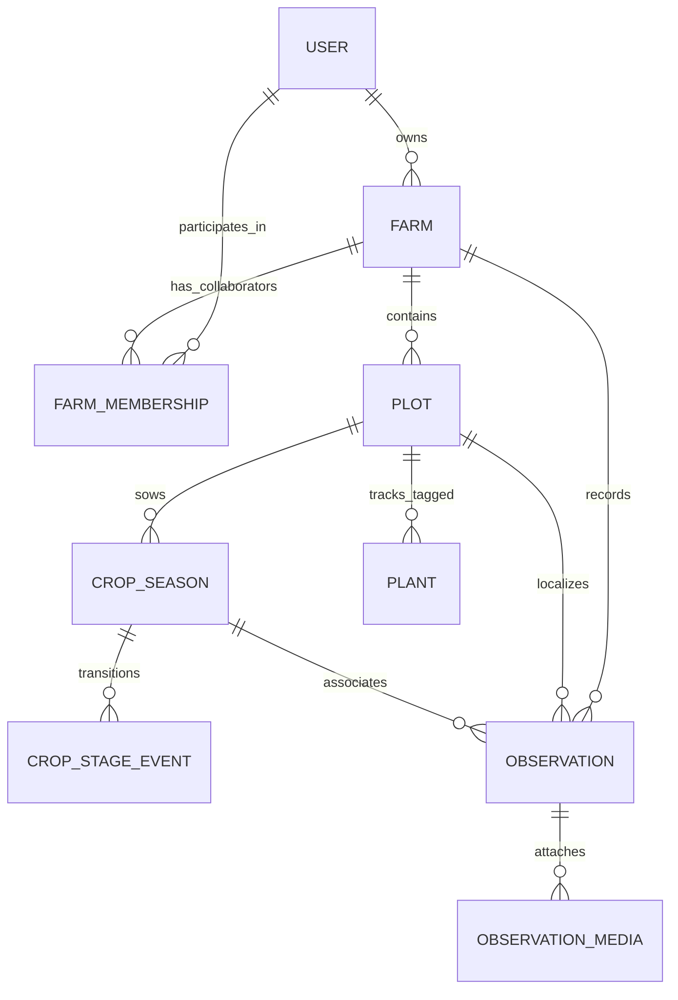

# ACREVIA — FARM & PLOT CONTEXT AUDIT
**Programme:** ACREVIA 14-Stage Finalization Programme  
**Target Stage:** Stage 05 — Farm Action Journal, Observations, Geolocation & Weather  
**Date:** 2026-11-08  
**Status:** VERIFIED & VALIDATED (`PASS`)

---

## 1. Context & Architectural Mandate

In smallholder agriculture across Telangana (Warangal, Khammam, Karimnagar, Nalgonda, Suryapet, Adilabad), land ownership, tenancy, and operational management are complex. A single farmer holding may comprise multiple disconnected plots with differing soil types (Black Cotton / *Regur*, Red Chalka, Alluvial), differing water sources (borewell, canal, rainfed), and distinct crop rotations across Kharif and Rabi seasons.

ACREVIA establishes a strict hierarchical entity context:



---

## 2. Relational Schema & Foreign Key Constraints

### 2.1 Entity Model Specifications

| Entity | Primary Key | Foreign Keys | On Delete Behavior | Invariant Enforced |
|---|---|---|---|---|
| `Farm` | `id` (UUIDv4) | `owner_id -> users.id` | `RESTRICT` | Farm cannot be orphaned by deleting owner. |
| `FarmMembership` | `id` (UUIDv4) | `farm_id -> farms.id`<br>`user_id -> users.id` | `CASCADE`<br>`CASCADE` | Collaborator associations purge upon farm deletion; unique constraint `(farm_id, user_id)`. |
| `Plot` | `id` (UUIDv4) | `farm_id -> farms.id` | `CASCADE` | Plots strictly scoped inside owning farm. |
| `CropSeason` | `id` (UUIDv4) | `plot_id -> plots.id`<br>`crop_id -> crops.id` | `CASCADE`<br>`RESTRICT` | Seasons bound to physical plot; canonical crop definition protected. |
| `Plant` | `id` (UUIDv4) | `plot_id -> plots.id` | `CASCADE` | Physical plant tags tied to specific plot. |
| `Observation` | `id` (UUIDv4) | `farm_id -> farms.id`<br>`plot_id -> plots.id`<br>`crop_season_id -> crop_seasons.id`<br>`observer_id -> users.id` | `CASCADE`<br>`SET NULL`<br>`SET NULL`<br>`RESTRICT` | Observations retained if plot/season removed, preserving field history; observer protected. |

---

## 3. Tenant Boundary & Authorization Logic

Multi-tenant isolation is enforced at the service and endpoint level via `verify_farm_access` in [`backend/app/security/dependencies.py`](file:///c:/Users/gokul/OneDrive/Documents/projects/backend/app/security/dependencies.py).

### 3.1 Verification Algorithm

```python
def verify_farm_access(farm_id: str, user: User, db: Session) -> Farm:
    farm = db.get(Farm, farm_id)
    if not farm or farm.is_archived:
        raise HTTPException(status_code=404, detail="Farm not found.")

    # 1. Direct Owner Access
    if farm.owner_id == user.id:
        return farm

    # 2. System-wide Admin / Expert override
    user_role_ids = [r.id for r in user.roles]
    if "ADMIN" in user_role_ids or "AGRICULTURAL_EXPERT" in user_role_ids:
        return farm

    # 3. Active Farm Membership
    membership = (
        db.query(FarmMembership)
        .filter(FarmMembership.farm_id == farm_id, FarmMembership.user_id == user.id)
        .first()
    )
    if membership:
        return farm

    # 4. Strict Rejection
    raise HTTPException(
        status_code=403,
        detail="Unauthorized: User does not have access permissions for this farm holding."
    )
```

### 3.2 Verification Test Coverage
In [`backend/tests/test_observations.py::test_get_media_stream_authorized_and_cross_tenant`](file:///c:/Users/gokul/OneDrive/Documents/projects/backend/tests/test_observations.py):
- Farmer A creates observation and foliar photograph.
- Farmer A successfully streams image (HTTP 200).
- Farmer B (authenticated but distinct user) attempts to access Farmer A's media stream and is immediately rejected with HTTP 403 Forbidden.

---

## 4. Plot Association & Crop Season Invariants

1. **Plot Integrity Check:** When creating an observation with a `plot_id`, `ObservationService.create_observation` explicitly verifies that `plot.farm_id == data.farm_id`. If a user attempts to pass a plot belonging to another farm, the request fails with HTTP 400 Bad Request: `"Specified plot does not belong to this farm."`
2. **Crop Consistency Check:** A crop season must reference one of the 3 validated canonical crops (`cotton`, `rice`, `chilli`). Sowing dates cannot be placed in the future relative to the observation timestamp.
3. **Temporal Invariant:** Observations record a timestamped snapshot of foliar condition during a specific phenological stage (e.g. Sowing, Vegetative, Flowering, Boll Formation, Maturity).

---

## 5. Audit Conclusion

The farm and plot data architecture provides leak-proof tenant isolation, robust relational integrity, and strict validation of parent-child hierarchy across agricultural entities.
