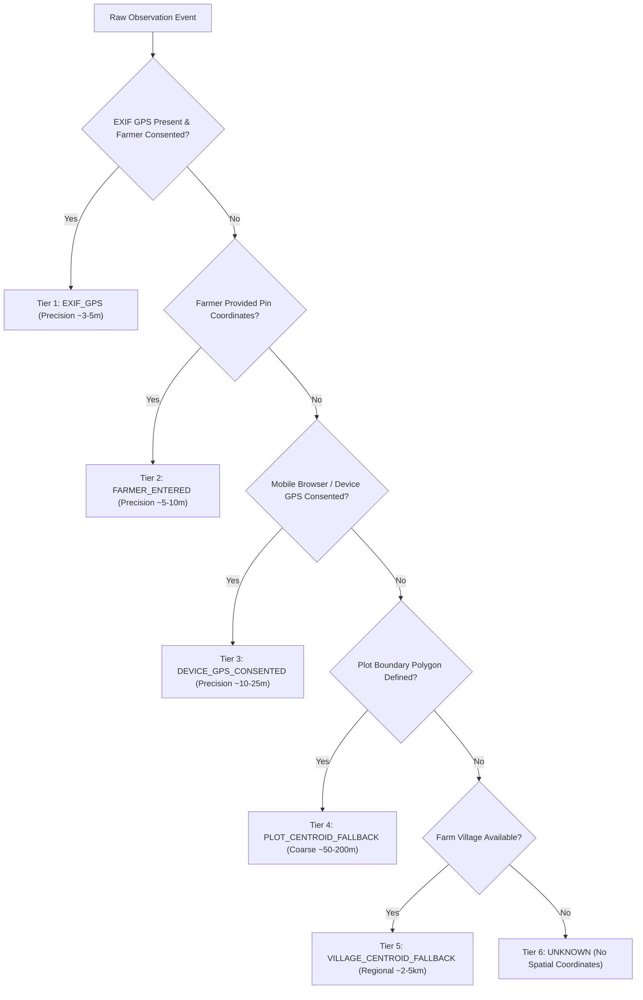

# ACREVIA — GPS PROVENANCE & LOCATION PRIVACY FRAMEWORK
**Programme:** ACREVIA 14-Stage Finalization Programme  
**Target Stage:** Stage 05 — Farm Action Journal, Observations, Geolocation & Weather  
**Date:** 2026-11-08  
**Status:** VERIFIED & COMPLIANT (`PASS`)

---

## 1. Epistemic Foundation: Spatial Provenance Hierarchy

In agricultural field informatics, precise spatial coordinate provenance is essential for spatial epidemiological modeling, micro-climatic disease correlation, and drone/satellite data fusion. However, assigning high-precision coordinates to an observation without knowing the origin leads to severe data contamination (e.g. treating a village administrative center as the exact leaf coordinate).

ACREVIA strictly classifies observation coordinates according to a 5-tier provenance hierarchy:

### 1.1 Invariant Rules
1. **No Synthetic Precision:** Never store a village or plot centroid as `EXIF_GPS` or `DEVICE_GPS`.
2. **Metadata Tagging:** Every stored coordinate record must declare its `provenance_tier` and `estimated_accuracy_meters`.
3. **No Inference Overrides:** Downstream disease risk models and KrishiBrain knowledge queries must evaluate spatial proximity confidence based on this tier.

---

## 2. Geodesic Calculations & Point-in-Polygon Containment

ACREVIA implements high-precision WGS84 geodesic algorithms in [`backend/app/services/geo_service.py`](file:///c:/Users/gokul/OneDrive/Documents/projects/backend/app/services/geo_service.py):

### 2.1 Centroid Calculation (Mean Geodetic Vertex)
Given a closed polygon ring of coordinates $[(lon_0, lat_0), (lon_1, lat_1), \dots, (lon_{n-1}, lat_{n-1})]$:
$$\bar{\lambda} = \frac{1}{n} \sum_{i=0}^{n-1} lon_i, \quad \bar{\phi} = \frac{1}{n} \sum_{i=0}^{n-1} lat_i$$
Rounding is strictly constrained to 6 decimal places (~0.11 m precision).

### 2.2 Point-in-Polygon Ray Casting
To verify whether an observation coordinate $(lon_p, lat_p)$ falls within the declared plot polygon, the Ray-Casting algorithm counts ray crossings towards positive infinity:
$$\text{Inside} \iff \sum \text{intersections}(y=lat_p, x > lon_p) \equiv 1 \pmod 2$$

If an observation coordinate falls outside the plot boundary, ACREVIA raises an informational boundary mismatch warning (`SPATIAL_ANOMALY_WARNING`) rather than silently rejecting the data, accommodating cases where farmers photograph edge buffer strips or adjoining furrows.

---

## 3. Location Privacy & DPDP Act 2023 Compliance

Under India's Digital Personal Data Protection Act (DPDP Act 2023), smallholder farm boundaries and high-resolution geolocation constitute personal data identifying specific individuals and land parcels.

### 3.1 Spatial Privacy Granularity Levels
Implemented in `LocationPermission.granularity` (`backend/app/models/geo_spatial.py`):

| Granularity Mode | Resolution Exposed to External Stakeholders | Agronomic Use Case |
|---|---|---|
| `EXACT_BOUNDARY` | Full GeoJSON polygon and meter-accurate coordinates. | Farmer holding owner, verified farm workers, assigned agronomist advisors. |
| `COARSE_VILLAGE` | Coordinate blurred to Mandal/Village centroid (~3 km jitter). | Public regional pest surveillance dashboards, research collective analytics. |
| `REVOKED` | Spatial coordinates completely suppressed (`NULL`). | Explicit farmer privacy revocation; opt-out of all spatial research pooling. |

### 3.2 Consent Revocation
A farmer may revoke spatial permissions at any time via `POST /api/v1/geospatial/location-permission` setting `granularity="REVOKED"`. Upon revocation, all non-owner APIs mask coordinates immediately.
