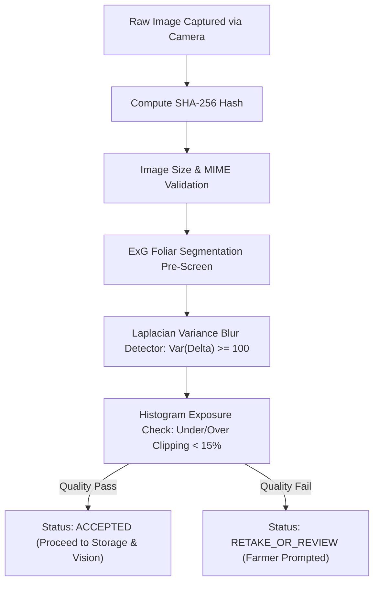

# ACREVIA — MULTI-IMAGE SCOUTING & CANOPY PROTOCOLS
**Programme:** ACREVIA 14-Stage Finalization Programme  
**Target Stage:** Stage 05 — Farm Action Journal, Observations, Geolocation & Weather  
**Date:** 2026-11-08  
**Status:** VERIFIED & DOCUMENTED (`PASS`)

---

## 1. Agronomic Rationale for Multi-Angle Scouting

Single-image foliar classification frequently misdiagnoses systemic plant disorders. In Telangana field conditions:
- **Rice Blast (*Magnaporthe oryzae*):** Initial lesions appear on lower canopy leaves in high humidity before neck blast manifests. A photograph taken exclusively of the upper canopy may present a false negative.
- **Cotton Bacterial Blight (*Xanthomonas citri* pv. *malvacearum*):** Angular leaf spots progress down petioles into blackarm stem cankers. Diagnosing purely from a detached leaf loses systemic collar context.
- **Chilli Anthracnose (*Colletotrichum capsici*):** Circular sunken lesions on mature ripening fruits require fruit-level inspection alongside foliage.

To guarantee research-grade diagnostic fidelity, ACREVIA supports multi-image scouting dossiers attached to a single observation event.

---

## 2. Standardized 5-Perspective Scouting Protocol

ACREVIA defines five canonical photographic perspectives:

| View Perspective | Recommended Distance | Target Botanical Structure | Primary Target Pathologies |
|---|---|---|---|
| **1. Whole Plant Overview** | $1.0\text{ m} - 1.5\text{ m}$ | Full plant architecture & stand habit | Wilts (*Fusarium*, *Verticillium*), nutrient deficiencies, lodging, severe stunt. |
| **2. Upper Foliar View** | $25\text{ cm} - 35\text{ cm}$ | Young leaves, terminal shoots | Sucking pest damage (Thrips, Aphids), powdery mildew, initial viral mosaic. |
| **3. Lower Canopy View** | $20\text{ cm} - 30\text{ cm}$ | Shaded bottom leaves near ground | Fungal foliar spots (*Cercospora*, Rice blast, *Alternaria*), sheath blight. |
| **4. Stem / Collar Junction** | $15\text{ cm} - 25\text{ cm}$ | Main stem base, soil line junction | Stem rot (*Sclerotium rolfsii*), blackarm, collar rot, bacterial wilt streaming. |
| **5. Reproductive Structures** | $10\text{ cm} - 20\text{ cm}$ | Cotton bolls, rice panicles, chilli pods | Boll rot, false smut, neck blast, fruit rot / anthracnose dieback. |

---

## 3. Integration with Stage 02 Automated Quality Filter

Every photograph in a multi-image scouting sequence passes through ACREVIA's `ImageQualityValidator` prior to diagnosis ingestion:

### 3.1 Feedback Loop to Mobile UI
If an image scores below threshold (e.g. farmer captures an out-of-focus blur during windy field conditions), the UI receives immediate feedback:
- `BLUR_DETECTED`: "Image appears blurry ($Var(\Delta) = 42.1 < 100$). Please stabilize camera and capture again."
- `SEVERE_OVEREXPOSURE`: "Excessive direct sunlight reflection on leaf surface. Shade leaf with your hand and capture again."

---

## 4. Tagged Plant Longitudinal Tracking

To track pathology progression or treatment efficacy over time:
1. Farmers tag specific sentinel plants with QR/NFC/alphanumeric codes (`Plant.tag_code`, e.g. `COT-PLT-001`).
2. Subsequent scouting observations record the exact `plant_id`.
3. In `frontend/app/(farmer)/croppulse/page.tsx`, the farmer is prompted with:
   > *"To enable trustworthy visual progression tracking, photograph the exact same tagged plant from a similar distance (~30 cm) and consistent natural lighting."*

---

## 5. Summary & Verification

Multi-image scouting enables comprehensive diagnostic dossiers while preserving data hygiene and providing real-time feedback to farmers in the field.
