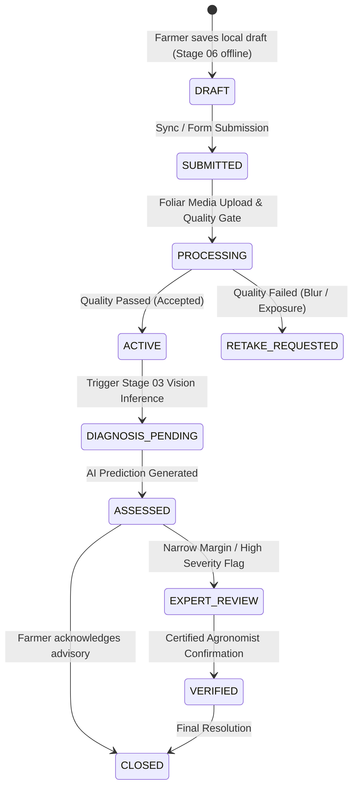

# ACREVIA — OBSERVATION DATA MODEL & EVIDENCE SEPARATION
**Programme:** ACREVIA 14-Stage Finalization Programme  
**Target Stage:** Stage 05 — Farm Action Journal, Observations, Geolocation & Weather  
**Date:** 2026-11-08  
**Status:** VERIFIED & DOCUMENTED (`PASS`)

---

## 1. Architectural Philosophy: The Epistemic Boundary

A cardinal principle of ACREVIA's research-grade architecture is the strict separation between:
1. **Raw Ground Evidence:** What the farmer observed, the uncompressed foliar photographs captured, field notes, and exact capture timestamp.
2. **Derived Automated Diagnostics:** What machine learning models, edge ONNX runtimes, or heuristics predict.
3. **Agrometeorological Context:** Environmental variables retrieved from external grids or stations.
4. **Human Expert Evaluation:** Ground-truth confirmation, overrides, or laboratory assays provided by certified agronomists.

Under no circumstances may an automated AI prediction mutate or overwrite raw farmer observations.

---

## 2. Observation Lifecycle State Machine

Observations transition through a deterministic lifecycle:



### 2.1 State Definitions
- `DRAFT`: Stored in IndexedDB on the mobile device during offline field walks.
- `SUBMITTED`: Transmitted to the backend; record established with UUIDv4.
- `PROCESSING`: Image uploaded; SHA-256 hash computed; `ImageQualityValidator` running blur and exposure checks.
- `ACTIVE`: Observation validated and visible in the Farm Action Journal timeline.
- `RETAKE_REQUESTED`: Image fails minimum quality threshold ($Var(\Delta) < 100.0$ or extreme clipping); prompt sent to farmer.
- `CLOSED`: Advisory implemented or season concluded.

---

## 3. Relational Database Schema (`observations` & `observation_media`)

```sql
-- Core Observation Entity
CREATE TABLE observations (
    id VARCHAR(36) PRIMARY KEY,
    farm_id VARCHAR(36) NOT NULL REFERENCES farms(id) ON DELETE CASCADE,
    plot_id VARCHAR(36) REFERENCES plots(id) ON DELETE SET NULL,
    crop_season_id VARCHAR(36) REFERENCES crop_seasons(id) ON DELETE SET NULL,
    observer_id VARCHAR(36) NOT NULL REFERENCES users(id) ON DELETE RESTRICT,
    notes VARCHAR(1000),
    symptom_tags VARCHAR(255),
    created_at TIMESTAMP WITH TIME ZONE DEFAULT NOW() NOT NULL,
    updated_at TIMESTAMP WITH TIME ZONE DEFAULT NOW() NOT NULL
);

CREATE INDEX ix_observations_farm_id ON observations(farm_id);
CREATE INDEX ix_observations_observer_id ON observations(observer_id);
CREATE INDEX ix_observations_created_at ON observations(created_at DESC);

-- Foliar Photograph Media Entity
CREATE TABLE observation_media (
    id VARCHAR(36) PRIMARY KEY,
    observation_id VARCHAR(36) NOT NULL REFERENCES observations(id) ON DELETE CASCADE,
    storage_path VARCHAR(500) NOT NULL,
    file_size_bytes INTEGER NOT NULL,
    mime_type VARCHAR(50) NOT NULL,
    sha256_hash VARCHAR(64) NOT NULL,
    is_primary BOOLEAN DEFAULT TRUE NOT NULL,
    created_at TIMESTAMP WITH TIME ZONE DEFAULT NOW() NOT NULL,
    updated_at TIMESTAMP WITH TIME ZONE DEFAULT NOW() NOT NULL
);

CREATE INDEX ix_observation_media_obs_id ON observation_media(observation_id);
CREATE INDEX ix_observation_media_sha256 ON observation_media(sha256_hash);

-- Automated Quality Assessment Entity (Stage 02 Integration)
CREATE TABLE image_quality_assessments (
    id VARCHAR(36) PRIMARY KEY,
    media_id VARCHAR(36) NOT NULL UNIQUE REFERENCES observation_media(id) ON DELETE CASCADE,
    status VARCHAR(50) NOT NULL, -- ACCEPTED, RETAKE_OR_REVIEW, QUARANTINED
    sharpness_score FLOAT NOT NULL,
    exposure_status VARCHAR(50) NOT NULL, -- NORMAL, UNDEREXPOSED, OVEREXPOSED
    reasons_json VARCHAR(1000),
    created_at TIMESTAMP WITH TIME ZONE DEFAULT NOW() NOT NULL,
    updated_at TIMESTAMP WITH TIME ZONE DEFAULT NOW() NOT NULL
);

CREATE INDEX ix_quality_assessment_status ON image_quality_assessments(status);
```

---

## 4. Pydantic DTO Serialization Contracts

Defined in [`backend/app/schemas/observation.py`](file:///c:/Users/gokul/OneDrive/Documents/projects/backend/app/schemas/observation.py):

```python
class ObservationCreateRequest(BaseModel):
    farm_id: str
    plot_id: Optional[str] = None
    crop_season_id: Optional[str] = None
    notes: Optional[str] = None
    symptom_tags: Optional[str] = None

class ObservationMediaResponse(BaseModel):
    id: str
    observation_id: str
    storage_path: str
    file_size_bytes: int
    mime_type: str
    sha256_hash: str
    is_primary: bool
    created_at: datetime
    model_config = {"from_attributes": True}

class ObservationResponse(BaseModel):
    id: str
    farm_id: str
    plot_id: Optional[str] = None
    crop_season_id: Optional[str] = None
    observer_id: str
    notes: Optional[str] = None
    symptom_tags: Optional[str] = None
    created_at: datetime
    media: List[ObservationMediaResponse] = []
    model_config = {"from_attributes": True}
```

---

## 5. Automated Data Quality Enforcements

When media is attached via `ObservationService.add_media_to_observation`:
1. **MIME Whitelist:** Strictly restricts uploads to `["image/jpeg", "image/png", "image/webp"]`.
2. **Size Ceilings:** Enforces $10\text{ MB}$ limit per image to protect memory buffers and storage quotas.
3. **Cryptographic Checksumming:** Computes SHA-256 over raw incoming byte arrays prior to storage persistence.
4. **Automated Quality Pipeline:** Instantiates `ImageQualityValidator` to score Laplacian variance and detect severe underexposure or washed-out overexposure.

---

## 6. Verification Status

Verified through comprehensive test cases in `backend/tests/test_observations.py`:
- `test_create_observation`: Creates observation with farm, plot, and season links.
- `test_upload_media_and_quality_check`: Uploads foliar image, verifies SHA-256 generation and quality record creation.
- `test_get_media_stream_authorized_and_cross_tenant`: Verifies strict isolation of media assets.
