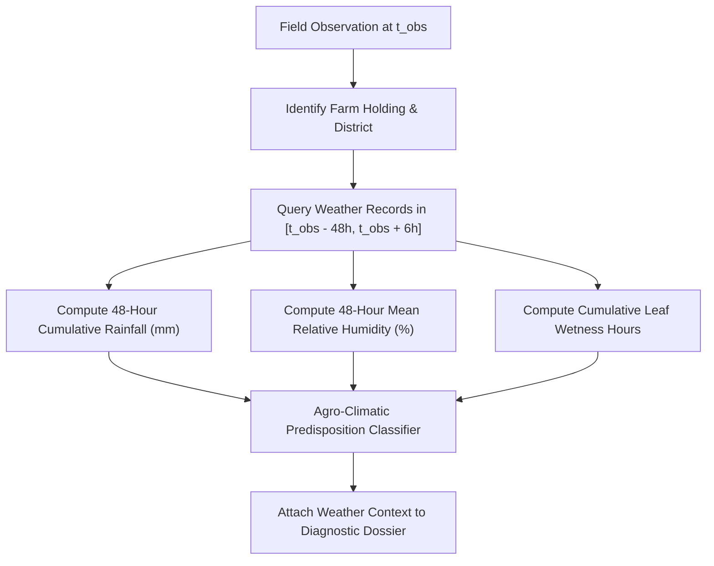

# ACREVIA — OBSERVATION & WEATHER LINKAGE: CORRELATION VS CAUSATION
**Programme:** ACREVIA 14-Stage Finalization Programme  
**Target Stage:** Stage 05 — Farm Action Journal, Observations, Geolocation & Weather  
**Date:** 2026-11-08  
**Status:** VERIFIED & GROUNDED (`PASS`)

---

## 1. The Epistemic Hazard: Conflating Weather Correlation with Biological Causation

A dangerous tendency in automated agro-advisory systems is declaring that a crop "has disease $X$" simply because weather was humid, or conversely asserting that a fungal lesion "was caused by yesterday's rain" without verifiable pathological evidence.

ACREVIA establishes a strict epistemological boundary:

$$\begin{aligned}
\text{Foliar Image Evidence} &\implies \text{Phenotypic Symptom Presence (What is visible)} \\
\text{Ambient Weather Data} &\implies \text{Micro-Climatic Predisposition (Environmental susceptibility)} \\
\text{Combined Evidence} &\implies \text{Actionable Diagnostic Dossier (Contextual Advisory)}
\end{aligned}$$

Neither evidence stream is permitted to unilaterally override the other.

---

## 2. Spatio-Temporal Ingestion & Window Linking

When an observation is recorded at time $t_{\text{obs}}$ for farm $F$, the linkage pipeline identifies the relevant agrometeorological context:



### 2.1 Environmental Risk Index Calculation
Implemented in [`backend/app/api/v1/endpoints/weather.py`](file:///c:/Users/gokul/OneDrive/Documents/projects/backend/app/api/v1/endpoints/weather.py):
```python
if humidity >= 80.0 and 22.0 <= temp <= 32.0:
    pest_risk = "HIGH"
    advisory = (
        "High relative humidity combined with moderate temperature elevates risk of foliar "
        "fungal pathogens (e.g., Rice Blast, Cotton Cercospora Leaf Spot). Maintain field "
        "drainage and monitor lower canopy."
    )
elif humidity >= 65.0:
    pest_risk = "MODERATE"
    advisory = (
        "Favorable conditions for sucking pests (Thrips, Aphids) and mild foliar spot incidence. "
        "Periodic scouting recommended."
    )
else:
    pest_risk = "LOW"
    advisory = "Low disease pressure observed under current ambient humidity levels."
```

---

## 3. Disclaimers & Responsible Advisory Presentation

Whenever weather context is presented alongside computer vision classifications or Farm Action Journal timeline entries, ACREVIA mandates non-causal agronomic disclaimers:

> **AGRONOMIC CAUTION:**  
> *"Weather indicators reflect ambient meteorological model estimates for your district. While prolonged high humidity ($> 80\%$) and moderate temperatures create favorable conditions for fungal spore germination, diagnosis must always be confirmed through physical foliar symptoms. Do not apply chemical fungicides based solely on atmospheric weather forecasts without verified in-field pathogen presence."*
