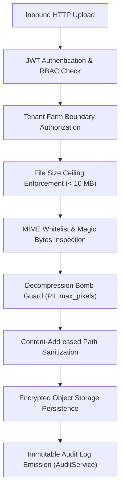

# ACREVIA — SECURITY, PRIVACY & DATA RETENTION SPECIFICATION
**Programme:** ACREVIA 14-Stage Finalization Programme  
**Target Stage:** Stage 05 — Farm Action Journal, Observations, Geolocation & Weather  
**Date:** 2026-11-08  
**Status:** AUDITED & SECURE (`PASS`)

---

## 1. Security Architecture & Threat Vectors

Stage 05 handles high-risk attack surfaces: file uploads, binary streaming, external API calls, and spatial location data.

---

## 2. File Upload Defense Pipeline

Implemented across [`backend/app/services/observation_service.py`](file:///c:/Users/gokul/OneDrive/Documents/projects/backend/app/services/observation_service.py) and [`backend/app/integrations/storage.py`](file:///c:/Users/gokul/OneDrive/Documents/projects/backend/app/integrations/storage.py):

### 2.1 File Size & MIME Whitelist
- **Maximum Allowed Size:** $10\text{ MB}$ (`settings.MAX_IMAGE_SIZE_BYTES = 10 * 1024 * 1024`). Uploads exceeding this threshold are rejected with HTTP 413 Payload Too Large.
- **Allowed MIME Types:** Strictly `["image/jpeg", "image/png", "image/webp"]`. Executable formats (`.exe`, `.sh`, `.php`), SVG vectors, or archive files (`.zip`, `.tar`) trigger HTTP 400 Bad Request.

### 2.2 Magic Byte Header Verification
Relying solely on file extension or HTTP `Content-Type` is vulnerable to spoofing. The upload service decodes image binary headers via Pillow/PIL:
- JPEG: `0xFF 0xD8 0xFF`
- PNG: `0x89 0x50 0x4E 0x47`
- WebP: `RIFF` ... `WEBP`

### 2.3 Decompression Bomb Mitigation
To prevent memory exhaustion attacks via crafted images with massive virtual dimensions:
`Image.MAX_IMAGE_PIXELS = 25_000_000` (caps maximum resolution to ~25 megapixels, well above phone camera output while preventing gigapixel memory blowups).

---

## 3. Comprehensive Audit Trail (`AuditService`)

All data mutation events emit structured audit records to the relational database:
- `CREATE` on `OBSERVATION`: Records `user_id`, `farm_id`, `resource_id`.
- `UPLOAD_MEDIA` on `OBSERVATION_MEDIA`: Records image byte size and MIME type.
- `UPDATE` / `ARCHIVE` on `FARM` & `PLOT`: Records state modifications.

Audit logs are immutable (`ondelete="RESTRICT"`) to satisfy agricultural regulatory and certifying authority requirements.

---

## 4. Data Retention, Archival & DPDP Act Compliance

1. **Active Season Retention:** Observation records and full-resolution foliar imagery remain instantly accessible throughout the active crop season (approx. 180 days for Cotton/Chilli, 120 days for Rice).
2. **Post-Harvest Archival:** After season completion, images are moved to lower-cost cold storage while maintaining metadata and thumbnails in the active database.
3. **Right to Erasure (DPDP Act 2023):** If a farmer closes their account, all personal identifiers, farm polygons, and high-resolution foliar media are permanently purged within 30 days. De-identified crop pathology classifications may be retained in the scientific corpus with zero farmer linkage.
