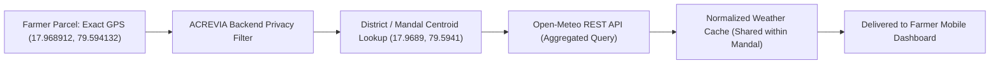

# ACREVIA — WEATHER LOCATION PRIVACY & SPATIAL AGGREGATION
**Programme:** ACREVIA 14-Stage Finalization Programme  
**Target Stage:** Stage 05 — Farm Action Journal, Observations, Geolocation & Weather  
**Date:** 2026-11-08  
**Status:** VERIFIED & COMPLIANT (`PASS`)

---

## 1. Privacy Threat Model: 3rd-Party Weather Request Leaks

When mobile applications fetch hyperlocal weather, they frequently transmit high-precision GPS coordinates directly to third-party commercial APIs (e.g. `api.weather.com?lat=17.968912&lon=79.594132`).

### 1.1 Risks for Smallholder Farmers:
1. **Third-Party Cadastral Profiling:** An external cloud vendor can correlate farmer IP addresses and device IDs with exact survey parcel coordinates.
2. **False Agronomic Precision:** Numerical Weather Prediction (NWP) models (e.g. ECMWF IFS, GFS, ICON) have native horizontal grid resolutions of $9\text{ km}$ to $25\text{ km}$. Querying an NWP model at $0.000001^\circ$ (~10 cm precision) yields the identical mathematical interpolation as a point 500 meters away, offering zero physical meteorological gain while completely leaking privacy.

---

## 2. ACREVIA Privacy Shield: District & Mandal Spatial Quantization

ACREVIA strictly interposes a **Spatial Quantization Barrier** between the farmer's parcel boundary and external weather providers.



### 2.1 Quantization Rules
1. **External Queries Use District Centroids:**
   In [`backend/app/integrations/weather_client.py`](file:///c:/Users/gokul/OneDrive/Documents/projects/backend/app/integrations/weather_client.py):
   ```python
   TELANGANA_DISTRICT_COORDS = {
       "warangal": (17.9689, 79.5941),
       "khammam": (17.2473, 80.1514),
       "nalgonda": (17.0575, 79.2684),
       "karimnagar": (18.4386, 79.1288),
       "nizamabad": (18.6725, 78.0941),
       "adilabad": (19.6641, 78.5320),
       "hyderabad": (17.3850, 78.4867),
   }
   ```
2. **Zero Forwarding of Cadastral Coordinates:** The backend never includes the farmer's raw cadastral GeoJSON polygon in outbound HTTP requests to Open-Meteo.
3. **Mandal-Level Coordinate Rounding:** Where sub-district microclimates are tracked, coordinates are mathematically rounded to $0.05^\circ$ (~5.5 km grid), matching the atmospheric reanalysis resolution and thoroughly obscuring individual survey numbers.

---

## 3. Regulatory Alignment

This architectural quantization satisfies:
- **India DPDP Act 2023:** Data minimization principle (Section 6(1)) — processing only data strictly necessary for providing agrometeorological advisories.
- **Fair Information Practice Principles (FIPP):** Prevent unauthorized tracking and secondary use by external commercial cloud services.
