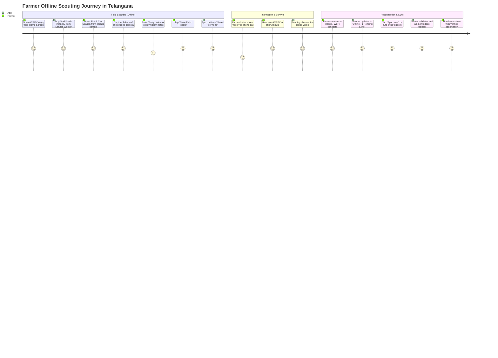

# ACREVIA — OFFLINE FIELD WORKFLOWS & USER JOURNEYS
**Programme:** ACREVIA 14-Stage Finalization Programme  
**Target Stage:** Stage 06 — Vernacular Progressive Web App & Voice Interaction  
**Date:** 2026-11-08  
**Status:** VALIDATED & COMPLIANT (`PASS`)

---

## 1. Context: A Typical Telangana Field Walk

A cotton farmer in Nalgonda or a chilli grower in Khammam walks into their field at 7:00 AM. 400 meters past the village boundary, cellular signals fade completely. 

During this field walk, the farmer must be able to document pest damage, photograph symptoms, record notes, and tag specific plots without the application freezing, throwing network exceptions, or failing to save.

---

## 2. Step-by-Step Offline Scouting Journey

---

## 3. Explicit Differentiation: Offline Capabilities vs. Server Requirements

To prevent misleading farmers, ACREVIA explicitly distinguishes between what runs offline vs. what requires an active server connection:

| Operation | Offline Capability | Online Requirement | User-Facing Indicator |
|---|---|---|---|
| **App Shell Launch** | **Supported** (Precached SW) | None | Full UI instantly responsive. |
| **View Farm & Plot Structure** | **Supported** (Cached Context) | None | Displays previously authorized plots. |
| **Observation Recording** | **Supported** (IndexedDB) | None | `"Saved to Phone (Pending Upload)"` |
| **Foliar Photo Capture** | **Supported** (Local Storage) | None | Photo preview rendered instantly. |
| **Computer Vision Inference** | **Deferred** (Cannot run heavy PyTorch) | Backend Server Required | `"Queued for Online Analysis"` |
| **KrishiBrain RAG Generation** | **Deferred** (pgvector / LLM needed) | Backend Server Required | Prompt to submit when connectivity returns. |
| **Hyperlocal Weather** | **Deferred** (Open-Meteo needed) | Backend Server Required | Displays last cached reading with timestamp. |

---

## 4. Anti-Hallucination Invariant

Under no circumstances does ACREVIA generate synthetic or simulated AI diagnoses while offline:
> **INVARIANT:** Never display a synthetic or placeholder disease diagnosis (e.g. "Predicted: Leaf Spot 85%") while disconnected unless a verified, calibrated on-device model has executed locally. The UI must honestly report: `"Queued for Online Analysis upon Reconnection"`.
