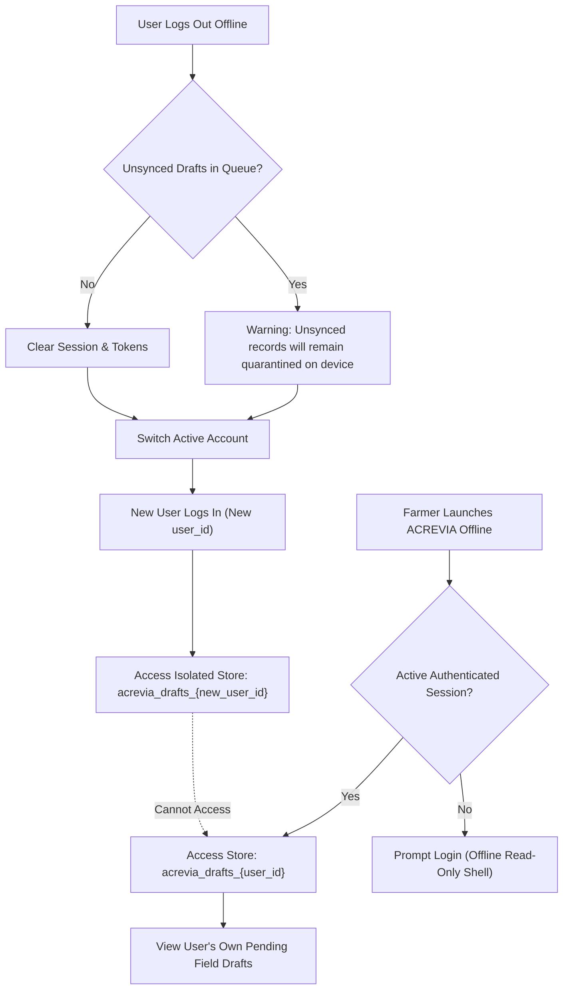

# ACREVIA — OFFLINE SECURITY, PRIVACY & AUTHORIZATION
**Programme:** ACREVIA 14-Stage Finalization Programme  
**Target Stage:** Stage 06 — Vernacular Progressive Web App & Voice Interaction  
**Date:** 2026-11-08  
**Status:** AUDITED & SECURE (`PASS`)

---

## 1. Threat Model: The Shared Rural Smartphone

In rural India, a single smartphone is frequently shared across family members, tenant farmers, and field helpers. A father may manage farm finances, a son may scout cotton pests, and an agronomist neighbor may borrow the phone to check local weather.

Offline-first architectures introduce severe security risks if local storage is treated as a shared unauthenticated scratchpad:
1. **Cross-Tenant Data Exposure:** User B logging in on the phone might view confidential foliar observations or crop yields recorded by User A.
2. **Unauthorized Server Submission:** User B synchronizing their queue might inadvertently submit User A's pending observations under User B's identity.

---

## 2. Multi-User Storage Partitioning

ACREVIA isolates client storage by embedding the authenticated `user_id` into the storage namespace:

$$\text{StoreKey} = \text{"acrevia\_drafts\_"} + \text{user\_id}$$

---

## 3. Sensitive Data Minimization in IndexedDB

Under India's DPDP Act 2023, data minimization must be enforced on client storage:

| Sensitive Category | Allowed in IndexedDB? | Security Rationale |
|---|---|---|
| **Plaintext Passwords** | **PROHIBITED** | Passwords must never touch client disk. |
| **Long-Lived Refresh Tokens** | **PROHIBITED** | Stored exclusively in secure `HttpOnly`, `SameSite=Lax` cookies. |
| **Exact Cadastral Survey Numbers** | **PROHIBITED** | Only generic `plot_id` UUIDs stored locally. |
| **Financial Ledger Records** | **PROHIBITED** | Financial balance sheets are strictly network-only. |
| **Field Observation Notes & Photos** | **PERMITTED** | Required for offline scouting workflow; tagged with user UUID. |

---

## 4. Offline Token Expiry & Re-Authentication

When a farmer operates offline for an extended duration, their short-lived JWT access token may expire.

### 4.1 Re-Authentication Invariant
- **Observation Creation:** The farmer is never interrupted or locked out while scouting in the mud. The app continues to accept and persist offline drafts locally.
- **Synchronization Gate:** When the phone reconnects to cellular data, the sync engine checks token validity:
  - If token is expired: The sync engine transitions drafts to `REAUTHENTICATION_REQUIRED`.
  - The farmer is prompted: *"Please sign in to verify identity before uploading field records."*
  - Upon successful sign-in, the queued observations upload under the authenticated identity.
- **Invariant:** Offline records are NEVER silently uploaded without valid cryptographic authorization.
