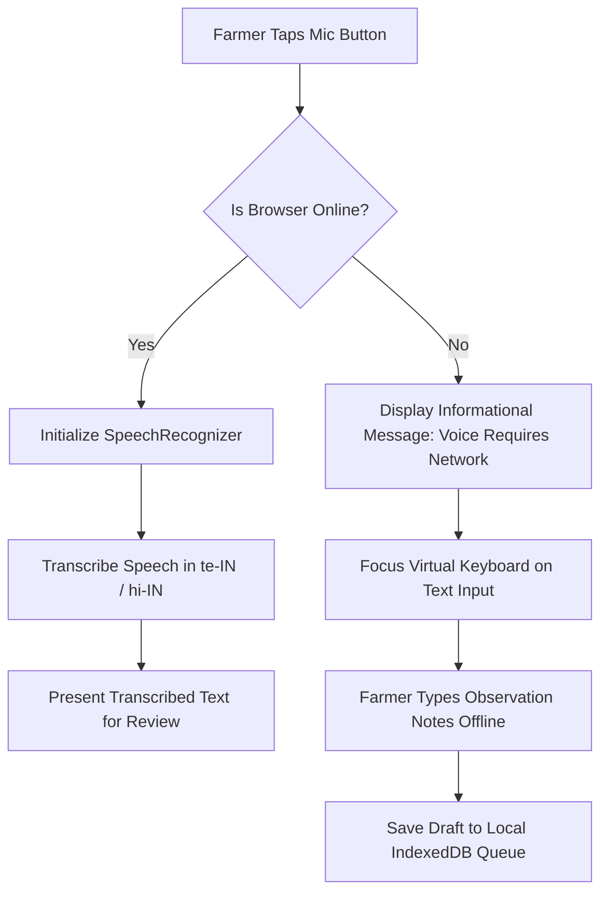

# ACREVIA — OFFLINE VOICE INTERACTIONS & ACCESSIBILITY FALLBACKS
**Programme:** ACREVIA 14-Stage Finalization Programme  
**Target Stage:** Stage 06 — Vernacular Progressive Web App & Voice Interaction  
**Date:** 2026-11-08  
**Status:** SPECIFIED & COMPLIANT (`PASS`)

---

## 1. Technical Reality: Browser Speech Recognition & Connectivity

A common misconception in mobile web engineering is assuming the browser's `SpeechRecognition` API operates locally on the phone's CPU. 

On Android Chrome and iOS Safari, speech recognition engines stream audio packets to cloud Automatic Speech Recognition (ASR) endpoints (e.g. Google Cloud Speech). When a farmer loses cellular connectivity in the field, speech recognition abruptly halts with a `network` error.

---

## 2. Transparent Offline Voice State Machine

ACREVIA manages voice capabilities dynamically based on connection status:

### 2.1 User-Facing Messages When Disconnected
- **Telugu (`te`):** *"వాయిస్ రికగ్నిషన్ కోసం ఇంటర్నెట్ అవసరం. దయచేసి వివరాలను టైప్ చేయండి."*
- **Hindi (`hi`):** *"आवाज़ पहचान के लिए इंटरनेट आवश्यक है। कृपया विवरण टाइप करें।"*
- **English (`en`):** *"Speech recognition requires an internet connection on this device. Please type your notes."*

---

## 3. Offline Text-to-Speech (TTS) Behavior

Unlike speech recognition, many mobile operating systems (Android 11+, iOS 14+) pre-install local TTS voice models.
- If an on-device voice exists for the selected language: The phone speaks the cached text even while offline.
- If the on-device voice is missing: The synthesis call fails silently without throwing unhandled exceptions.
- **Invariant:** The text advisory is ALWAYS rendered visually on screen. Critical agricultural warnings (e.g. chemical toxicity, withholding periods) are NEVER delivered solely through audio.
