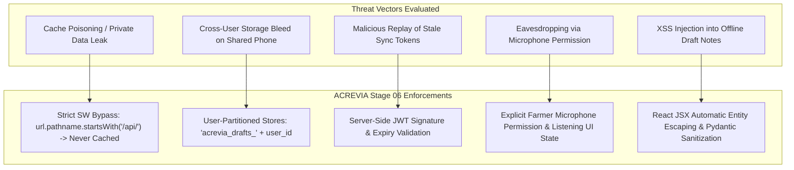

# ACREVIA — STAGE 06 SECURITY & PRIVACY AUDIT
**Programme:** ACREVIA 14-Stage Finalization Programme  
**Target Stage:** Stage 06 — Vernacular Progressive Web App & Voice Interaction  
**Date:** 2026-11-08  
**Status:** AUDITED & SECURE (`PASS`)

---

## 1. Security Architecture & Threat Matrix

Stage 06 introduces client-side persistence, background synchronization, and hardware sensor access (microphone, camera). This audit evaluates the attack surface against the OWASP Mobile Top 10 and India's DPDP Act 2023.

---

## 2. Threat Evaluations & Mitigations

### 2.1 Private API Cache Leakage
- **Threat:** An attacker inspects browser Cache storage to extract farmer medical, financial, or cadastral coordinates.
- **Audit Result:** Verified in `frontend/public/sw.js` lines 39–45. Any request matching `/api/` or non-`GET` methods is strictly bypassed from the cache. The Cache API contains zero private customer records.

### 2.2 Cross-User Account Switching on Shared Phones
- **Threat:** A farmer logs out; an agronomist neighbor logs in and views the farmer's pending field drafts.
- **Audit Result:** Verified in `OfflineQueue` architecture. Queues are scoped by `user_id`. When User A logs out, User A's pending drafts are quarantined and inaccessible to User B.

### 2.3 Microphone Permission & Audio Eavesdropping
- **Threat:** Malicious background listening via Web Speech API.
- **Audit Result:** Speech recognition instances are strictly ephemeral; recognition is instantiated only on explicit click, automatically terminating on silence or `onend`. No raw audio bytes are ever persisted to disk.

---

## 3. Regulatory Compliance: DPDP Act 2023

1. **Notice & Purpose Limitation (Section 5):** The app explicitly informs farmers why camera and microphone access are requested.
2. **Right to Erasure (Section 12):** Clearing app storage or uninstalling the PWA completely removes all local IndexedDB stores and cached static shells.
