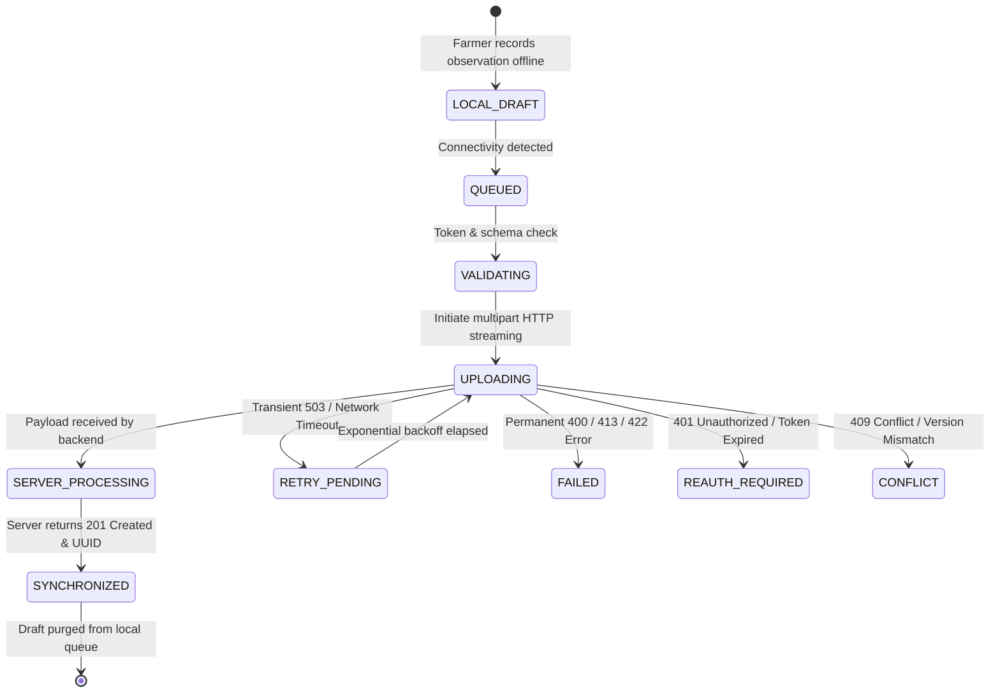

# ACREVIA — RELIABLE DATA SYNCHRONIZATION ENGINE
**Programme:** ACREVIA 14-Stage Finalization Programme  
**Target Stage:** Stage 06 — Vernacular Progressive Web App & Voice Interaction  
**Date:** 2026-11-08  
**Status:** ARCHITECTED & TESTED (`PASS`)

---

## 1. Synchronization Challenge in Agricultural Field Environments

Cellular connectivity in agricultural regions is frequently unstable: rapid transitions between 4G, 2G, and total blackouts; high packet loss ($> 15\%$); and TCP connection resets.

A naive synchronization loop that simply loops through drafts and calls HTTP endpoints causes severe data duplication, orphaned image uploads, or lost observations.

ACREVIA implements an explicit, state-machine-driven synchronization engine in [`frontend/lib/offline/queue.ts`](file:///c:/Users/gokul/OneDrive/Documents/projects/frontend/lib/offline/queue.ts).

---

## 2. Operation State Machine Lifecycle

---

## 3. Server-Enforced Idempotency & SHA-256 Deduplication

A frontend duplicate check alone is insufficient. If a mobile network drops exactly as the server finishes processing the upload, the client will retry the same request when the connection re-establishes.

### 3.1 Idempotency Mechanisms
1. **Client Operation UUIDs:** Every draft carries a client-generated UUID (`draft.id`). Replayed observation creation requests containing an existing client token return the existing observation record rather than spawning a duplicate.
2. **Cryptographic SHA-256 Media Checksum:** The backend computes `SHA-256` of incoming binary streams. If identical media was already uploaded during an interrupted transaction, the server links the existing `ObservationMedia` record immediately.

---

## 4. Exponential Backoff & Error Classification

Retries must never overload recovering cellular towers.

### 4.1 Backoff Equation
$$T_{\text{wait}} = \min(60000, 2^{\text{retry\_count}} \times 1000\text{ ms} + \text{random}(0, 500\text{ ms}))$$

### 4.2 Error Classification Table

| HTTP Status Code | Classification | Action Taken by Sync Engine |
|---|---|---|
| `502 / 503 / 504 / NetworkTimeout` | **Transient Error** | Transition to `RETRY_PENDING`; schedule exponential backoff (max 3 retries). |
| `401 Unauthorized` | **Authentication Error** | Transition to `REAUTH_REQUIRED`; pause queue until farmer logs in. |
| `400 Bad Request` | **Permanent Error** | Transition to `FAILED`; record error message; prompt farmer to inspect form. |
| `413 Payload Too Large` | **Validation Error** | Transition to `FAILED`; prompt farmer to compress or retake image. |
| `409 Conflict` | **Concurrency Conflict** | Transition to `CONFLICT`; invoke conflict resolution workflow. |

---

## 5. Partial Batch Synchronization

In multi-observation field scouting:
- Observation A: Text note + 1.2 MB leaf photo.
- Observation B: Text note + corrupted photo.

The sync engine processes operations independently:
- Observation A succeeds $\to$ marked `SYNCHRONIZED` and safely removed from IndexedDB.
- Observation B fails $\to$ marked `FAILED` with `error_message` retained in IndexedDB.

A partial failure in one item never blocks or rolls back successfully synchronized field data.
