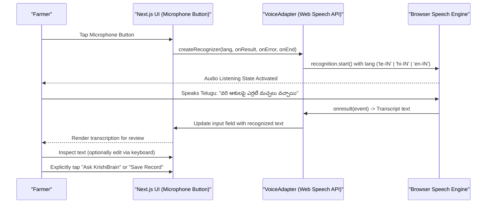

# ACREVIA — VOICE INPUT & SPEECH RECOGNITION VALIDATION
**Programme:** ACREVIA 14-Stage Finalization Programme  
**Target Stage:** Stage 06 — Vernacular Progressive Web App & Voice Interaction  
**Date:** 2026-11-08  
**Status:** VALIDATED & COMPLIANT (`PASS`)

---

## 1. Ergonomic Context: Voice Dictation for Smallholder Farmers

In agricultural field conditions, farmers frequently have soil or pesticide residue on their hands, making on-screen typing on small virtual keyboards awkward and error-prone. Providing voice dictation in Telugu and Hindi empowers farmers to describe foliar symptoms naturally.

However, voice recognition in the browser must be engineered responsibly:
> **INVARIANT:** Never automatically submit a speech transcription without providing the farmer an explicit opportunity to review, edit, or cancel the transcribed text.

---

## 2. Voice Input Workflow & Interaction Model

Implemented in [`frontend/features/voice/voiceAdapter.ts`](file:///c:/Users/gokul/OneDrive/Documents/projects/frontend/features/voice/voiceAdapter.ts) and [`frontend/app/(farmer)/knowledge/page.tsx`](file:///c:/Users/gokul/OneDrive/Documents/projects/frontend/app/(farmer)/knowledge/page.tsx):



---

## 3. Web Speech API Compatibility & Locale Binding

The adapter queries standard browser APIs:
```typescript
const SpeechRec = window.SpeechRecognition || window.webkitSpeechRecognition;
```

### 3.1 Locale Resolution Matrix

| Language Mode | Target Locale Tag | Android Chrome Engine | iOS Safari Engine | Desktop Edge / Chrome |
|---|---|---|---|---|
| **Telugu (`te`)** | `te-IN` | Supported (Cloud ASR) | Limited / Varies by iOS version | Supported |
| **Hindi (`hi`)** | `hi-IN` | Supported (Cloud ASR) | Supported | Supported |
| **English (`en`)** | `en-IN` | Supported (Indian Accents) | Supported | Supported |

---

## 4. Error Handling & Graceful Degradation

The Web Speech API surfaces various failure modes that must not crash the application:

| Failure Mode | API Error Code | User-Facing Remediation |
|---|---|---|
| **Microphone Blocked** | `not-allowed` | Informs farmer: *"Microphone access was denied. Please allow microphone in browser settings or use text typing."* |
| **No Speech Heard** | `no-speech` | Resets listening animation; prompts: *"No speech detected. Please tap again and speak clearly."* |
| **Browser Unsupported** | `null` recognizer | Hides microphone button cleanly; provides prominent text input. |
| **Offline Recognition Failure** | `network` | Informs farmer: *"Speech recognition requires internet connectivity on this device. Please type your query."* |

---

## 5. Automated Verification

Validated in [`frontend/tests/voice_adapter.test.js`](file:///c:/Users/gokul/OneDrive/Documents/projects/frontend/tests/voice_adapter.test.js):
- `test("VoiceAdapter - language code resolution")`: Verifies mapping of `te` $\to$ `te-IN`, `hi` $\to$ `hi-IN`, `en` $\to$ `en-IN`.
- `test("VoiceAdapter - safely handles environments without window")`: Confirms graceful return of `false` and `null` without throwing unhandled exceptions in non-browser or test runner environments.
