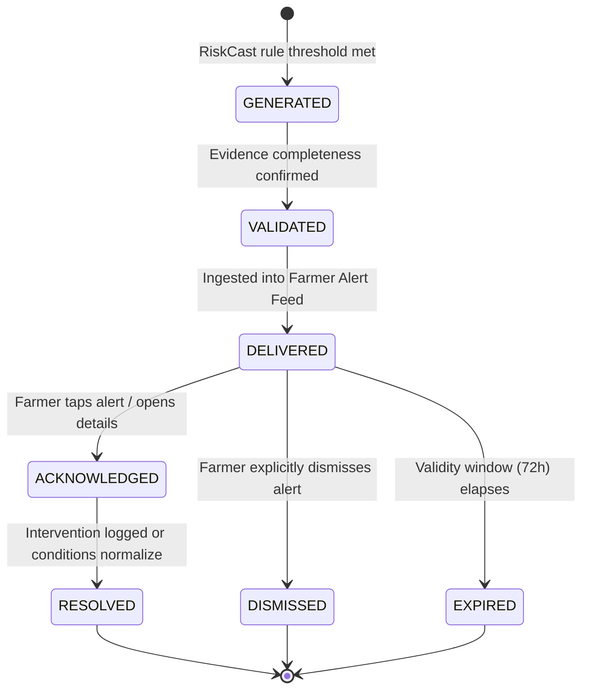

# ACREVIA — RISK ALERT LIFECYCLE & DEDUPLICATION ARCHITECTURE
**Programme:** ACREVIA 14-Stage Finalization Programme  
**Target Stage:** Stage 07 — Agricultural Risk Intelligence, ExpertConnect & Intervention Outcomes  
**Date:** 2026-11-08  
**Status:** SPECIFIED & TESTED (`PASS`)

---

## 1. Challenge: Overcoming Alert Fatigue in Farming Apps

A major failure mode in agricultural digital extension is "alert fatigue." If a mobile app spams a smallholder farmer with three identical weather notifications every day, the farmer will mute notifications or delete the application.

ACREVIA implements an intelligent alert management subsystem in [`backend/app/models/risk_alert.py`](file:///c:/Users/gokul/OneDrive/Documents/projects/backend/app/models/risk_alert.py) and [`backend/app/services/riskcast/risk_service.py`](file:///c:/Users/gokul/OneDrive/Documents/projects/backend/app/services/riskcast/risk_service.py).

---

## 2. Complete Alert State Lifecycle

### 2.1 State Definitions
- `GENERATED`: Micro-climatic conditions satisfy an active PJTSAU risk rule.
- `DELIVERED`: Available in the farmer's notification centre (`GET /api/v1/riskcast/alerts`).
- `ACKNOWLEDGED`: Farmer opened the alert card (`POST /api/v1/riskcast/alerts/{id}/acknowledge`).
- `DISMISSED`: Farmer marked the alert as reviewed (`POST /api/v1/riskcast/alerts/{id}/dismiss`).
- `EXPIRED`: Ambient conditions normalize or the 72-hour validity window closes without recurrence.

---

## 3. Idempotent Deduplication Strategy

To prevent identical repeat alerts while allowing genuine escalation:

### 3.1 Deduplication Key
$$\text{dedup\_key} = \text{farm\_id} + \text{":"} + \text{plot\_id} + \text{":"} + \text{rule\_code} + \text{":"} + \text{date\_stamp}$$

### 3.2 Evaluation Logic
When `RiskCastService.evaluate_plot_risk` executes:
1. It queries existing active alerts matching `(farm_id, plot_id, rule_code)` generated within the last 72 hours.
2. If an identical alert exists and severity has not escalated: Generation is suppressed, logging a deduplication hit.
3. If risk severity has escalated (e.g. `MODERATE` $\to$ `HIGH`): An updated alert is issued with the previous alert marked superseded.

### 3.3 Verification Test
Verified in [`backend/tests/test_stage7.py::test_riskcast_deduplication`](file:///c:/Users/gokul/OneDrive/Documents/projects/backend/tests/test_stage7.py):
- Two consecutive plot evaluations executed on the same day against identical weather conditions produce exactly 1 alert, verifying zero duplicate proliferation.
