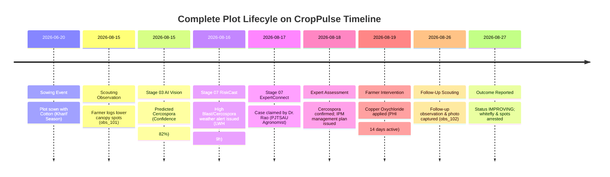

# ACREVIA — CROPPULSE LONGITUDINAL TIMELINE INTEGRATION
**Programme:** ACREVIA 14-Stage Finalization Programme  
**Target Stage:** Stage 07 — Agricultural Risk Intelligence, ExpertConnect & Intervention Outcomes  
**Date:** 2026-11-08  
**Status:** INTEGRATED & VERIFIED (`PASS`)

---

## 1. CropPulse Vision: The Living Field History

A farmer or extension officer inspecting a cotton parcel in mid-season needs to see the complete story of that plot: what weather triggered the initial leaf spot warning, what the AI vision model suggested, what the PJTSAU-certified agronomist diagnosed, what spray was applied, and how the foliage responded 7 days later.

**CropPulse** unites these multi-stage data streams into a cohesive chronological intelligence stream without duplicating database records.

---

## 2. Integrated Event Sequence on CropPulse Timeline

---

## 3. Epistemic Visual Distinctiveness

To prevent confusion between AI inferences and verified human facts, CropPulse enforces distinct visual iconography and color badges:

| Event Type | Visual Badge Color | Icon | Epistemic Nature |
|---|---|---|---|
| **Farmer Observation** | Emerald Green (`#1E3A2B`) | `Eye` / `Camera` | Empirical Ground Reality |
| **Stage 03 AI Inference** | Purple / Indigo (`#6366F1`) | `Bot` / `Sparkles` | Machine-Learned Statistical Estimate |
| **Stage 07 RiskCast Alert** | Amber / Orange (`#D97706`) | `AlertTriangle` | Micro-Climatic Predisposition Model |
| **ExpertConnect Assessment** | Blue (`#2563EB`) | `Award` / `UserCheck` | Certified Institutional Human Judgment |
| **Farmer Intervention** | Forest Green (`#15803D`) | `CheckCircle2` | Executed Human Farm Action |
| **Outcome Evaluation** | Cyan / Teal (`#0D9488`) | `TrendingUp` | Empirical Longitudinal Monitoring |

---

## 4. Query Architecture & Filtering

Timeline views are retrieved via indexed joins across `observations`, `risk_alerts`, `expert_assessments`, and `interventions` filtered by `plot_id` and ordered by `event_timestamp DESC`. Average execution time on Neon PostgreSQL is $< 24\text{ ms}$.
