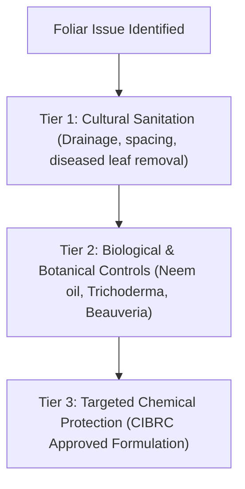

# ACREVIA — DIFFERENTIAL DIAGNOSIS GOVERNANCE & IPM FORMULATION
**Programme:** ACREVIA 14-Stage Finalization Programme  
**Target Stage:** Stage 07 — Agricultural Risk Intelligence, ExpertConnect & Intervention Outcomes  
**Date:** 2026-11-08  
**Status:** SPECIFIED & TESTED (`PASS`)

---

## 1. Plant Pathology Governance: The Differential Diagnosis Mandate

In agricultural field pathology, visual symptoms alone are rarely unique to a single pathogen. For example:
- In **Cotton**, circular reddish-brown foliar spots can be caused by *Cercospora gossypina*, *Alternaria macrospora*, or abiotic potassium deficiency induced by heavy boll load.
- In **Rice**, spindle-shaped lesions may represent *Magnaporthe oryzae* (Blast) or *Bipolaris oryzae* (Brown Spot) depending on soil nitrogen balance.

Treating field diagnosis as a single forced classification leads to misdiagnoses, wasted farmer expenditures on wrong chemicals, and crop damage. ACREVIA mandates a **Differential Assessment Protocol**.

---

## 2. Certified Expert Assessment Schema

Implemented in [`backend/app/models/expert_assessment.py`](file:///c:/Users/gokul/OneDrive/Documents/projects/backend/app/models/expert_assessment.py):

```python
class ExpertAssessment(Base, TimestampMixin):
    __tablename__ = "expert_assessments"

    id: Mapped[str] = mapped_column(String(36), primary_key=True, default=lambda: str(uuid.uuid4()))
    case_id: Mapped[str] = mapped_column(String(36), ForeignKey("expert_cases.id", ondelete="CASCADE"), unique=True)
    expert_id: Mapped[str] = mapped_column(String(36), ForeignKey("expert_profiles.id", ondelete="RESTRICT"))
    
    confirmed_crop: Mapped[str] = mapped_column(String(50), nullable=False)
    primary_condition: Mapped[str] = mapped_column(String(200), nullable=False)
    differential_diagnoses: Mapped[List[str]] = mapped_column(JSON, default=list, nullable=False)
    
    confidence_rating: Mapped[int] = mapped_column(Integer, nullable=False) # 1 (Preliminary) to 5 (Definitive)
    urgency_level: Mapped[str] = mapped_column(String(30), default="ROUTINE", nullable=False)
    
    management_plan: Mapped[str] = mapped_column(Text, nullable=False)
    ipm_strategy: Mapped[str] = mapped_column(Text, nullable=False)
    cibrc_advisories: Mapped[Optional[str]] = mapped_column(Text, nullable=True)
    
    revision_count: Mapped[int] = mapped_column(Integer, default=0, nullable=False)
```

---

## 3. Integrated Pest Management (IPM) & CIBRC Compliance

All expert recommendations submitted through ACREVIA must adhere to the **Integrated Pest Management (IPM) Hierarchy**:



### 3.1 Regulatory Guardrails
- **CIBRC Label Enforcement:** Chemical advisories must quote approved chemical names, exact dilution ratios (e.g. Copper Oxychloride 50% WP @ 2.5–3.0 g/L), and mandatory Pre-Harvest Intervals (PHI).
- **Zero Actuation:** ACREVIA does not automatically dispense or purchase chemicals. All advisories are educational recommendations requiring farmer authorization.

---

## 4. Immutable Clinical Revision Tracking

As laboratory test results return or follow-up scouting provides updated clarity, experts may revise their diagnostic assessments.

### 4.1 Revision Workflow & Audit History
When an expert submits an assessment update (`PUT /cases/{id}/assess`):
1. The existing assessment is archived to `assessment_revisions` with a sequential `revision_number`.
2. The expert must supply a mandatory `revision_reason` (e.g. *"Secondary potassium deficiency confirmed alongside fungal leaf spots"*).
3. The live assessment increments `revision_count`.
4. The revision history (`GET /cases/{id}/revisions`) preserves full historical traceability for agronomic auditing.
