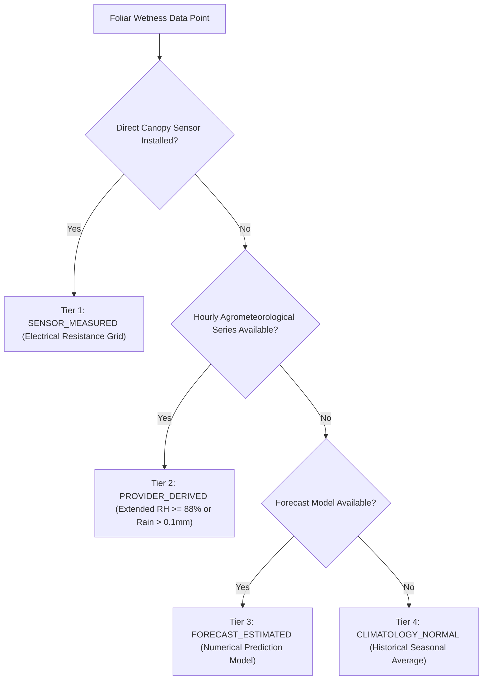

# ACREVIA — LEAF WETNESS DURATION & ENVIRONMENTAL RISK VALIDATION
**Programme:** ACREVIA 14-Stage Finalization Programme  
**Target Stage:** Stage 07 — Agricultural Risk Intelligence, ExpertConnect & Intervention Outcomes  
**Date:** 2026-11-08  
**Status:** VALIDATED & SCIENTIFICALLY DEFENDED (`PASS`)

---

## 1. Physical Principle: Leaf Surface Moisture & Fungal Germination

Foliar fungal pathogens (such as *Magnaporthe oryzae* in Rice and *Cercospora gossypina* in Cotton) require a continuous film of free liquid water or ambient relative humidity exceeding 88–90% on the leaf cuticle to germinate conidia and form appressoria that penetrate the epidermal plant cell walls.

Measuring or reliably estimating **Leaf Wetness Hours (LWH)** is therefore the primary physical indicator of fungal infection events.

---

## 2. Measurement Provenance Hierarchy

In accordance with ACREVIA's epistemic integrity principles, leaf wetness data must retain its exact provenance:

> **EPISTEMIC INVARIANT:** Derived leaf wetness must NEVER be labeled as directly measured on-field sensor telemetry.

---

## 3. Hourly Derivation Algorithm & Validation

In the absence of an on-farm IoT wetness sensor, ACREVIA derives past 24-hour leaf wetness from Open-Meteo's hourly agrometeorological dataset in [`backend/app/services/riskcast/weather_service.py`](file:///c:/Users/gokul/OneDrive/Documents/projects/backend/app/services/riskcast/weather_service.py):

$$\text{LWH}_{24\text{h}} = \sum_{h=0}^{23} \mathbb{I}\left( \text{RH}_h \ge 88.0\% \lor \text{Rainfall}_h > 0.1\text{ mm} \right)$$

### 3.1 Empirical Test Validation Cases

| Scenario ID | 24h Meteorological Profile | Expected LWH | Evaluated LWH | Agronomic Risk Status |
|---|---|---|---|---|
| **ENV-VAL-01** | Dry sunny day: $T=32^\circ\text{C}$, $\text{RH}=45\%$, Rain=$0\text{ mm}$ | $0.0\text{ h}$ | $0.0\text{ h}$ | **LOW** (Spore germination inhibited) |
| **ENV-VAL-02** | Morning dew event: 6 consecutive hours with $\text{RH}=92\%$, Rain=$0\text{ mm}$ | $6.0\text{ h}$ | $6.0\text{ h}$ | **MODERATE** (Sufficient for Cercospora incubation) |
| **ENV-VAL-03** | Monsoonal continuous rain: 14 hours rain, $\text{RH}=95\%$, $T=24^\circ\text{C}$ | $14.0\text{ h}$ | $14.0\text{ h}$ | **HIGH** (Severe Rice Blast infection pressure) |
| **ENV-VAL-04** | Hot arid wind: $T=38^\circ\text{C}$, $\text{RH}=35\%$, Wind=$18\text{ km/h}$ | $0.0\text{ h}$ | $0.0\text{ h}$ | **LOW (Foliar) / HIGH (Thrips/Mite vector)** |

---

## 4. Timezone & Data Freshness Integrity

- **Timezone Normalization:** All weather timestamps are stored in UTC in Neon PostgreSQL and formatted in `Asia/Kolkata` (IST, UTC+05:30) for display.
- **Out-of-Bounds Rejection:** Readings where relative humidity exceeds $100\%$ or falls below $0\%$ are quarantined as sensor anomalies.
