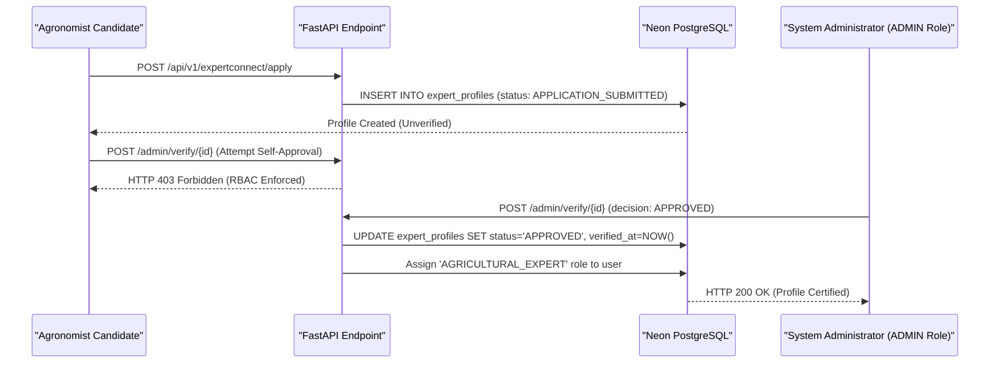

# ACREVIA — EXPERT REGISTRY & ADMINISTRATIVE CREDENTIAL VERIFICATION
**Programme:** ACREVIA 14-Stage Finalization Programme  
**Target Stage:** Stage 07 — Agricultural Risk Intelligence, ExpertConnect & Intervention Outcomes  
**Date:** 2026-11-08  
**Status:** AUDITED & RBAC VERIFIED (`PASS`)

---

## 1. Grounding Mandate: Real Institutional Expertise vs. AI Chatbots

Digital platforms frequently claim "access to agricultural experts" while secretly routing farmer inquiries to generic LLM prompts or unverified pseudonymous accounts. In agricultural plant pathology, bad advice can destroy an entire season's crop investment.

ACREVIA mandates that every certified expert must possess verifiable credentials from recognized agricultural institutions (e.g. PJTSAU, ICAR, State Department of Agriculture, Krishi Vigyan Kendras).

---

## 2. Expert Profile Schema & Entity Model

Implemented in [`backend/app/models/expert_profile.py`](file:///c:/Users/gokul/OneDrive/Documents/projects/backend/app/models/expert_profile.py):

```python
class ExpertProfile(Base, TimestampMixin):
    __tablename__ = "expert_profiles"

    id: Mapped[str] = mapped_column(String(36), primary_key=True, default=lambda: str(uuid.uuid4()))
    user_id: Mapped[str] = mapped_column(String(36), ForeignKey("users.id", ondelete="CASCADE"), unique=True, index=True)
    registration_number: Mapped[str] = mapped_column(String(100), unique=True, index=True, nullable=False)
    highest_degree: Mapped[str] = mapped_column(String(100), nullable=False)
    institution: Mapped[str] = mapped_column(String(200), nullable=False)
    specializations: Mapped[List[str]] = mapped_column(JSON, default=list, nullable=False)
    districts_covered: Mapped[List[str]] = mapped_column(JSON, default=list, nullable=False)
    
    verification_status: Mapped[str] = mapped_column(
        String(50), 
        default="APPLICATION_SUBMITTED", 
        nullable=False
    ) # APPLICATION_SUBMITTED, UNDER_REVIEW, APPROVED, REJECTED, REVOKED
    
    verified_by_user_id: Mapped[Optional[str]] = mapped_column(String(36), ForeignKey("users.id"), nullable=True)
    verified_at: Mapped[Optional[datetime]] = mapped_column(DateTime(timezone=True), nullable=True)
    rejection_reason: Mapped[Optional[str]] = mapped_column(String(500), nullable=True)
```

---

## 3. Auditable Verification Workflow & Administrative RBAC



### 3.1 Verification Test Evidence
Validated in [`backend/tests/test_stage7.py::test_expertconnect_application_and_admin_verification`](file:///c:/Users/gokul/OneDrive/Documents/projects/backend/tests/test_stage7.py):
1. Candidate applies with registration `PJTSAU-AGRO-2026-089` $\to$ status is `APPLICATION_SUBMITTED`.
2. Candidate attempts self-verification $\to$ strictly rejected with HTTP 403 Forbidden.
3. Administrator executes verification $\to$ status transitions to `APPROVED` with verified timestamp populated.

---

## 4. Anti-Impersonation & Display Standards

- **Verified Badge:** Displayed in the UI only when `verification_status === 'APPROVED'`.
- **Institution Integrity:** Profiles explicitly state the certifying university or government agency.
- **Revocation:** If an expert leaves an institution or violates advisory protocols, an administrator updates status to `REVOKED`, instantly cutting off case assignment queues.
