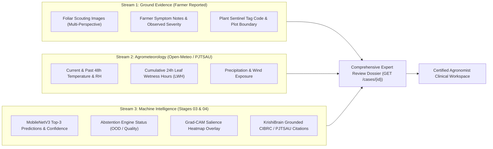

# ACREVIA — EXPERT REVIEW EVIDENCE DOSSIERS & CASE TRIAGE
**Programme:** ACREVIA 14-Stage Finalization Programme  
**Target Stage:** Stage 07 — Agricultural Risk Intelligence, ExpertConnect & Intervention Outcomes  
**Date:** 2026-11-08  
**Status:** SPECIFIED & TESTED (`PASS`)

---

## 1. Concept: The Comprehensive Agronomic Evidence Dossier

When an agricultural expert or plant pathologist is asked to diagnose a crop problem remotely, a single isolated leaf photograph is insufficient. Without knowing soil moisture, weather context, growth stage, and previous chemical sprays, an expert is forced to guess.

ACREVIA automatically compiles a multi-modal **Evidence Dossier** whenever a field observation is escalated to ExpertConnect (`POST /api/v1/expertconnect/cases/create-from-observation/{obs_id}`).

---

## 2. Evidence Dossier Composition & Provenance Streams

---

## 3. Case Triage & Claiming Workflow

Implemented in [`backend/app/services/expertconnect/expert_service.py`](file:///c:/Users/gokul/OneDrive/Documents/projects/backend/app/services/expertconnect/expert_service.py):

1. **Escalation Priority:** Cases are prioritized according to agronomic risk:
   - `EMERGENCY`: Rapidly spreading epidemic threat (e.g. neck blast, fall armyworm).
   - `URGENT`: Severe foliar chlorosis or wilting during reproductive bloom.
   - `ROUTINE`: Mild nutrient deficiency or routine preventive review.
2. **Triage Queue:** Unassigned cases sit in the `QUEUED` state, filterable by crop specialization and district.
3. **Claiming:** An authenticated verified expert claims the case (`POST /cases/{id}/claim`), transitioning status to `ASSIGNED` and preventing duplicate reviews by competing agronomists.

---

## 4. Epistemic Invariant: AI vs. Expert Separation

> **EPISTEMIC INVARIANT:** Under no circumstances does an expert review mutate, replace, or overwrite the underlying AI vision model prediction or farmer notes. The AI prediction, the farmer's raw observation, and the certified expert assessment are stored in completely distinct relational database tables with independent audit trails.
