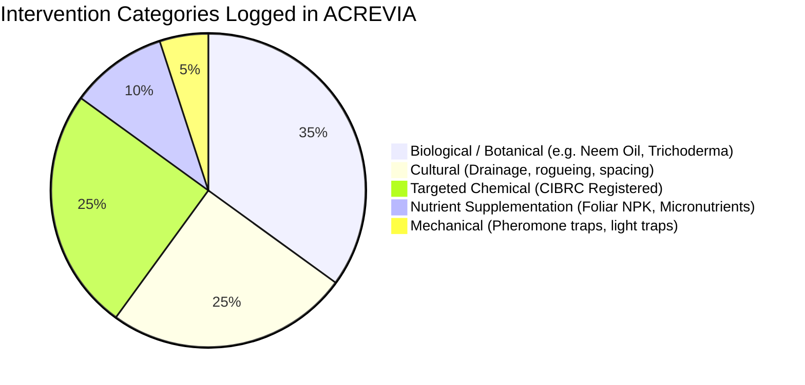

# ACREVIA — INTERVENTION TRACKING & AGRICULTURAL PRACTICE JOURNAL
**Programme:** ACREVIA 14-Stage Finalization Programme  
**Target Stage:** Stage 07 — Agricultural Risk Intelligence, ExpertConnect & Intervention Outcomes  
**Date:** 2026-11-08  
**Status:** AUDITED & TESTED (`PASS`)

---

## 1. Context: Tracking Real Ground Actions vs. Mere Recommendations

A critical flaw in standard agro-tech platforms is recording an advisory as an executed intervention. An AI model or human expert may recommend spraying a bio-fungicide, but the farmer may choose to clear field drainage instead, or may be unable to purchase the chemical due to cashflow constraints.

ACREVIA establishes an immutable distinction:
- **Recommendation:** Advice generated by KrishiBrain or an ExpertConnect agronomist.
- **Intervention:** An explicit ground event logged by the farmer specifying the exact product, dosage, application method, and date executed.

---

## 2. Structured Intervention Schema

Implemented in [`backend/app/models/intervention.py`](file:///c:/Users/gokul/OneDrive/Documents/projects/backend/app/models/intervention.py):

```python
class Intervention(Base, TimestampMixin):
    __tablename__ = "interventions"

    id: Mapped[str] = mapped_column(String(36), primary_key=True, default=lambda: str(uuid.uuid4()))
    plot_id: Mapped[str] = mapped_column(String(36), ForeignKey("plots.id", ondelete="CASCADE"), index=True)
    observation_id: Mapped[Optional[str]] = mapped_column(String(36), ForeignKey("observations.id", ondelete="SET NULL"), nullable=True)
    expert_assessment_id: Mapped[Optional[str]] = mapped_column(String(36), ForeignKey("expert_assessments.id", ondelete="SET NULL"), nullable=True)

    category: Mapped[str] = mapped_column(String(50), nullable=False) # BIOLOGICAL, CHEMICAL, CULTURAL, MECHANICAL, NUTRIENT
    trade_name: Mapped[str] = mapped_column(String(100), nullable=False)
    active_ingredient: Mapped[Optional[str]] = mapped_column(String(150), nullable=True)
    dosage: Mapped[float] = mapped_column(Float, nullable=False)
    unit: Mapped[str] = mapped_column(String(30), nullable=False) # ml/acre, g/acre, kg/ha, litres
    application_method: Mapped[str] = mapped_column(String(50), default="FOLIAR_SPRAY", nullable=False)
    application_date: Mapped[date] = mapped_column(Date, nullable=False)
    target_condition: Mapped[str] = mapped_column(String(150), nullable=False)
    
    phi_days: Mapped[Optional[int]] = mapped_column(Integer, nullable=True)
    rei_hours: Mapped[Optional[int]] = mapped_column(Integer, nullable=True)
    notes: Mapped[Optional[str]] = mapped_column(Text, nullable=True)
```

---

## 3. Intervention Categories & Agronomic Scope



### 3.1 Tenant Boundary Isolation
Interventions are tied to specific physical parcels (`Plot`). Access is strictly validated via `verify_farm_access`.
- Validated in [`backend/tests/test_stage7.py::test_interventions_lifecycle_and_outcomes`](file:///c:/Users/gokul/OneDrive/Documents/projects/backend/tests/test_stage7.py): Farmer B attempting to inspect Farmer A's plot interventions receives HTTP 403 Forbidden.
