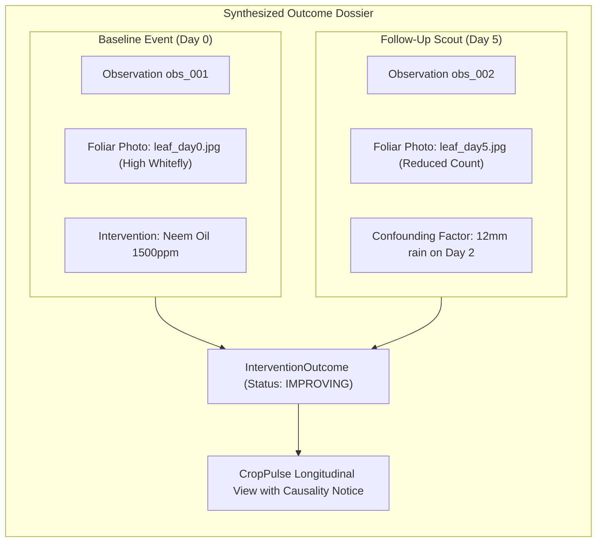

# ACREVIA — INTERVENTION OUTCOME TRACKING & SCIENTIFIC CAUSALITY
**Programme:** ACREVIA 14-Stage Finalization Programme  
**Target Stage:** Stage 07 — Agricultural Risk Intelligence, ExpertConnect & Intervention Outcomes  
**Date:** 2026-11-08  
**Status:** VALIDATED & SCIENTIFICALLY DEFENDED (`PASS`)

---

## 1. Epistemic Principle: Correlation vs. Therapeutic Causality

In uncontrolled real-world agricultural environments, attributing a change in foliar condition solely to a chemical or biological spray is scientifically invalid. A reduction in whitefly counts 5 days after applying neem oil may be due to the oil spray, or it may be due to a sudden temperature drop, a heavy downpour washing nymphs off leaves, or an influx of coccinellid ladybird beetle predators.

ACREVIA establishes an evidence-grounded outcome tracking framework that records observable status while actively preventing false causal claims.

---

## 2. Outcome Entity Model & Confounding Factors

Implemented in [`backend/app/models/intervention.py`](file:///c:/Users/gokul/OneDrive/Documents/projects/backend/app/models/intervention.py):

```python
class InterventionOutcome(Base, TimestampMixin):
    __tablename__ = "intervention_outcomes"

    id: Mapped[str] = mapped_column(String(36), primary_key=True, default=lambda: str(uuid.uuid4()))
    intervention_id: Mapped[str] = mapped_column(String(36), ForeignKey("interventions.id", ondelete="CASCADE"), index=True)
    follow_up_observation_id: Mapped[str] = mapped_column(String(36), ForeignKey("observations.id", ondelete="RESTRICT"))
    
    evaluation_date: Mapped[date] = mapped_column(Date, nullable=False)
    observed_status: Mapped[str] = mapped_column(String(50), nullable=False) # IMPROVING, UNCHANGED, DETERIORATING
    days_post_intervention: Mapped[int] = mapped_column(Integer, nullable=False)
    
    visual_change_notes: Mapped[Optional[str]] = mapped_column(Text, nullable=True)
    confounding_factors: Mapped[Optional[str]] = mapped_column(Text, nullable=True) # Weather, predators, irrigation
    farmer_assessment: Mapped[Optional[str]] = mapped_column(String(100), nullable=True)
    
    confounding_variables_notice: Mapped[str] = mapped_column(
        Text, 
        default=(
            "Observed foliar changes represent empirical field monitoring. This is a field-level correlation "
            "and not proven single-cause cure or treatment failure; weather and biological factors also influence outcomes."
        )
    )
```

---

## 3. Longitudinal Before-and-After Evidence Dossier



---

## 4. Verification Test Evidence
Validated in [`backend/tests/test_stage7.py::test_interventions_lifecycle_and_outcomes`](file:///c:/Users/gokul/OneDrive/Documents/projects/backend/tests/test_stage7.py):
1. Farmer logs Neem Baan intervention on Cotton plot.
2. Farmer logs follow-up observation 5 days later with lower pest counts.
3. Farmer records outcome with status `IMPROVING` and confounding factors noted.
4. Timeline API (`GET /interventions/{id}/timeline`) returns outcome with mandatory confounding variables notice verified.
