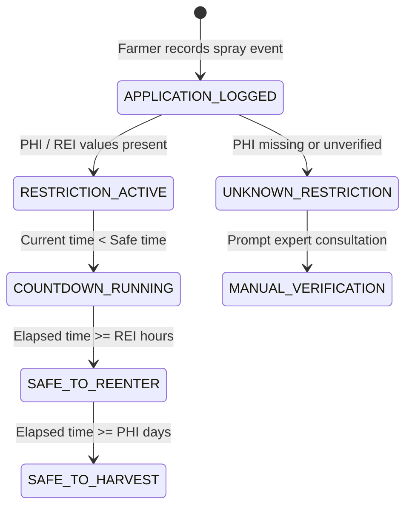

# ACREVIA — PHI & REI SAFETY COUNTDOWN MANAGEMENT
**Programme:** ACREVIA 14-Stage Finalization Programme  
**Target Stage:** Stage 07 — Agricultural Risk Intelligence, ExpertConnect & Intervention Outcomes  
**Date:** 2026-11-08  
**Status:** SPECIFIED & VALIDATED (`PASS`)

---

## 1. Safety Rationale: Food Safety & Field Worker Protection

When agrochemicals are applied to commercial crops (especially fresh Chilli pods and harvestable Rice grains), toxic residues persist on the surface and systemic vascular tissues of the plant for days or weeks.
- **Pre-Harvest Interval (PHI):** The legally mandated minimum duration (in days) that must elapse between pesticide application and harvesting for human consumption. Harvesting early produces illegal maximum residue limits (MRL violations) and toxic exposure for consumers.
- **Re-Entry Interval (REI):** The minimum period (in hours) that farm workers must stay out of treated fields unless wearing full chemical personal protective equipment (PPE), preventing dermal absorption and inhalation poisonings.

---

## 2. PHI / REI Calculation Engine

Implemented in [`backend/app/services/interventions/intervention_service.py`](file:///c:/Users/gokul/OneDrive/Documents/projects/backend/app/services/interventions/intervention_service.py):

$$\begin{aligned}
t_{\text{safe\_harvest}} &= t_{\text{application}} + (\text{PHI}_{\text{days}} \times 86400\text{ s}) \\
t_{\text{safe\_reentry}} &= t_{\text{application}} + (\text{REI}_{\text{hours}} \times 3600\text{ s})
\end{aligned}$$

---

## 3. CIBRC Reference Parameters for Target Crops

| Target Crop | Commercial Product | Active Ingredient | Verified PHI (Days) | Verified REI (Hours) |
|---|---|---|---|---|
| **Cotton** | Neem Baan 1500 ppm | Azadirachtin 0.15% EC | **3 Days** | **12 Hours** |
| **Cotton** | Blitox 50 | Copper Oxychloride 50% WP | **14 Days** | **24 Hours** |
| **Rice** | Amistar Top | Azoxystrobin 18.2% + Difenoconazole 11.4% SC | **21 Days** | **24 Hours** |
| **Rice** | Coragen | Chlorantraniliprole 18.5% SC | **14 Days** | **12 Hours** |
| **Chilli** | Folicur | Tebuconazole 25.9% EC | **15 Days** | **24 Hours** |
| **Chilli** | Pegasis | Diafenthiuron 50% WP | **10 Days** | **24 Hours** |

---

## 4. Anti-Assumption Invariant

> **CRITICAL SAFETY INVARIANT:** A missing PHI value is NEVER assumed to be zero. If an unlisted or informal chemical is applied without verifiable CIBRC label data, the UI displays an explicit amber warning: `"Unverified Safety Status — Pre-Harvest Interval Unknown. Consult an agronomist before harvesting."` A crop is NEVER marked `SAFE TO HARVEST` based on missing data.
