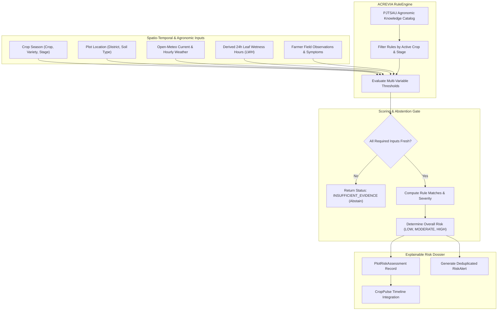

# ACREVIA — RISKCAST AGROMETEOROLOGICAL RISK ENGINE
**Programme:** ACREVIA 14-Stage Finalization Programme  
**Target Stage:** Stage 07 — Agricultural Risk Intelligence, ExpertConnect & Intervention Outcomes  
**Date:** 2026-11-08  
**Status:** SPECIFIED & TESTED (`PASS`)

---

## 1. Architectural Philosophy: Risk Predisposition vs. Disease Diagnosis

The primary purpose of **RiskCast** is to evaluate environmental and crop susceptibility to pest and pathogen pressure. 

RiskCast does **not** diagnose disease; it determines whether the micro-climatic environment currently favors pathogen incubation, spore germination, or vector proliferation.

> **MANDATORY LIMITATIONS NOTICE:**  
> *"RiskCast assessments represent micro-climatic disease predisposition modeling based on ambient weather and crop phenology. This is NOT a confirmed disease outbreak. Physical scouting of foliage is required before initiating intervention."*

---

## 2. RiskCast Engine Architecture

---

## 3. Seeded PJTSAU-Grounded Agronomic Rules

Implemented in [`backend/app/services/riskcast/rule_engine.py`](file:///c:/Users/gokul/OneDrive/Documents/projects/backend/app/services/riskcast/rule_engine.py):

| Rule Code | Crop | Target Condition | Environmental Trigger Thresholds | PJTSAU Evidence Citation | Multilingual Advisory |
|---|---|---|---|---|---|
| `RIC-BLST-01` | Rice | Rice Blast (*Magnaporthe oryzae*) | $20.0^\circ\text{C} \le T \le 28.0^\circ\text{C}$ $\text{RH} \ge 85.0\%$ $\text{LWH} \ge 8.0\text{ h}$ | PJTSAU Vyavasaya Panchangam (Rice Blast Forewarning Index, Table 4.2) | **TE:** అనుకూల వాతావరణం వల్ల వరిలో అగ్గి తెగులు వ్యాప్తి చెందే అవకాశం ఉంది. **HI:** मौसम की स्थिति धान में झुलसा रोग के लिए अनुकूल है। |
| `RIC-SHBL-01` | Rice | Sheath Blight (*Rhizoctonia solani*) | $25.0^\circ\text{C} \le T \le 32.0^\circ\text{C}$ $\text{RH} \ge 88.0\%$ $\text{Rainfall} \ge 5.0\text{ mm}$ | ICAR-IIRR Technical Bulletin on Sheath Blight Epidemiology | **TE:** కాండం కుళ్ళు తెగులు వ్యాప్తి చెందవచ్చు. నీటి పారుదల తగ్గించండి. **HI:** शीथ ब्लाइट का खतरा। खेत से अतिरिक्त पानी निकालें। |
| `COT-CLSP-01` | Cotton | Cercospora Leaf Spot (*Cercospora gossypina*) | $24.0^\circ\text{C} \le T \le 32.0^\circ\text{C}$ $\text{RH} \ge 78.0\%$ $\text{LWH} \ge 6.0\text{ h}$ | ICAR-CICR Cotton Pathology Monograph (2024 Ed.) | **TE:** పత్తిలో సెర్కోస్పోరా ఆకుమచ్చ తెగులు ఆశించే అవకాశం ఉంది. **HI:** कपास में सर्कोस्पोरा पत्ती धब्बा रोग का जोखिम। |
| `COT-BLGT-01` | Cotton | Bacterial Blight / Blackarm (*Xanthomonas*) | $28.0^\circ\text{C} \le T \le 35.0^\circ\text{C}$ $\text{RH} \ge 80.0\%$ $\text{Wind} \ge 12.0\text{ km/h}$ | PJTSAU Cotton Production Guide, Section 8 | **TE:** గాలులతో కూడిన తేమ వల్ల బాక్టీరియా ఆకుమచ్చ వ్యాపిస్తుంది. **HI:** तेज हवा और नमी से जीवाणु पत्ती धब्बा फैलने का खतरा। |
| `CHL-ANTH-01` | Chilli | Anthracnose / Fruit Rot (*Colletotrichum*) | $22.0^\circ\text{C} \le T \le 30.0^\circ\text{C}$ $\text{RH} \ge 80.0\%$ $\text{LWH} \ge 7.0\text{ h}$ | PJTSAU Chilli IPM Bulletin | **TE:** మిరపలో కొమ్మ ఎండు మరియు కాయకుళ్ళు తెగులు వచ్చే సూచనలున్నాయి. **HI:** मिर्च में फल सड़न और डाइबैक का खतरा। |
| `CHL-THRP-01` | Chilli | Chilli Thrips (*Scirtothrips dorsalis*) | $28.0^\circ\text{C} \le T \le 38.0^\circ\text{C}$ $\text{RH} \le 60.0\%$ $\text{Rainfall} = 0.0\text{ mm}$ | Dr. YSRHU Horticultural Extension Handbook | **TE:** పొడి వాతావరణం వల్ల తామర పురుగుల ఉధృతి పెరిగే అవకాశం ఉంది. **HI:** शुष्क मौसम में थ्रिप्स का प्रकोप बढ़ सकता है। |

---

## 4. Transparent Risk Scoring & Abstention Logic

### 4.1 Scoring Formula
RiskCast does not manufacture fake statistical probabilities (e.g. "87.3% chance of disease"). It computes discrete agronomic predisposition levels:
- `LOW`: Ambient conditions do not satisfy pathogen incubation thresholds.
- `MODERATE`: Temperature or humidity falls within threshold, but leaf wetness hours remain below critical duration.
- `HIGH`: All environmental criteria (Temperature, Humidity, Leaf Wetness Duration, and Rainfall) are simultaneously met.
- `CRITICAL`: High risk coinciding with confirmed foliar symptoms during peak phenological vulnerability (e.g. Flowering / Boll Formation).

### 4.2 Abstention Criteria
RiskCast strictly returns `INSUFFICIENT_EVIDENCE` and suppresses alert generation when:
1. Weather observations are older than 24 hours (stale data).
2. The target crop is not among the verified crops (`cotton`, `rice`, `chilli`).
3. Essential physical parameters are missing or out of plausible range ($T < 0^\circ\text{C}$ or $T > 55^\circ\text{C}$).
