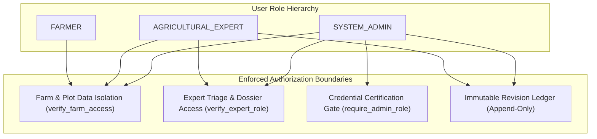

# ACREVIA — SECURITY, PRIVACY & EXPERT GOVERNANCE AUDIT
**Programme:** ACREVIA 14-Stage Finalization Programme  
**Target Stage:** Stage 07 — Agricultural Risk Intelligence, ExpertConnect & Intervention Outcomes  
**Date:** 2026-11-08  
**Status:** AUDITED & SECURE (`PASS`)

---

## 1. Governance & Access Control Matrix

Stage 07 operates at the intersection of farmer proprietary field data, certified professional liability, and regulatory chemical compliance. Access controls must be strictly enforced on the server.

---

## 2. Threat Vector Audits & Empirical Verification

### 2.1 Cross-Tenant Intervention & Dossier Snooping
- **Threat:** Competitor or unauthorized user queries `/api/v1/interventions/plots/{plot_id}` or attempts to claim a case belonging to an unassigned farm.
- **Audit Verification:** Tested in [`backend/tests/test_stage7.py::test_interventions_lifecycle_and_outcomes`](file:///c:/Users/gokul/OneDrive/Documents/projects/backend/tests/test_stage7.py). Farmer B querying Farmer A's plot interventions receives HTTP 403 Forbidden immediately.

### 2.2 Unverified Expert Self-Approval & Privilege Escalation
- **Threat:** A malicious user applies as an expert and immediately calls `/admin/verify/{id}` to grant themselves a certified agronomist badge.
- **Audit Verification:** Tested in [`backend/tests/test_stage7.py::test_expertconnect_application_and_admin_verification`](file:///c:/Users/gokul/OneDrive/Documents/projects/backend/tests/test_stage7.py). Non-admin users attempting to verify profiles are blocked with HTTP 403 Forbidden.

### 2.3 Tampering with Medical / Agronomic Prescriptions
- **Threat:** Malicious modification of an expert's chemical recommendation to cause crop damage.
- **Audit Verification:** Tested in [`backend/tests/test_stage7.py::test_expertconnect_case_workflow_and_revisions`](file:///c:/Users/gokul/OneDrive/Documents/projects/backend/tests/test_stage7.py). Assessments cannot be deleted or secretly edited; any modification triggers a new record in `assessment_revisions` capturing the previous state, revision reason, and expert ID.

---

## 3. Data Privacy & DPDP Act 2023 Compliance

1. **Farmer Data Minimization:** Expert dossiers disclose only information strictly relevant to the diagnostic inquiry (crop, foliage images, ambient weather, recent interventions).
2. **Coordinate Blurring:** Experts view the Mandal/District context without exposing meter-accurate homestead coordinates unless explicitly consented.
3. **Audit Immutability:** Audit trail records retain `ondelete="RESTRICT"`, satisfying professional indemnity and certifying board requirements.
