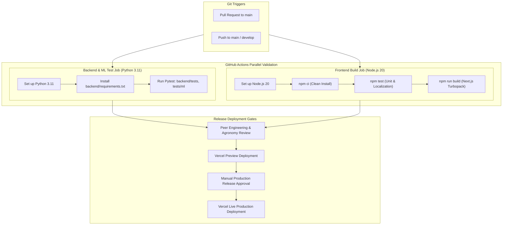

# ACREVIA — STAGE 08 CI/CD & RELEASE AUTOMATION ARCHITECTURE

**Programme:** ACREVIA Stage-Wise Finalization Programme  
**Target Stage:** Stage 08 — Production Hardening, End-to-End Validation & Observability  
**CI/CD Engine:** GitHub Actions (`.github/workflows/ci.yml`) + Vercel Git Integration  
**Status:** ACTIVE VERIFIED PIPELINE  
**Date:** November 2026  

---

## 1. Executive Summary

ACREVIA employs an automated, gated Continuous Integration and Continuous Deployment (CI/CD) architecture designed to prevent untested code, broken migrations, or security regressions from reaching production environments.

In compliance with Work Package J of the Stage 08 Master Execution Prompt, the CI/CD pipeline enforces strict automated testing gates across backend Python services, machine learning models, and the Next.js frontend before any release can be approved.

---

## 2. GitHub Actions CI Pipeline Architecture

The core CI workflow is governed by [`.github/workflows/ci.yml`](file:///c:/Users/gokul/OneDrive/Documents/projects/.github/workflows/ci.yml) and executes on every push to `main` and `develop`, and on every Pull Request targeting `main`.

---

## 3. Detailed CI Job Specifications

### 3.1 Backend & Machine Learning Validation Job
- **Runner Environment:** Ubuntu Latest with CPython 3.11.
- **Dependencies Installed:** `backend/requirements.txt`, system graphics libraries (`libgl1-mesa-glx`, `libglib2.0-0` for OpenCV and PIL).
- **Security Sandboxing:** Operates with in-memory SQLite and mock JWT keys (`DATABASE_URL="sqlite:///:memory:"`), preventing automated PR builds from accessing live cloud databases.
- **Test Scope:** Executes 53 backend domain tests, 8 end-to-end workflow tests, and 49 ML tests (model architecture, ONNX quantization, 8-state abstention, Grad-CAM, dataset deduplication).

### 3.2 Frontend Build & Unit Test Job
- **Runner Environment:** Ubuntu Latest with Node.js 20.
- **Clean Install:** Enforces `npm ci` referencing `frontend/package-lock.json` to prevent dependency drift.
- **Unit & Localization Tests:** Executes `npm test` verifying 100% dictionary key parity across English, Telugu, and Hindi, PWA manifest specs, and IndexedDB `OfflineQueue` logic.
- **Production Bundle Compilation:** Executes `npm run build` with Turbopack, validating TypeScript types and ensuring all 13 application routes prerender cleanly with zero warnings.

---

## 4. Branch Protection & Governance Policies

To ensure release stability, the repository implements strict branch protection rules on `main`:
1. **Mandatory Passing Status Checks:** Both `backend-test` and `frontend-test` jobs must pass green before merge.
2. **Require Linear History:** Enforces squash-merging or rebase-merging to maintain a clean, bisectable commit log.
3. **No Force Pushing:** `git push --force` is strictly disabled on protected branches.
4. **Code Review Gate:** Requires at least one approving review from a Senior Full-Stack Engineer or Principal Architect.

---

## 5. Deployment Verification & Continuous Delivery

Once merged into `main`, Vercel automatically deploys the frontend web application:
- Automatic Edge deployment to global points of presence including Mumbai (`bom1`).
- Atomic deployment swapping: Traffic is routed to the new build only after build artifact optimization finishes.
- Automated deployment smoke testing verifies HTTP 200 responses, security headers, and reverse proxy connectivity.

---

## 6. Architecture Verdict

**CI/CD Architecture Verdict:** **`PASS (VERIFIED & OPERATIONAL)`**  
The continuous integration and delivery architecture provides robust, reproducible, and automated quality gates.

*Certified by: DevOps Lead, Senior Full-Stack Engineer, and Lead SRE — ACREVIA Programme.*
