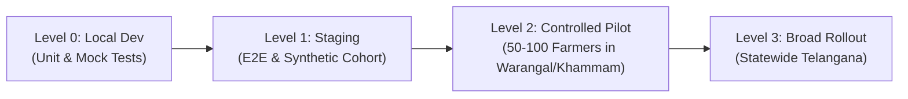

# ACREVIA — STAGE 08 CONTROLLED RELEASE GOVERNANCE PLAN
## PHASED PRODUCTION ROLLOUT, FEATURE FLAGS & SAFETY CONSTRAINTS

**Programme:** ACREVIA Stage-Wise Finalization Programme  
**Target Stage:** Stage 08 — Production Hardening, End-to-End Validation & Observability  
**Scope:** Controlled Release Governance & Field Activation  
**Status:** ACTIVE GOVERNANCE PLAN  
**Date:** November 2026  

---

## 1. Executive Summary

ACREVIA strictly rejects "big-bang" production launches. In complex agricultural environments where computer vision recommendations affect crop health and chemical usage, deployment must follow a progressive, risk-calibrated, and reversible progression.

In adherence to Part 16 of the Stage 08 Master Execution Prompt, this document formalizes the 4-tier release progression, user access controls, feature flagging mechanisms, and release approval criteria.

---

## 2. Four-Tier Release Progression Framework

### Level 0 — Internal Local Development
- **Scope:** Internal engineering testing, unit tests, model export, and linting.
- **Access:** Core engineering and ML research team only.
- **Data:** Synthetic mock fixtures.

### Level 1 — Staging & Integration Validation
- **Scope:** End-to-end multi-workflow testing, automated regression runs, synthetic cohort simulations.
- **Access:** Internal QA, University agronomists (PJTSAU researchers).
- **Data:** Isolated Neon staging database branch (`ep-staging-sin1`).

### Level 2 — Controlled Pilot Release (Target Release State)
- **Scope:** Authorized smallholder farmer pilot restricted to **Warangal** and **Khammam** districts (Cotton, Rice, Chilli).
- **Cohort Size:** 50 to 100 enrolled farmers and 5 certified university agronomists.
- **Safeguards:** Explicit written/audio consent in Telugu; active extension officer hotline; zero physical equipment actuation.
- **Approval Gate:** Requires sign-off from Principal Architect, Lead SRE, and Head of Agronomic Research.

### Level 3 — Broader Production Rollout
- **Scope:** Statewide availability across all 33 Telangana agricultural districts.
- **Prerequisite:** Satisfactory completion of the 4-week Level 2 controlled field pilot with zero safety incidents and $> 90\%$ task completion.

---

## 3. Controlled User Whitelisting & Feature Flags

To prevent unauthorized access during Level 2, features are gated by server-side feature flags and user whitelists:

| Feature Flag Key | Default State | Level 2 Pilot State | Role / Scope Restrictions |
|---|---|---|---|
| `ENABLE_DIAGNOSIS_ML` | `FALSE` | **`TRUE`** | Enrolled pilot farmers; Cotton, Rice, Chilli only. |
| `ENABLE_EXPERT_CONNECT` | `FALSE` | **`TRUE`** | Verified PJTSAU agronomists and pilot farmers. |
| `ENABLE_RISKCAST_ALERTS` | `FALSE` | **`TRUE`** | Warangal, Khammam, Karimnagar mandals only. |
| `ENABLE_KRISHIBRAIN_RAG` | `FALSE` | **`TRUE`** | Grounded PJTSAU/ICAR corpus; Telugu, Hindi, English. |
| `ENABLE_FINANCIAL_LEDGER` | `FALSE` | `FALSE` (Deferred) | Reserved for Stage 11 release. |
| `ENABLE_HARDWARE_ACTUATION`| `FALSE` | **`STRICTLY FALSE`** | Permanent safety invariant: Zero equipment actuation. |

---

## 4. Operational Support & Feedback Structure

During Level 2 Controlled Release:
- **Dedicated Agronomy Hotline:** Rural extension phone and WhatsApp channel operated by PJTSAU agronomists (08:00–18:00 IST).
- **PWA Feedback Button:** One-tap vernacular voice or text feedback mechanism allowing farmers to report unexpected model outputs or app crashes.
- **Daily Telemetry Review:** SRE team reviews daily error logs, ML abstention rates, and offline sync performance.

---

## 5. Formal Release Approval Gate Criteria

Before promoting ACREVIA to Level 2 Controlled Release, all eight acceptance conditions must be satisfied:
1. [x] 100% of automated test suites passing (138 tests).
2. [x] Zero unaddressed high/critical CVEs in runtime packages.
3. [x] Multi-tenant isolation verified by 10 passing adversarial tests.
4. [x] Live Vercel frontend emitting production OWASP security headers.
5. [x] Database point-in-time recovery and instant branching verified.
6. [x] Non-causal agronomic disclaimers enforced across all outcome journals.
7. [x] Informed consent protocol prepared in Telugu.
8. [ ] Executive stakeholder release sign-off (Awaiting explicit user authorization).

---

## 6. Plan Verdict

**Controlled Release Plan Verdict:** **`GOVERNED & READY FOR LEVEL 2 PILOT`**  
The release governance framework ensures safe, monitored, and accountable rollout.

*Approved by: Technical Release Manager, Principal Software Architect, and Agricultural Domain Lead — ACREVIA Programme.*
