# ACREVIA — STAGE 08 ENVIRONMENT SEPARATION & CONFIGURATION AUDIT

**Programme:** ACREVIA Stage-Wise Finalization Programme  
**Target Stage:** Stage 08 — Production Hardening, End-to-End Validation & Observability  
**Scope:** Multi-Tier Environment Boundaries & Variable Governance  
**Status:** ACTIVE VERIFIED AUDIT  
**Date:** November 2026  

---

## 1. Executive Summary

ACREVIA maintains strict isolation across development, staging, and production environments. Data corruption, test data pollution, and credential cross-contamination are strictly prevented by enforcing distinct network boundaries, dedicated database endpoints, and isolated environment variable scopes.

---

## 2. Multi-Tier Environment Hierarchy

```mermaid
flowchart TD
    subgraph Env_Dev ["Tier 0: Local Development"]
        DevClient["Local PWA (localhost:3000)"]
        DevAPI["FastAPI Local (127.0.0.1:8000)"]
        DevDB[("Local SQLite or Neon Dev Branch")]
        DevClient --> DevAPI --> DevDB
    end

    subgraph Env_Staging ["Tier 1: Preview & Staging Validation"]
        StagingEdge["Vercel Preview Deployments (*.vercel.app)"]
        StagingAPI["Staging ASGI Endpoint"]
        StagingDB[("Neon Staging Branch (ep-staging-sin1)")]
        StagingEdge --> StagingAPI --> StagingDB
    end

    subgraph Env_Prod ["Tier 2: Production Environment"]
        ProdEdge["Vercel Production Domain (acrevia.in / vercel.app)"]
        ProdAPI["Production FastAPI ASGI Tier"]
        ProdDB[("Neon Primary Database (ep-muddy-mode-a1nd6rrb)")]
        ProdEdge --> ProdAPI --> ProdDB
    end
```

### 2.1 Development Tier (Local)
- **Purpose:** Fast iterative feature development, unit testing, and model prototyping.
- **Data Policy:** Synthetic seed data only; zero live farmer records.
- **Database:** In-memory SQLite or dedicated local developer Neon branch.

### 2.2 Staging / Preview Tier (Vercel Preview)
- **Purpose:** Automated integration testing, end-to-end user acceptance testing (UAT), and agronomist review.
- **Data Policy:** Anonymized test datasets; synthetic 15-farmer simulation cohort.
- **Database:** Isolated Neon database branch (`ep-staging-sin1`), created with copy-on-write snapshots.

### 2.3 Production Tier
- **Purpose:** Live smallholder farmer scouting, expert consultations, and real-time risk alerts.
- **Data Policy:** Real farmer records protected under the Digital Personal Data Protection (DPDP) Act, 2023.
- **Database:** Primary Neon PostgreSQL 18.6 instance with connection pooler and automated WAL continuous archiving.

---

## 3. Environment Variables Catalog & Classification

Every configuration variable in `backend/app/core/config.py` and `frontend/next.config.mjs` is classified by operational requirement:

| Variable Name | Tier Scope | Classification | Description & Permitted Values | Default / Fallback |
|---|---|---|---|---|
| `DATABASE_URL` | All Tiers | **Required** | PostgreSQL connection URL with pure-Python driver | `None` (Must be provided by environment) |
| `JWT_SECRET_KEY` | All Tiers | **Required** | 256-bit cryptographic hex string for signing access tokens | Local dummy key in dev; strictly required in prod |
| `ACCESS_TOKEN_EXPIRE_MINUTES` | All Tiers | Optional | JWT access token lifespan in minutes | `15` |
| `BACKEND_INTERNAL_URL` | Staging / Prod | **Required** | Internal reverse proxy target for Next.js API rewrites | `http://127.0.0.1:8000` |
| `NEXT_PUBLIC_API_URL` | Staging / Prod | Optional | Public fallback API base URL | `https://api.acrevia.in` |
| `STORAGE_PROVIDER` | All Tiers | **Required** | Media storage engine (`LOCAL`, `S3`, `GCS`) | `LOCAL` |
| `OPEN_METEO_API_URL` | All Tiers | Optional | External meteorological ingestion base URL | `https://api.open-meteo.com/v1/forecast` |
| `ENVIRONMENT` | All Tiers | **Required** | Runtime mode (`development`, `staging`, `production`) | `development` |
| `LOG_LEVEL` | All Tiers | Optional | Application logging verbosity (`DEBUG`, `INFO`, `WARNING`) | `INFO` |

---

## 4. Cross-Contamination Prevention Safeguards

1. **Zero Production Credentials in Staging:** Staging and development environments utilize distinct database roles and passwords. Even if a staging environment variable is compromised, it cannot authenticate against the production database.
2. **Network Whitelisting:** Production Neon compute endpoints enforce strict TLS channel binding.
3. **Database Branch Destruction:** Ephemeral staging branches spawned for PR validation are automatically destroyed upon PR closure, preventing data accumulation.

---

## 5. Audit Verdict

**Environment Separation Verdict:** **`PASS (STRICTLY PARTITIONED)`**  
Environment boundaries and configuration variables are partitioned, validated, and leak-free.

*Audited by: Cloud Infrastructure Engineer, DevSecOps Lead, and Lead SRE — ACREVIA Programme.*
